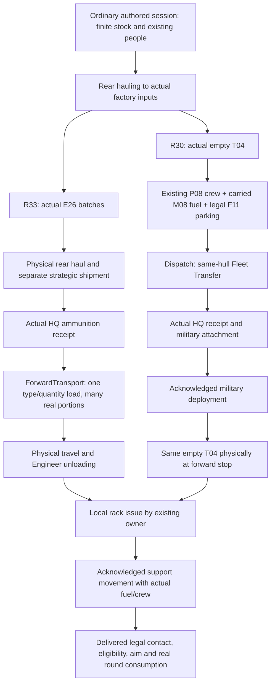

# C30 ownership and physical transition map

Lead's source-inspected map at `c3f2fe2e1f46980b4dce019afc6c0bdca89d9c3b`, 31 October 2026. This describes existing implementation and the accepted connected path, not a new proposed architecture or a claim that all stages passed. Current run outcomes belong to [#87](https://github.com/TheInfinityIQ/Trencho_V4/issues/87) and [PR86](https://github.com/TheInfinityIQ/Trencho_V4/pull/86). See the [engineering guide](engineering_field_guide.md) for research and review method; [playable delivery](playable_delivery.md) remains the parent acceptance.

## Session and authority

`game/main/main.gd` initially opens the generic connected rear. The player selects **New playtest**, whose `_start_playtest` / `_start_session` path creates the authored `game/scenario/farmland_session.gd`. That session constructs `game/rear_base/base_simulation.gd`; `BaseSimulation._init` creates the existing `game/staffing/rear_simulation.gd` and wires most domain services onto it. The rear owns shared event-clock advancement and ordered settling. Composition, clock coordination and presentation driving are distinct responsibilities. `game/identity/identity_ledger.gd` remains authoritative for identity, current physical holder/position, people, goods and consumption. Service job dictionaries record commitments/progress, not another inventory.

The rear view currently drives that clock even when the battlefield view is displayed. Hiding the rear must suppress presentation work without stopping the shared session. This is a coupling to keep visible in review; moving the clock is a separate behavior change requiring pause/speed/view-switch and exact-order regression, not part of this documentation.

The player manages production, staffing and shipments. Orders and military owners control deployment, targeting and firing. No diagnostic driver, view refresh or supply receipt may grant a tactical release.

The C30 observer deliberately withholds the separate rear ammunition shipment until the empty APC arrives at the forward stop. That establishes forward-lineage evidence for this observation. It is not a new restriction that the player must always delay every ammunition shipment.

## Boundaries to review together

| Stage and current owner | Preconditions and commitment | Physical completion / observation |
| --- | --- | --- |
| Authored session: `scenario/farmland_session.gd`, `scenario/rear_start.gd`, `scenario/battlefield_start.gd` | Selected R30/R33 access plus essential recipes; finite authored goods and real people | Same session, ledger and clock; no initial manufactured APC/E26 grant |
| Material haul: `staffing/rear_simulation.gd` with staffing/ledger owners | Correct source and input holder, actual available stock, exclusive handler/carry capacity | Goods actually deposited into `vehicle_input` / `munitions_input`; depot totals alone do not satisfy production |
| Manufacture: `production/fixed_production.gd` and heavy-production owner | Real local ingredients, operator work, output capacity and accepted recipe/order | R30 creates the actual empty hull; R33 receipts preserve batch/output origin. Completion still leaves downstream transport obligations |
| Rear hull handling: `vehicles/vehicle_activity.gd` and heavy-production parking promise | Existing distinct crew stations; real fuel carrier; lawful declared parking; route/footprint clearance | Fuel enters same hull after carry; hull physically drives/parks and bay clears. Admission and execution use the same bay-exit path policy |
| Dispatch: `dispatch/dispatch_service.gd` | Exact hull/manifest, loading, occupants and actual route fuel including reserve; validate again on departure | Hull receipt registers military hull/crew before manifest unloading finishes. Matching Fleet Transfer manifest must subsequently reach `Complete`; separate goods manifest physically arrives/unloads |
| Military attachment/deployment: `military/organization.gd`, `battlefield/vehicle_deployment.gd`, `orders/order_service.gd`, `military/troop_transport.gd` | Actual matching Fleet Transfer receipt **and completed manifest**, existing attached platoon and acknowledged intent; crew, fuel, route, fallback and danger admissions | Completed physical movement plus actual destination holder/position. Military membership, an attachment or an accepted order alone is not departure/arrival |
| Forward freight: `forward_supply/forward_transport.gd` | Own direct-HQ stock; type/quantity plan resolves exact source quotas/claims, actual truck/handlers, payload/fuel and both routes | Carry-sized portions loaded/deposited through ledger; every origin retained; return releases transport commitments |
| Initial rack scheduling: `battlefield/opening_resupply.gd`; physical rack issue: `forward_supply/vehicle_rack_issue.gd` under `forward_supply/forward_supply.gd` | Scheduler latches the initial empty eligible hull and chooses a real Engineer-squad member; issue service validates a healthy free active formation member, local E26, claim/capacity/proximity. Do not invent a P02 qualification rule in the generic issue owner | Issue owner performs physical timed deposit. Scheduler credits actual deposits once; firing does not create a new initial allocation. General repeat-resupply policy remains separate |
| Support / mounted fire: deployment, orders, `vehicle_combat/vehicle_combat_service.gd`, combat and ledger owners | Separate acknowledged military support intent, useful physical ammunition, crew/fuel/movement, delivered contact, legal sight/range/aim | Actual autonomous release consumes E26 on the same hull. Rack fill or contact marker alone is insufficient |

Paths in this table are relative to `game/`. Read current code when changing a boundary; this is an ownership index, not a duplicated API specification.

## Concrete next-slice review example

**Outcome:** one real manufactured APC can leave the rear and later receive separately manufactured ammunition at the forward stop. **Starting state:** ordinary C30, zero initial T04/E26, existing finite goods and people. **Authorities:** ledger physical state; current hauling, factory, vehicle, dispatch, military and supply owners. **Dependencies:** material inputs and production, legal parking promise, crew, actual fuel/route preview, HQ receipt, acknowledged deployment and a separate forward shipment.

**Guards:** do not weaken collision to clear an occupied slot; the existing public parking choice can select the clear west place before manufacture. For the current observer, one real 25-unit rear fuel carry must satisfy the actual Fleet Transfer preview and its reserve; later HQ fuel handling remains a physical process. Preserve an independent two-carry regression to catch the same-worker bay-exit defect even if the integrated path needs only one carry.

**Evidence:** journal each actual batch completion, crew report, fuel deposit, parking arrival, departure/HQ receipt, empty forward arrival, E26 origins/source claims, physical loading/unloading, local issue, support movement and first legal shot. A failed prerequisite ends the driver with that owner state. Record what remains unpassed rather than letting subsequent denials appear to be separate causes.

**Remaining parent obligations:** second genuine need and resupply in the same session, continuing contested battlefield consequence, understandable player controls/pacing and acceptable responsiveness. No first-stage proof closes those obligations.
