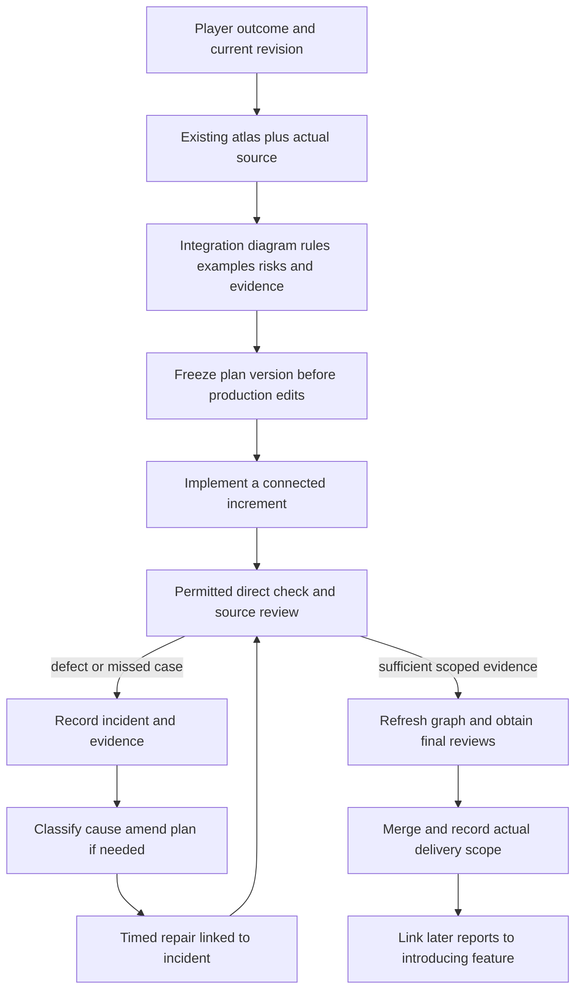

# Feature planning and delivery measurement

Effective 9 November 2026, following Dawson's instruction to resume development.
Lead remains the sole programmer. This supplements current team ownership and
verification policy; it does not activate the historical multi-worker controller.

Apply this workflow to actual development: feature implementation, code changes,
bug fixes and integration. General inquiries, explanations and read-only
discussion receive direct answers without opening a feature plan, timer or
development briefing. Record a genuine development decision from a discussion
when that development starts.

Use Dawson's numbered game-loop stages as manual playtest checkpoints, rather
than requesting a new playtest after every commit. Deliver a normal-run playable
state, short controls and the relevant actions for that stage; record feedback
before expanding the dependent next stage. Independent authorized work can
continue. Implementation, a scoped check, ready-for-player testing and player
acceptance are separate statuses. Stages 1 (people/materials) and 2 (place/manage
buildings) currently await Dawson's 3D F5 playtest; prior scoped receipts do not
make those stages completed.

Keep files/CLI as the default authoring/check workflow. Godot MCP is a selective
live-scene inspection option; the pinned experimental plugin remains outside
Trencho because its rapid new-script/save errors are unresolved. Resuming game
development does not enable that plugin or lift the no-local-engine restriction.
The completed three-pair MCP experiment is separate from the feature-workflow
comparison proposed here; neither its tiny task nor this resumed pilot establishes
a generally faster or cheaper development method.

## PR size and publication — 9 November 2026

Dawson requests one complete, playable block of the game loop per PR. Plan its
connected player outcome with the Designer, then implement its systems, UI and
integration together before the first feature push. For example, a supply block
can cover ordering, arrival, unloading and actual stock receipt; do not create a
PR for each button, callback or intermediate repair. Keep unrelated loop blocks
separate so the result remains understandable and reviewable.

Use frequent small local commits as recoverable checkpoints. Finish the block's
code, diagrams, documentation and static review before publishing its review
candidate. Necessary runtime checking still runs on GitHub under the existing
no-local-engine restriction; local completion is not a runtime-pass claim. Prepare
the brief block check from actual owner APIs and preconditions before dispatch,
and follow actual allocated identities. Fixes stay in the same PR; repeat only
checks affected by a change, a failure or an unresolved concern. Do not replay
already-passing independent portions or add routine suites to fill a larger PR.

GDUnit4 suites remain preserved and paused under the current verification policy.
There is no automatic local-unit-suite followed by a full GitHub suite. Required
CI checks the changed production syntax/dependencies; runtime demonstrations are
explicitly supplied, bounded checks of the current change. Review and player
acceptance still follow the existing ownership/stage rules. This policy update
is prepared locally for inclusion with the next game-loop block, without a
standalone workflow PR or an otherwise unnecessary remote run.

## Plan before programming

1. State the player outcome, acceptance evidence, exclusions and current source
   revision. Open the relevant existing system-atlas diagram and query the living
   function map for entry points, owners, callers and emitted events. Read those
   implementations. Mark stale map entries and dynamic/unresolved edges explicitly.
2. Draw the proposed integration: input → command → state owner → event → view.
   Identify identity/custody, lifetime, cancellation, pause/hidden-view behavior,
   invalid/stale input and repeat-command handling where relevant. Use existing
   owners. Explain any new service, recurring work or polling with a requirement.
3. Write a few concrete rule/examples, unknowns and the important failure/cleanup
   paths. Link each important boundary to a source function and a planned response.
   Ask the Designer only about actual gameplay ambiguity; resolve reversible
   engineering details independently. Do not enumerate every imaginable case.
4. Freeze a versioned plan before production edits. A material discovery gets a
   dated amendment, reason and measurement event; never rewrite the old plan to
   make an omission appear planned. A resumed existing feature is a resume plan,
   not a retrospective claim that its already-written code followed this process.
   When a late discovery appears to need another special condition, revisit its
   shared owner/invariant first. Fix the underlying boundary once when appropriate;
   neither more guard clauses nor fewer branches is itself a quality measure.
5. Implement the planned playable game-loop block, using small local commits
   within it. Publish after its code, UI and graph documentation are ready, then
   perform only the permitted brief current-change checks on GitHub. Preserve
   failures and update affected graph
   entries/purposes and obtain Lead technical plus Designer gameplay approval of
   the final PR revision before merge. Neither parsing nor a graph proves gameplay.

Keep context gathering economical: query specific functions instead of dumping
whole maps, project API responses to the fields needed before showing them to
the model, and prepare commands for the actual Windows shell and per-process
dependency environment. Record meaningful tool/setup failures separately from
game defects. These are concrete workflow lessons, not permission to omit
necessary source reading.

Godot recommends focused scenes, loose coupling and injected external dependencies;
signals let a scene respond without owning unrelated behavior. These are useful
criteria for our ownership graph, not a reason to rewrite every existing system.
[Godot scene organization](https://docs.godotengine.org/en/stable/tutorials/best_practices/scene_organization.html).

## Measurement contract — agreed before implementing the tracker

Use a small local JSON journal and a standard-library command-line helper, not a
new runner, service, scheduler or game autoload. One run per bounded feature and
workflow version; one active phase per run. The helper only records timestamps,
counter metadata and human-classified incidents; it launches no agent or engine.
Raw journals stay in ignored `logs/development-metrics/`; publish concise summaries
under `docs/evidence/workflow/` with the plan and PR references. No prompts, reasoning,
credentials or raw session transcripts go into summaries.

Use `python tools/workflow_metrics.py start --journal <ignored-run.json>
--feature <id> --workflow graph-first-v1 --plan <versioned-plan.json>
--source-revision <sha> --session-file <this-chat-rollout.jsonl>` at the start.
Use `phase --journal <run> --phase <name>` at actual phase boundaries;
`repair` and `late_handling` require `--incident <id>`. `incident --data <json>`
records one evidenced root cause; `amend --data <json>` preserves its prior
classification in history. `observe --note <scope-and-evidence>` records what
was actually checked. `stop` closes tracking without declaring gameplay done;
`report --output <summary.json>` exports the closed intervals. All commands take
the same `--journal`. No watcher is needed. Pause tracking when work stops.
For a later discovery after closure, start a linked continuation with the same
feature ID and original incident ID; retain introducing revision and prior run.
Compare unique `(feature, incident ID)` roots across continuations rather than
adding every journal's count or treating amended history as another defect.

| Measure | Definition and limits |
| --- | --- |
| End-to-end duration | First tracked start through delivery or explicit stop. Separate active intervals, review/CI waiting and human pause. Untracked earlier work stays unknown. |
| Phase time | Exclusive planning, implementation, direct-check, repair, review, release, waiting, paused or workflow-overhead intervals. Includes model/tool time while that phase is active; it is not developer CPU/typing time. |
| Observed regressions | Unique confirmed incidents where established existing behavior broke because of this change. Require prior-good and current-bad evidence plus attribution. A candidate remains unconfirmed until evidence exists. |
| Feature defects | New behavior fails its own acceptance; do not relabel these as regressions. Deduplicate retries and symptoms sharing one root cause. Preserve severity, discovery stage, affected behavior and introducing/fixing revisions. |
| Missed planning cases | An existing requirement/ownership boundary was available before coding but the frozen plan omitted or contradicted it. Record the source, omitted assumption, hindsight rationale and confidence; unknown attribution stays unknown. |
| Repair cost | Sum intervals explicitly linked to an incident, including investigation and correction; CI/review wait remains separate. No invented retrospective minutes. One interval has one primary incident; note shared work instead of double-counting. |
| Late handling | A missed boundary may cause ordinary implementation work without an observed bug. Record it as a planning discovery and its added work; do not inflate regression counts or count every conditional branch. |
| Tokens | Actual reported input, cached input, output, reasoning and total; include failures/retries and state measurement coverage. Cached input and reasoning are included subsets. Unknown counters remain null. No character estimates or whole-chat totals presented as feature usage. |

Record environment/tool failures, pre-existing defects, scope changes and workflow
mistakes separately. An HTTP download failure is not a game regression. A defect
reopened after an ineffective fix remains the same incident with another repair
interval. Later reports retain the original feature link and discovery date.
Zero observed regressions means zero **found in the stated observation scope**;
it never means regression-free. The current no-suite/no-local-engine restrictions
remain in force; counting defects does not authorize running regression campaigns.

For the active desktop chat, take read-only snapshots of this chat's reported
`token_count` metadata at boundaries and compute validated cumulative deltas.
Only this feature may own a measured interval; leave setup, unrelated discussion,
ambiguous overlaps and missing/tail receipts unassigned. Phase splits use receipt
completion boundaries and are approximate, not request-level tracing. Record the
receipt timestamp and partial coverage. The metadata format is an observed local
implementation detail; fail to unknown if unavailable. Fresh native CLI sessions,
when otherwise authorized, can instead attach their `turn.completed.usage` receipts.
Do not create workers or change models merely to make accounting convenient.
[Codex structured usage](https://learn.chatgpt.com/docs/non-interactive-mode).

Tracker acceptance: demonstrate one start/phase change, one explicitly fictional
incident and linked repair interval, and a summary on a scratch journal; verify
non-overlapping time, token-subset arithmetic, unknown counters, and no transcript
data in the summary. This is one direct new-code demonstration, not a test suite.

## Comparing workflows later

The candidate protocols and source links are in `workflow_experiments.json`.
Graph-first v1 is the initial prospective baseline. Alternatives retain the same
graph safety step, ownership, acceptance, implementation/review and verification
policy; vary the additional planning method rather than silently changing scope.

Start with comparable bounded feature slices, rotate which protocol goes first,
record system count/risk, acceptance, model/reasoning, tool versions, starting
revision/context size, caching, interruptions and check scope. Reimplementing the
same feature later has learning bias; label that comparison. Keep failed/cancelled
runs and setup/measurement overhead. Current resumed convoy work is a pilot with
historical work excluded, not a fair from-zero workflow benchmark. Plan later
comparisons now; do not run extra benchmarks or feature implementations for them.

Compare total delivery time and repair time, planning time, confirmed defects by
severity, missed-case work and actual token categories together. Report individual
runs, denominators and ranges; small samples and different features cannot establish
causality. Hold a common observation window/check scope for later defect reports;
mark still-open windows as censored. Prefer a workflow only when delivery quality
and total cost improve without reducing evidence. More planning documents, fewer
tokens or fewer checks alone are not success metrics. Change a protocol only as a
new version after reviewing its evidence, not mid-comparison.

DORA's deployment-level change-failure/recovery measures support keeping delivery
speed and stability visible together; our per-feature defect journal is a local
adaptation, not an implementation of DORA or an industry score.
[DORA measurement definitions](https://dora.dev/guides/dora-metrics/).
