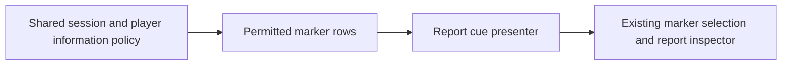

# Battlefield report cue handoff

This provisional amber diamond identifies a reported contact; it is not an enemy body or an uncertainty footprint. It consumes only the current permitted marker rows and retains their reported position, class, age and uncertainty in its presentation cache. Existing inspection remains authoritative.

Integrated field adapter (Lead review pending): instantiate under the field marker root, bind with `world.ground`, and reconcile the same current `Policy.markers` rows on field refresh. Connect `changed(id)` and `removing(id, anchor)` using the existing objective registration pattern; register `anchors[id]` in `world.markers` and suppress the old generic cube for represented contacts. Preserve the existing `Policy.inspect` picking/inspection path, including report age, class and uncertainty. Clear bindings during world replacement. No simulation or new clock is created.

Acceptance: finite current contact reports appear, update or disappear with the permitted rows. No hidden enemy position or status is used. Existing camera, people, objectives, supply, pause and 2D fallback are unchanged. Standalone source parsing does not establish runtime or visual acceptance; a brief current-change GitHub check and integrated visual review remain required.
