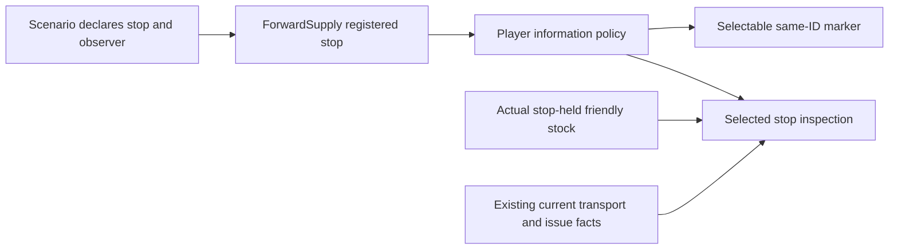

# Friendly forward stop observation

The accepted Farmland scenario registers the actual `blue-delivery` place and its forward route. The player can inspect friendly unit supply information, but the shared marker policy does not currently admit the stop. This slice gives an explicitly authorized stop a selectable marker and read-only inspection; it neither delivers goods nor issues orders.

Only an explicitly declared observer matching the player may see a registered stop. Empty or different authorization is undisclosed. Marker and inspection must use the same policy. Directly held stock is distinct from freight on a vehicle and issue to a recipient; missing data is unknown rather than invented. Opening-managed active job references do not cover all retained forward transport or issue work. The Lead selected the narrower display: directly held stock, opening-owned pending freight and active opening-managed issue facts. Transit and other or historical issue details are explicitly unavailable. Empty tracked sets mean only no tracked opening issue. No active index or historical-job scan is added.

A scoped direct check should verify the real authorized Farmland stop's identity and shared marker, actual available service facts, and omission of an undisclosed stop. Visual appearance, native clicks, hidden-area progression and FPS require separate evidence. Existing selection, pause, ledger custody, military orders and 2D fallback remain authoritative. No new economy, timer, automatic delivery policy or unseen enemy disclosure is introduced.

The selected authorized stop caches direct-holder stock until the ledger emits `stock_changed`, the selection changes or the model is replaced. Any stock change dirties the cache, including unrelated changes; only selection of an authorized stop triggers a refresh. This broad invalidation is a current limitation, not a new stock index. Permission is rechecked before cache use.
