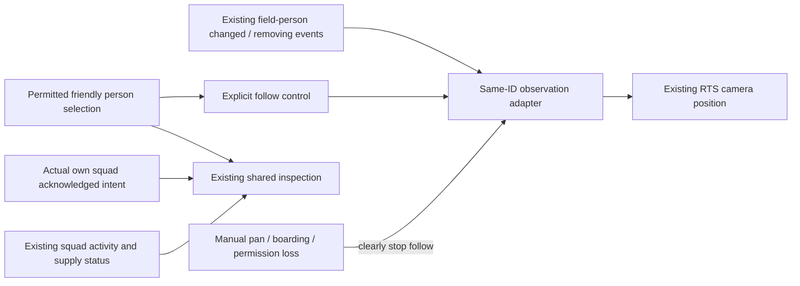

# Proposed first squad-observation slice

Designer-agreed outcome: the player follows one actual selected friendly soldier while understanding that soldier's squad and its existing acknowledged intent and current activity. No new AI hierarchy, military command, unit, target information or clock.

Existing behavior: `preview.gd::_select_marker` inspects current permitted marker IDs. `_observe_recipient` moves the camera once to a selected own person. `field_persons.gd` already emits `changed`/`removing` for permitted person anchors and listens to ledger movement/parent changes; detailed human animation includes actual `person_fired` events at close zoom. `battlefield_view.gd::inspection_text` already presents individual duty and, when available, squad execution/supply journey state. Existing `orders.intents` records intent state and action; show only the selected permitted person's real friendly squad and distinguish issued/acknowledged intent from current execution. Do not show raw target facts or infer current orders.

Proposed boundary pending Lead assignment: feature-owned small follow adapter subscribes only to the current `field_persons` presenter and tracks a single explicit ID. Lead-owned `preview.gd` supplies visible Follow/Stop action and manual-pan cancellation; existing view/inspector renders the permitted own squad facts. Preserve a camera offset and zoom as the anchor moves, use existing signal and camera projection notifications, and do not add a per-frame simulation/ledger query. No autonomous follow after selecting a different person without the player's action. On boarding, person removal, permission loss, or replacement of the simulation, clearly stop the same ID; never substitute a vehicle, another soldier or synthetic squad centroid. Pause/speed and hidden-domain progression remain unchanged.

Acceptance: one selected eligible friendly person can be followed as its real position changes; manual pan or removal/boarding clears follow with a visible reason; no follow path starts from contacts or enemy information. Existing selection/inspection stay usable, current intent and activity remain distinct, and no player military order is introduced. A single brief current-change demonstration should use a real selected permitted person and actual movement event; native input/rendering and full-game/FPS acceptance remain separate. The exact test action and any model replacement/boarding coverage need Lead scope and must not become a broad suite.

## Agreed state transitions and acceptance

- Inactive → following only through an explicit control for the selected currently permitted, visible, on-foot friendly person. Retain that exact ID and its existing anchor; preserve camera offset and zoom.
- Following → following on that same anchor's changed event, moving only the observation camera. No per-frame policy or entity lookup; no new clock or combat input.
- Following → stopped with a visible reason on manual pan, changed selection, boarding/removal, lost permission, leaving the battlefield, simulation replacement or an anchor replaced under the same ID. Do not silently choose a new person or hull. Rebinding and teardown disconnect old presenter signals.
- Selected friendly squad identity, acknowledged action and execution status are shown as separate facts. Missing or unacknowledged intent is labelled unavailable or not yet acknowledged; no hidden enemy target or military order control is introduced.
- One brief direct check uses an actual permitted person, starts follow, moves that person through the ledger and verifies the same camera offset, then releases follow. Native button/mouse input, visuals, FPS, boarding and session replacement remain separate unverified behavior.
