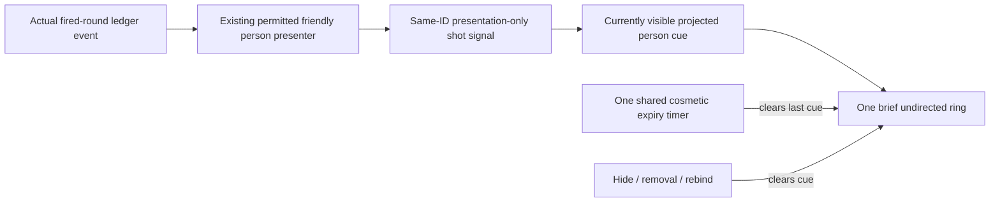

# Friendly firing cue

Designer direction accepted: a brief, undirected cue means only that the same permitted friendly soldier actually fired a round. No shot attempt, target, hit, kill, bearing or hidden person is implied. This is a provisional presentation; final source and appearance remain unreviewed.

Proposed UI semantics: show only the latest actual admitted shooter and replace the cue with the next actual shot; never imply all simultaneous shots are represented. Ignore hidden battlefield/cue, absent or unprojectable anchors. One shared one-shot cosmetic UI timer removes the cue after a short wall-time interval; it owns no simulation time or combat state and creates no per-person polling/timers. Rebind, removal and hiding clear it; pause/speed and all military authority remain unchanged. Existing close-up recoil remains. Lead approved the bounded field-presenter scope; this implementation uses one 0.35-second cosmetic UI timer.

Acceptance: one actual friendly fired-round event at an admitted visible shooter triggers its same-ID ring; firing at no permitted shooter or while hidden produces none; the one shared timeout clears it, and hiding/removal/rebinding cannot leave a stale marker. A single brief direct action should cover the actual event and clear; native input/rendering, strategic readability and FPS remain separate visual/player acceptance. The scoped demonstration remains unrun until Lead review and GitHub dispatch.

## Proposed lifecycle after Lead scope assignment

- `_ready`: create one child `Timer`, one-shot, UI-only real-time expiry; connect timeout and the existing cue control's visibility change once. The timer changes only ephemeral presentation, never combat/time.
- `bind`: disconnect shot/changed/removing from the old admitted-person presenter; clear the one visible cue and stop the timer; connect the new presenter once. No ownership or entity lookup is performed by the cue.
- `FieldPersons._on_shot`: only after its existing real `ledger.person_fired` handler confirms `bodies.has(id)`, emit the same admitted shooter ID. Existing actual recoil remains unchanged.
- cue shot handler: require visible control, current camera, current presenter anchor and freshly flushed existing camera projection with the same ID in `points`. Then replace `latest_shot_id`, draw one undirected ring and restart the shared one-shot timer. No target/hit data or simulated shot is created; simultaneous shots are intentionally not all represented.
- timeout, visibility loss, removal of the same anchor, rebind or exit: clear cue and stop timer. Reveal never replays an old event. Camera pan/zoom use the existing projection cache; an offscreen ID is not drawn. Global simulation pause/speed do not change the cosmetic wall-time duration or any game state.

One proposed direct episode: in normal Farmland, admit an actual on-foot friendly person with an actual loaded rifle; connect the existing presenter and cue, trigger one successful `ledger.fire_loaded_round` on that person's real weapon, verify the same admitted ID is the latest cue, then await the one UI timer and verify it clears. No target/hit/kill is created or inferred. The episode verifies the signal and cleanup but not appearance, native input or FPS. Exact setup/hash requires Lead review before running; no broad tests.
