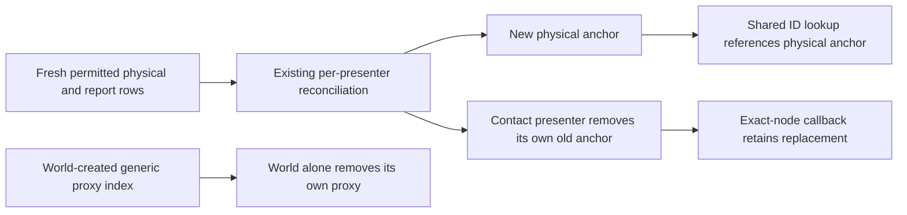

# Battlefield marker lifetime repair

Source-derived conditional defect: during reconciliation a permitted physical same-ID marker can be installed before the former contact presenter removes its own anchor. The shared marker lookup currently detaches and queues any displaced node, including one owned for lifetime by another presenter. That presenter then tries to remove its no-longer-child anchor. This is not a claim of an observed ordinary-player incident.

Acceptance: World tracks and frees only its own generic marker proxies. Specialized presenters retain sole lifetime responsibility for their anchors. Shared marker lookup can point to the new physical anchor while the old presenter removes its own exact anchor; old removal callbacks cannot erase the replacement. Generic proxies still clear when absent or displaced. No policy, gameplay, timing, art or per-frame scan changes.

One proposed GitHub-only direct episode (unrun pending Lead review): actual normal Farmland world, arrange one explicitly admitted report, then same-ID permitted actual physical carrier; reconcile, flush queued deletion, verify physical anchor is retained and report presenter cleans its own node without detached-child errors. No ordinary encounter, rendering, native input, FPS or broader lifecycle acceptance is claimed.

Primary source: https://docs.godotengine.org/en/stable/classes/class_node.html#class-node-method-remove-child and https://docs.godotengine.org/en/stable/classes/class_node.html#class-node-method-queue-free. Godot documents removal from a parent separately from end-of-frame deletion and child destruction. Node.owner concerns scene hierarchy/serialization and is not the runtime lifetime authority used by this repair.
