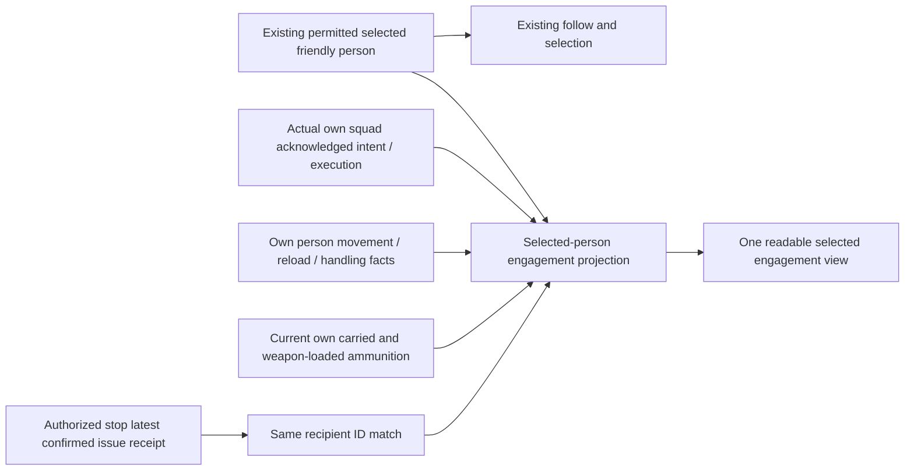

# Selected friendly engagement: proposed coherent block

Designer-agreed outcome: while selecting/following one actual permitted friendly person, distinguish the squad's acknowledged task and existing execution status from that person's current physical motion/reload/work and actual carried versus loaded ammunition. A matching latest authorized physical supply receipt can be shown as a past event beside current ammunition, without claiming that its rounds remain or caused a shot. No readiness calculation, new AI, orders, target knowledge, supplies or clock.

Source anchors: `BattlefieldPresentation.inspect` enforces player ownership and occupied/aboard information; `BattlefieldView.inspection_text` currently shows the permitted person, own squad action/status, total and loaded E02, and some supply collection/journey information. `_activity_label` falls back to squad status, so an individual physical action is not consistently distinguished. `SquadExecution.motions[id]` owns pending versus active foot motion and purpose; do not expose destination or hidden target data. `Combat.reloads[weapon_id]` owns actual reload state; use the selected person's already-inspected actual weapon IDs, not a scan of unrelated history. The existing `FieldPersons` presentation independently derives moving and reload visuals. `ForwardSupply.observe_stop` returns the authorized latest bounded issue receipt; only a personal receipt whose existing job's `recipient` matches the selected person may be shown, retaining receipt event time. A handler is not a recipient. If it has been replaced/unavailable, omit or say unavailable; do not search historical jobs.

Acceptance: selected friendly person shows separately labelled acknowledged squad action (or unavailable), squad execution status (or unavailable), actual individual movement/reload/handling status (or unavailable), current carried E02 and current weapon-loaded E02 with clear scope, and only a same-recipient authorized historical transfer when available. A past receipt never asserts current possession, readiness, a hit or causation. Occupied/boarded/removed/session boundaries and enemy information restrictions remain in existing policy. One brief direct action should show one actual selected person's real local issue and current/receipt distinction; final specific fixture and scope require Lead review. Visual, native input, full encounter and FPS remain unverified.

Proposed file boundary pending Lead: feature-owned read-only engagement projection under `game/battlefield/`, consuming explicit selected-person/rear dependencies; existing shared `battlefield_view.gd` displays it; any restricted receipt projection extension belongs to Lead-assigned `forward_supply.gd`. Existing session, tick, orders, claims, combat rules and ledger remain unchanged. Avoid per-frame scans and unbounded retained job histories; reuse existing selected-inspector cadence and latest receipt only.

## Assigned source boundary

Lead approved one feature-owned selected-person projection, bounded consolidation in `battlefield_view.gd`, and an exact-recipient latest-personal-transfer accessor in `forward_supply.gd`. The projection consumes the already-permitted selected row and one existing selected-holder inventory snapshot. It must not retrieve a hidden target, scan retained job history, rebuild marker policy or mutate simulation. The accessor rechecks the explicit opening-stop entitlement and current actor visibility, requires the same recipient rather than the handler, and returns only type, quantity and event time. It never treats a receipt as present possession or loaded ammunition. Only existing selected-inspection refresh is used; no clock or per-frame scanning is introduced.
