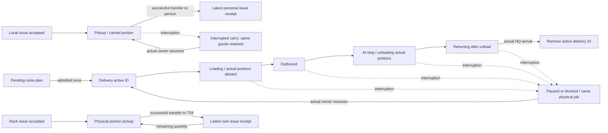

# Proposed bounded delivery and issue observation lifecycle

Read-only proposal against forward-stop PR149 source a9fc00a (documentation head 3cecdf9). No code change or authorization for lifecycle edits is implied.

## Source owners and proposed minimal hooks

- `game/forward_supply/forward_transport.gd::_request_delivery` creates a real delivery after stock claims succeed. Add its ID to a private per-stop active set only after that creation. Deferred plan `request_deferred`/`pump_planning` remains a separate planning status; pending is not a delivery and admission must not add twice.
- `_finish_load` increments `loaded` after a real drop to the named carrier. `_finish_route` changes Outbound to Unloading only after the real hull reaches the stop. `_finish_unload` increments `unloaded` only after the real stock portion transfers to the stop. `loaded` and `unloaded` are cumulative job progress, not current on-board stock or current stop inventory. A carried unload portion can be between hull and stop; never label their difference as aboard cargo.
- `interrupt_delivery`, `_pause_task`, `_block_route`, `_begin_route`, and `resume_delivery` retain the same job through paused, blocked, stranded or resumed states. Keep its active membership throughout, displaying the existing state/blocker and exact physical facts; do not re-add on resume. `_finish_route` removes the active ID only after Returning reaches HQ and `return_completed` is set. Showing a returning job must not imply freight is still outbound. No timeout or result forcing.
- `game/forward_supply/forward_supply.gd::start_issue` adds a personal-issue ID after its actual claim and job exist. `_finish_drop` publishes one bounded latest personal-issue receipt only after `transfer_stock` succeeds and `issued_stock` is set; the receipt is an event record, not proof the recipient still carries or loaded those rounds. Then remove that active ID. `_interrupt_row` retains `Interrupted Carry` as unresolved; ordinary `Interrupted` has no resumable personal issue and leaves active membership. `resume_issue` reuses only the retained carried job; never add a new physical transfer or increment a receipt on resume.
- `game/forward_supply/vehicle_rack_issue.gd::request` adds an active rack issue after its claim/job exists. `_drop` emits/updates a bounded latest rack receipt for each successful physical portion, using that portion and actual hull, then removes active membership only on Complete. `_stop` retains `Interrupted Carry` as unresolved but removes ordinary `Interrupted` from active membership; `resume` must re-add the exact existing ID only after all checks/claims and `_begin` succeed. On a failed resume, membership must still reflect the existing carried state. A receipt is not a new weapon reload or consumption event.
- The private per-stop sets and one last receipt per issue kind are presentation indexes, not custody or scheduling owners. Their keys refer back to existing jobs. Do not copy entire histories, sum cross-type quantities, infer completeness, alter `jobs`, fuel, claims, transfers or the clock. Growth is limited to actual unfinished/resumable work plus a fixed number of latest receipt records per authorized stop. If the latest receipt is replaced, say “latest observed issue,” never lifetime total.
- Projection remains behind `ForwardSupply.observe_stop` and explicit `observer_owner == rear.PLAYER`. Before returning any row or receipt, validate current friendly hull/recipient/handler through the existing identity/information boundary; missing or changed ownership yields omitted/unknown, never a competing side's identity or data. Do not disclose unregistered or other-observer stops. Where ownership cannot be verified at receipt read time, omit details.

## Open engineering review

Indexes must update on every success/failure/interrupt/return path that changes membership, including implicit `_interrupt_row`/`_stop` paths, not only UI commands. Determine whether stop-owned index helpers belong in `ForwardSupply` or each existing service; no new global controller. Snapshot/restore behavior is not established by this proposal and must not pretend persistence exists. A one-action current-change demonstration must be chosen with Lead after wiring; follow the no-regression-suite and GitHub-only engine policy.

The existing current view's stop-held loose-stock cache and permission check remain in force. This proposal does not authorize a per-frame scan, full retained-history scan, new military orders, enemy logistics, a second clock, or an implementation before Lead approval.

## Refined interrupted-carry and partial-issue semantics

- Personal `ForwardSupply._interrupt_row` labels a job `Interrupted Carry` solely because `carried_stock` is a nonempty ID. That label by itself does not prove the handler still has goods: `resume_issue` independently requires the current stock holder to be the named handler, quantity to match, and both actors to remain eligible. A projection must inspect that exact stock ID and owner before saying “held by handler.” If missing, changed, or unauthorized, report “interrupted; current custody unavailable” rather than claiming a successful handoff or inventing a terminal transition. `Interrupted` has no ordinary personal `resume_issue` path; a retained carried job can still fail its resume checks and must not be called automatically resumable.
- Rack `_stop` itself checks current carry holder and portion before assigning `Interrupted Carry`; it clears `row.carry` for ordinary `Interrupted`. Rack `resume` can attempt either state, but admission depends on current hull/handler, actual portion, capacity, claims and route. It may create a replacement claim and then release it if route planning fails, leaving the job interrupted. Update an active/resumable index only after the existing successful `_begin`; never treat a failed attempt or released claim as a new issue. For a stopped non-carried rack job, removing it from active membership loses visibility of a potentially resumable job: either maintain a separately bounded *current interrupted job* reference or explicitly label untracked interrupted rack work unavailable. Do not silently call the active set a complete list of all resumable work.
- A rack job can transfer several portions. `_drop` increments `row.issued` immediately after each successful transfer; it may then stop before completion if the return path fails. A last-receipt record should be updated once per successful portion, identified by job and its post-transfer cumulative count, and distinguished from the request total and from completion. `row.issued` is historical job progress; it does not prove the same rounds remain in the hull later. An interruption or resume must never replay that receipt or count the same portion again.
- Transport `_pause_task` retains its existing `row.task` and physical holder, while route interruptions retain the same job. Stage alone cannot say cargo is aboard, at the stop or carried by an unloader: verify the exact portion holder before such a claim, or report only existing state plus cumulative loaded/unloaded. The stop's direct loose-stock view remains independent of prior unload and may fall after actual onward transfers.

## Accepted implementation boundary

Lead authorized this bounded design on 12 November. Keep each real work owner authoritative, add only per-stop observation indexes at accepted/terminal hooks and one latest confirmed transfer receipt per issue kind. Empty index does not claim no earlier work or prove all interrupted rack work is tracked. Current actor and stop permission is rechecked before projection. Existing simulations create services fresh; restore/backfill compatibility has not been established. The single planned direct action is one real local issue and its observed receipt, with unpermitted-stop omission; it does not establish transport, rack, interruption, native input, visual, restore or FPS behavior.

Observation indexes update at the existing semantic admission, interruption and successful-transfer/return events. The existing selected inspector cadence reads only the bounded projection; this block adds no observation signal or new tick listener. Person disclosure also preserves the existing hidden `rear_place == Occupied` boundary.
