# Current game systems — implementation atlas

Reviewed game baseline: `5fdd5561f3337896b85eef4ebb942bfdeb75101e`.

[Open the offline interactive atlas](system_atlas.html) · [Reviewed catalog](system_atlas_catalog.json) · [Queryable inventory](system_atlas.json)

The HTML contains an overview, individual diagrams, filtering, source inventory and VS Code links. These are source-observed conditional workflows and dependencies, not measured call stacks.

People share one Person/ledger implementation; vehicles span several activity owners; workshops reuse a common batch engine. A shared advance_time/settlement coordinator still connects rear and battlefield. The manager is separate from the worker pool.


## Overview

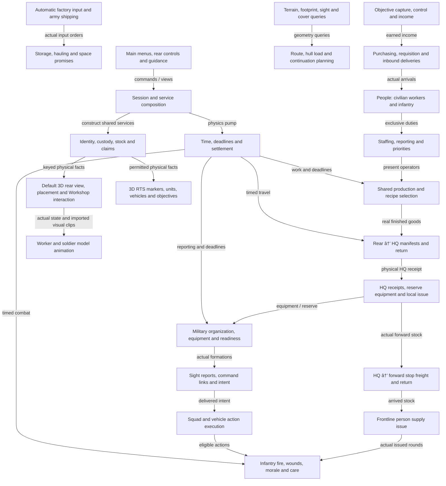

## System index

- [Session and service composition](#session) — GameSession + BaseSimulation
- [Time, deadlines and settlement](#clock) — BaseSimulation + RearSimulation
- [Identity, custody, stock and claims](#identity) — IdentityLedger / Entity / Person / Claim
- [People: civilian workers and infantry](#people) — Shared Records.Person + role-specific services
- [Staffing, reporting and priorities](#staffing) — RearSimulation requests + actors
- [Storage, hauling and space promises](#hauling) — RearSimulation jobs / actors / stores + ledger claims
- [Purchasing, requisition and inbound deliveries](#procurement) — ReceivingSimulation
- [Rear building placement, completion and dismantling](#construction) — ConstructionService
- [Construction Office utility truck](#truck) — ConstructionTruckService
- [Shared production and recipe selection](#production) — FixedProduction + SelectableProduction
- [Workshop / F04](#workshop) — R01Production or per-site SelectableProduction
- [Munitions / F05](#munitions) — R02Production + SelectableProduction
- [Building Materials / F13](#materials) — R26Production + FixedProduction
- [Support Workshop / F09](#support) — SupportProduction + SelectableProduction
- [Vehicle Works / heavy manufacture](#heavy) — HeavyProduction + ledger admission + Vehicles
- [School, instructors and qualifications](#training) — TrainingService
- [Rear vehicles, crew, fuel and parking](#vehicles) — VehicleActivity + IdentityLedger
- [Rear → HQ manifests and return](#dispatch) — DispatchService
- [HQ receipts, reserve equipment and local issue](#hq) — HqLogistics
- [Automatic factory input and army shipping](#logistics) — RearLogistics (event-woken Node)
- [Military organization, equipment and readiness](#army) — MilitaryOrganization
- [Military passenger and supply transport](#troop) — TroopTransport (owned by MilitaryOrganization)
- [Sight reports, command links and intent](#orders) — OrderService
- [Squad and vehicle action execution](#execution) — SquadExecution + VehicleExecution
- [Authored operations, resupply and resource decisions](#policy) — OpeningPolicy + OpeningResupply + ResourceOperations + VehicleDeployment
- [Rifle squad collection and return journeys](#collect) — RifleSupplyTravel + SquadExecution
- [Frontline person supply issue](#forward) — ForwardSupply
- [HQ → forward stop freight and return](#freight) — ForwardTransport
- [Forward vehicle ammunition rack issue](#rack) — VehicleRackIssue
- [Infantry fire, wounds, morale and care](#combat) — CombatService + ledger physical mutations
- [Mounted weapons, armour and projectiles](#mounted) — VehicleCombatService
- [Vehicle destruction, repair and towing](#recovery) — RecoveryService
- [Objective capture, control and income](#objectives) — ObjectiveService + Receiving account
- [Terrain, footprint, sight and cover queries](#terrain) — TerrainWorld + TerrainCatalog + RouteWork
- [Route, hull load and continuation planning](#routes) — RoutePlanner + RoutePlanWork + Terrain RouteWork
- [Field structures, roads and support sites](#field) — FieldService + FieldCatalog
- [Bridge construction, crossings and repair](#bridge) — BridgeService
- [Attached demolition charges](#demolition) — DemolitionService
- [Mines, hazards, knowledge and clearance](#mines) — MineService + DeviceCatalog
- [Main menus, rear controls and guidance](#ui) — Main + CommandShell + BaseDemo + panels
- [Battlefield read models and 2D inspection](#battleview) — BattlefieldPresentation + BattlefieldView
- [Default 3D rear view, placement and Workshop interaction](#preview) — Preview + WorldPresenter + rear presenters
- [3D RTS markers, units, vehicles and objectives](#field3d) — FieldPersons / FieldT01Trucks / FieldObjectives + cached cue overlays
- [Player manager pose and movement](#manager) — ManagerPose + WorldPresenter CharacterBody3D
- [Authored world, opening armies and normal rear start](#scenario) — FarmlandSession + FarmlandScenario + BattlefieldStart / RearStart
- [Explicit prototype debug actions](#debug) — RearDebugMenu + RearDebugActions
- [Function-call logging and retained performance tooling](#diagnostics) — FunctionCallLog + performance/report helpers
- [Optional review scenes, fixtures and probes](#reviews) — Main.REVIEWS and standalone diagnostic scenes
- [Worker and soldier model animation](#character_animation) — CharacterVisual with RearWorkers and FieldPersons

<a id="session"></a>
## Session and service composition

**Owner:** GameSession + BaseSimulation. Main/F5 instances the existing 3D scene; its shared base controller creates one scene-owned session for rear and battlefield views. BaseSimulation injects the same rear/ledger into domain services. The development opening has four real present unloaders at the south Table service apron.

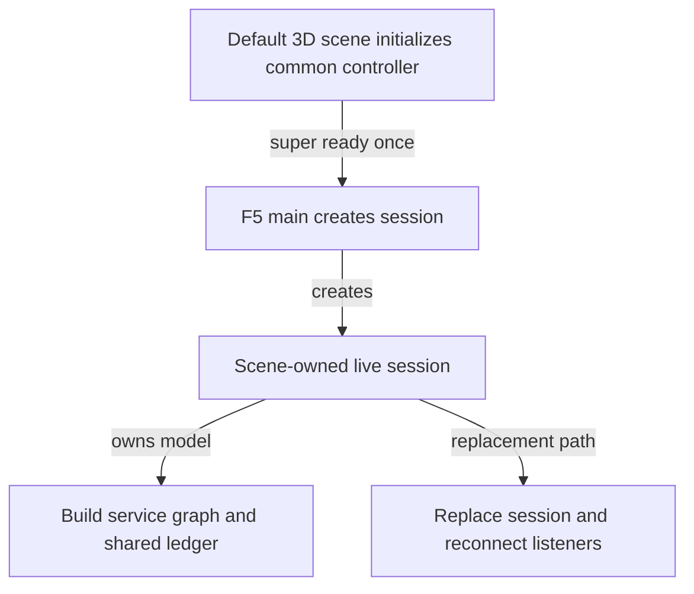

Configured main.tscn is a root instance of preview.tscn, whose script extends common main.gd. No extra wrapper/controller, autoload or game session is introduced. F6 on either entry also uses 3D. Review scenes may create separate diagnostic sessions. Native input, the complete loop and FPS remain unverified; stages 1/2 await player acceptance.

**Source anchors:**

- [_ready](https://github.com/TheInfinityIQ/Trencho_V4/blob/5fdd5561f3337896b85eef4ebb942bfdeb75101e/game/preview_3d/preview.gd#L46) — Default 3D scene initializes common controller
- [_ready](https://github.com/TheInfinityIQ/Trencho_V4/blob/5fdd5561f3337896b85eef4ebb942bfdeb75101e/game/main/main.gd#L39) — F5 main creates session
- [_ready](https://github.com/TheInfinityIQ/Trencho_V4/blob/5fdd5561f3337896b85eef4ebb942bfdeb75101e/game/main/game_session.gd#L21) — Scene-owned live session
- [_init](https://github.com/TheInfinityIQ/Trencho_V4/blob/5fdd5561f3337896b85eef4ebb942bfdeb75101e/game/rear_base/base_simulation.gd#L54) — Build service graph and shared ledger
- [replace_simulation](https://github.com/TheInfinityIQ/Trencho_V4/blob/5fdd5561f3337896b85eef4ebb942bfdeb75101e/game/main/game_session.gd#L66) — Replace session and reconnect listeners

<a id="clock"></a>
## Time, deadlines and settlement

**Owner:** BaseSimulation + RearSimulation. The actual implementation still advances one shared rear time across rear and battlefield services. Live wall-time debt and cooperative route planning feed an event-boundary loop.

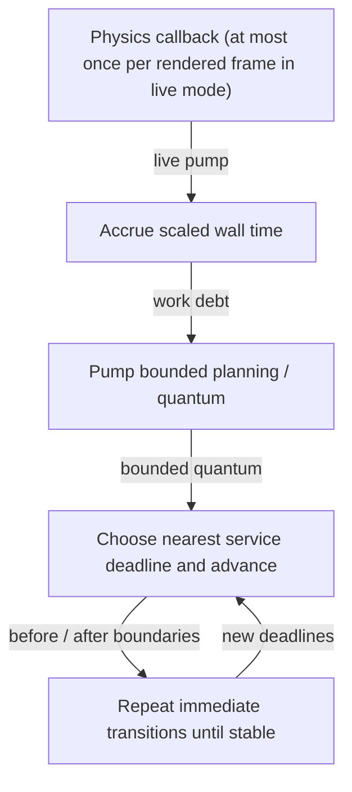

advance_time queries next_boundary across services, advances work/motion and calls _settle. _settle has a 1000-iteration safety bound; it is not a thousand unconditional passes. Finite event-woken logistics processing is a separate path. Independent domain clocks/timer-only overhaul is NOT completed.

**Source anchors:**

- [_physics_process](https://github.com/TheInfinityIQ/Trencho_V4/blob/5fdd5561f3337896b85eef4ebb942bfdeb75101e/game/main/game_session.gd#L32) — Physics callback (at most once per rendered frame in live mode)
- [tick_live](https://github.com/TheInfinityIQ/Trencho_V4/blob/5fdd5561f3337896b85eef4ebb942bfdeb75101e/game/rear_base/base_simulation.gd#L186) — Accrue scaled wall time
- [_pump_live](https://github.com/TheInfinityIQ/Trencho_V4/blob/5fdd5561f3337896b85eef4ebb942bfdeb75101e/game/rear_base/base_simulation.gd#L204) — Pump bounded planning / quantum
- [advance_time](https://github.com/TheInfinityIQ/Trencho_V4/blob/5fdd5561f3337896b85eef4ebb942bfdeb75101e/game/staffing/rear_simulation.gd#L342) — Choose nearest service deadline and advance
- [_settle](https://github.com/TheInfinityIQ/Trencho_V4/blob/5fdd5561f3337896b85eef4ebb942bfdeb75101e/game/staffing/rear_simulation.gd#L658) — Repeat immediate transitions until stable

<a id="identity"></a>
## Identity, custody, stock and claims

**Owner:** IdentityLedger / Entity / Person / Claim. One ledger owns physical people, hulls, stock portions, weapons, holders, ownership, fuel, health and reservations. Services request validated mutations; detached inspections are read models.

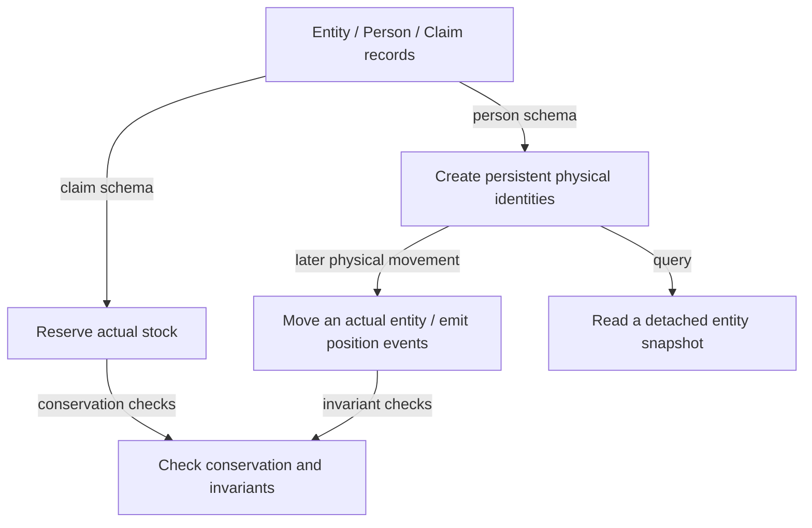

inspect_entity is a query, not the game-loop controller. Many callers share the ledger because goods/people must retain identity across systems. Broad snapshots, narrow queries and mutation APIs coexist; this atlas does not measure their frequency. Explicit activity-owned per-person handling points permit real port arrival without widening global interaction distances. Actual person-held round release emits person_fired for read-only presentation.

**Source anchors:**

- [identity_records.gd](https://github.com/TheInfinityIQ/Trencho_V4/blob/5fdd5561f3337896b85eef4ebb942bfdeb75101e/game/identity/identity_records.gd#L1) — Entity / Person / Claim records
- [add_person](https://github.com/TheInfinityIQ/Trencho_V4/blob/5fdd5561f3337896b85eef4ebb942bfdeb75101e/game/identity/identity_ledger.gd#L676) — Create persistent physical identities
- [request_stock](https://github.com/TheInfinityIQ/Trencho_V4/blob/5fdd5561f3337896b85eef4ebb942bfdeb75101e/game/identity/identity_ledger.gd#L1156) — Reserve actual stock
- [move_entity](https://github.com/TheInfinityIQ/Trencho_V4/blob/5fdd5561f3337896b85eef4ebb942bfdeb75101e/game/identity/identity_ledger.gd#L699) — Move an actual entity / emit position events
- [inspect_entity](https://github.com/TheInfinityIQ/Trencho_V4/blob/5fdd5561f3337896b85eef4ebb942bfdeb75101e/game/identity/identity_ledger.gd#L1706) — Read a detached entity snapshot
- [audit](https://github.com/TheInfinityIQ/Trencho_V4/blob/5fdd5561f3337896b85eef4ebb942bfdeb75101e/game/identity/identity_ledger.gd#L1897) — Check conservation and invariants

<a id="people"></a>
## People: civilian workers and infantry

**Owner:** Shared Records.Person + role-specific services. There are not two independent civilian/infantry entity implementations. The same PERSON identity has assignment, qualification, duty, holder, gear, health, morale and suppression. Different services own its activities.

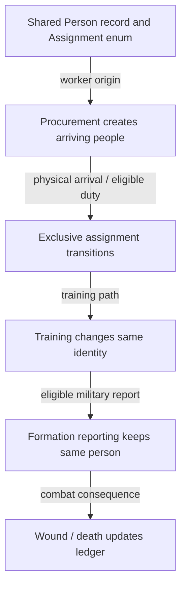

Arrows show possible lifecycle stages, not automatic enlistment. Workers, instructors, crew, passengers and infantry have distinct eligibility/commitment rules. The player manager is a separate ManagerPose/CharacterBody3D, not a free worker identity.

**Source anchors:**

- [identity_records.gd](https://github.com/TheInfinityIQ/Trencho_V4/blob/5fdd5561f3337896b85eef4ebb942bfdeb75101e/game/identity/identity_records.gd#L1) — Shared Person record and Assignment enum
- [buy_people](https://github.com/TheInfinityIQ/Trencho_V4/blob/5fdd5561f3337896b85eef4ebb942bfdeb75101e/game/procurement/receiving_simulation.gd#L267) — Procurement creates arriving people
- [request_assignment](https://github.com/TheInfinityIQ/Trencho_V4/blob/5fdd5561f3337896b85eef4ebb942bfdeb75101e/game/identity/identity_ledger.gd#L987) — Exclusive assignment transitions
- [complete_training](https://github.com/TheInfinityIQ/Trencho_V4/blob/5fdd5561f3337896b85eef4ebb942bfdeb75101e/game/identity/identity_ledger.gd#L970) — Training changes same identity
- [complete_formation_report](https://github.com/TheInfinityIQ/Trencho_V4/blob/5fdd5561f3337896b85eef4ebb942bfdeb75101e/game/identity/identity_ledger.gd#L796) — Formation reporting keeps same person
- [injure_person](https://github.com/TheInfinityIQ/Trencho_V4/blob/5fdd5561f3337896b85eef4ebb942bfdeb75101e/game/identity/identity_ledger.gd#L1363) — Wound / death updates ledger

<a id="staffing"></a>
## Staffing, reporting and priorities

**Owner:** RearSimulation requests + actors. Requested staff, assignment and physical presence are separate. Shared people are rebalanced by duties/priorities and walk/report before contributing work. Development service eligibility includes the apron outside the unchanged construction rectangle. Empty-field people reserve distinct physical service positions through RearWorkPositions; read-only route admission and actual commitment use the same point owner.

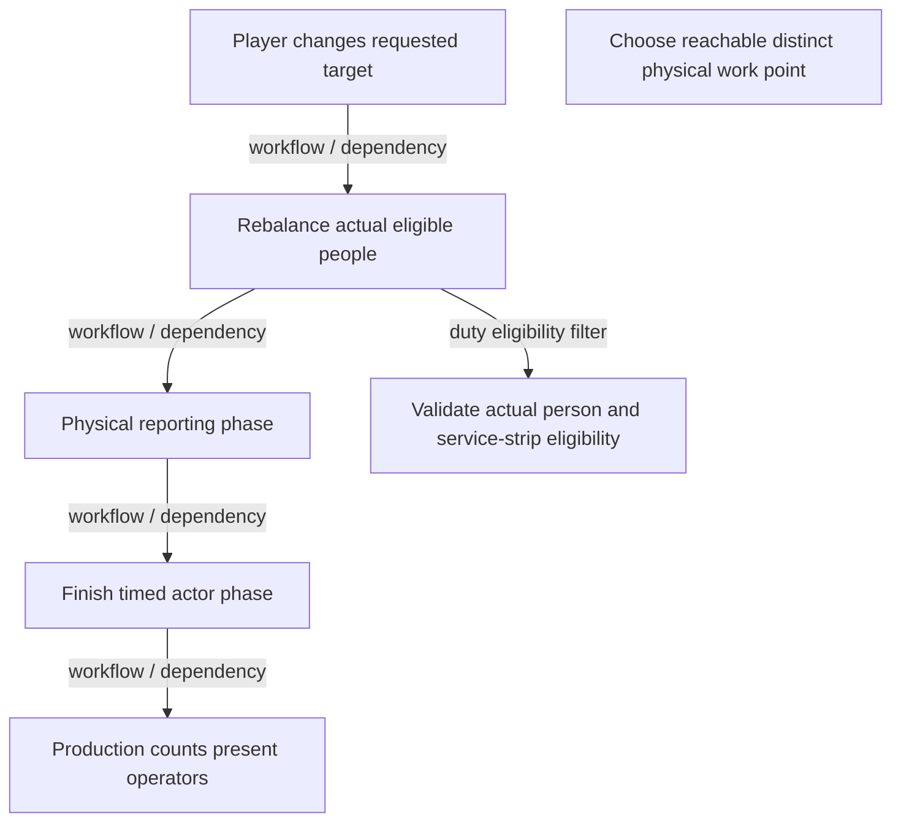

One person cannot fill two jobs at once. Newly completed facilities apply their starting request through Construction once; selecting or changing a recipe must not reset deliberate edits. Work points avoid Table/building geometry, preserve person identity and register explicit per-person handling access. Legacy unregistered handling keeps exact colocation. Reservations are not visual offsets or a universal crowd solver. In the empty-field game uncommitted people default to fallback Hauling after workplace/crew quotas. Shared starter-candidate rules preserve once-only automatic workplace demand; safe Reporting completion retries. Actual outbound tasks retain exclusive worker ownership until completion.

**Source anchors:**

- [set_target](https://github.com/TheInfinityIQ/Trencho_V4/blob/5fdd5561f3337896b85eef4ebb942bfdeb75101e/game/staffing/rear_simulation.gd#L121) — Player changes requested target
- [_rebalance](https://github.com/TheInfinityIQ/Trencho_V4/blob/5fdd5561f3337896b85eef4ebb942bfdeb75101e/game/staffing/rear_simulation.gd#L477) — Rebalance actual eligible people
- [_report](https://github.com/TheInfinityIQ/Trencho_V4/blob/5fdd5561f3337896b85eef4ebb942bfdeb75101e/game/staffing/rear_simulation.gd#L608) — Physical reporting phase
- [_finish_phase](https://github.com/TheInfinityIQ/Trencho_V4/blob/5fdd5561f3337896b85eef4ebb942bfdeb75101e/game/staffing/rear_simulation.gd#L771) — Finish timed actor phase
- [operators](https://github.com/TheInfinityIQ/Trencho_V4/blob/5fdd5561f3337896b85eef4ebb942bfdeb75101e/game/production/fixed_production.gd#L86) — Production counts present operators
- [_eligible](https://github.com/TheInfinityIQ/Trencho_V4/blob/5fdd5561f3337896b85eef4ebb942bfdeb75101e/game/staffing/rear_simulation.gd#L562) — Validate actual person and service-strip eligibility
- [point](https://github.com/TheInfinityIQ/Trencho_V4/blob/5fdd5561f3337896b85eef4ebb942bfdeb75101e/game/staffing/rear_work_positions.gd#L12) — Choose reachable distinct physical work point

<a id="hauling"></a>
## Storage, hauling and space promises

**Owner:** RearSimulation jobs / actors / stores + ledger claims. Haul requests reserve real source portions and destination capacity. Actor phases represent walking, pickup, carrying and deposit; output space and relocation promises belong to the rear. The default common pool selects its next feasible category in an explicitly confirmed top-first order through existing service owners.

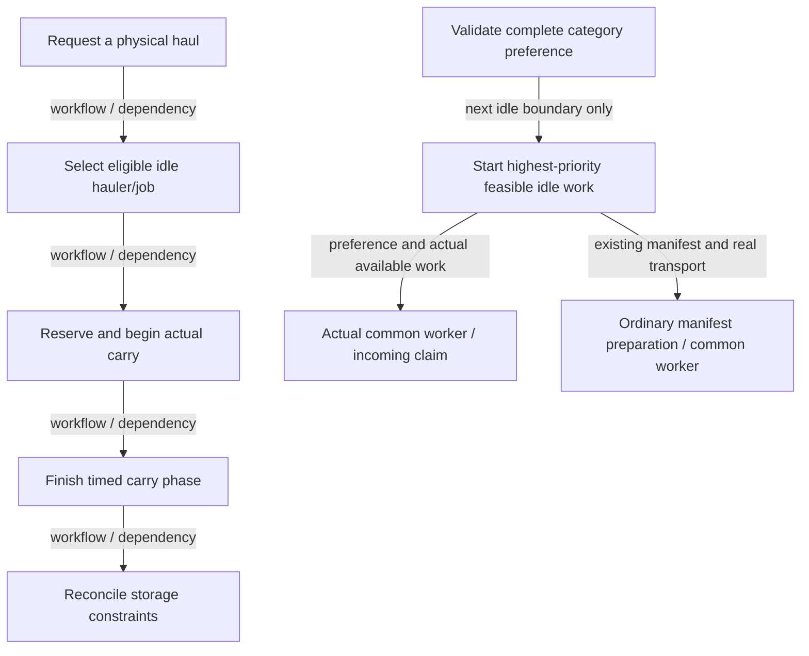

This diagram is the local rear haul path. Strategic manifests, forward trucks and frontline issue have other owners. Construction utility trucks can replace a local long carry leg without creating resources. HaulingPolicy owns preference only. Incoming unloading retains four shared/dedicated slots per berth; ordinary Dispatch retains manifest/route/custody/finite task and real transport/driver. Active safe work is not cancelled by reorder.

**Source anchors:**

- [request_haul](https://github.com/TheInfinityIQ/Trencho_V4/blob/5fdd5561f3337896b85eef4ebb942bfdeb75101e/game/staffing/rear_simulation.gd#L148) — Request a physical haul
- [_start_job](https://github.com/TheInfinityIQ/Trencho_V4/blob/5fdd5561f3337896b85eef4ebb942bfdeb75101e/game/staffing/rear_simulation.gd#L894) — Select eligible idle hauler/job
- [begin_carry](https://github.com/TheInfinityIQ/Trencho_V4/blob/5fdd5561f3337896b85eef4ebb942bfdeb75101e/game/identity/identity_ledger.gd#L1024) — Reserve and begin actual carry
- [_finish_phase](https://github.com/TheInfinityIQ/Trencho_V4/blob/5fdd5561f3337896b85eef4ebb942bfdeb75101e/game/staffing/rear_simulation.gd#L771) — Finish timed carry phase
- [_reconcile_store](https://github.com/TheInfinityIQ/Trencho_V4/blob/5fdd5561f3337896b85eef4ebb942bfdeb75101e/game/staffing/rear_simulation.gd#L288) — Reconcile storage constraints
- [set_order](https://github.com/TheInfinityIQ/Trencho_V4/blob/5fdd5561f3337896b85eef4ebb942bfdeb75101e/game/staffing/hauling_policy.gd#L11) — Validate complete category preference
- [start](https://github.com/TheInfinityIQ/Trencho_V4/blob/5fdd5561f3337896b85eef4ebb942bfdeb75101e/game/staffing/hauling_policy.gd#L33) — Start highest-priority feasible idle work
- [start_shared_unload](https://github.com/TheInfinityIQ/Trencho_V4/blob/5fdd5561f3337896b85eef4ebb942bfdeb75101e/game/procurement/receiving_simulation.gd#L655) — Actual common worker / incoming claim
- [start_shared_preparation](https://github.com/TheInfinityIQ/Trencho_V4/blob/5fdd5561f3337896b85eef4ebb942bfdeb75101e/game/dispatch/dispatch_service.gd#L500) — Ordinary manifest preparation / common worker

<a id="procurement"></a>
## Purchasing, requisition and inbound deliveries

**Owner:** ReceivingSimulation. Receiving owns actual paid resource/worker purchases and physical supplier movement, berth/loading capacity and custody. Development Confirm atomically registers and immediately dispatches one convoy; the final actual handover/departure event reopens ordering while empty egress continues.

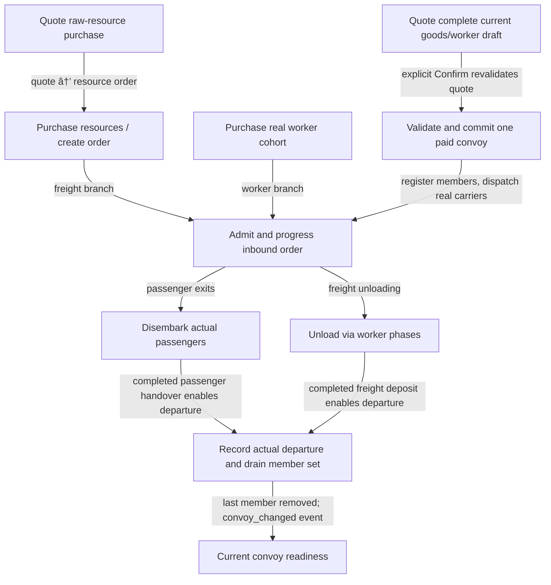

Resources and people are parallel order types, not mandatory sequential steps. Empty-field Supply Table has its own configured receiving arrangement; a Receiving Bay is not required for the first worker purchase. Credit from controlled resource objectives goes to this account. Empty-field workers use reserved actual pickup/drop/arrival points and retain original handling durations/cargo claims. Actual arriving foot positions survive admission instead of collapsing onto the Table centre. Incoming handling accepts idle common haulers through the existing owner; common entries retire after deposit and do not bypass the next category selection. Combined actual jobs retain four slots per berth and25kg carries.

**Source anchors:**

- [quote_resources](https://github.com/TheInfinityIQ/Trencho_V4/blob/5fdd5561f3337896b85eef4ebb942bfdeb75101e/game/procurement/receiving_simulation.gd#L134) — Quote raw-resource purchase
- [buy_resources](https://github.com/TheInfinityIQ/Trencho_V4/blob/5fdd5561f3337896b85eef4ebb942bfdeb75101e/game/procurement/receiving_simulation.gd#L142) — Purchase resources / create order
- [buy_people](https://github.com/TheInfinityIQ/Trencho_V4/blob/5fdd5561f3337896b85eef4ebb942bfdeb75101e/game/procurement/receiving_simulation.gd#L267) — Purchase real worker cohort
- [_pump](https://github.com/TheInfinityIQ/Trencho_V4/blob/5fdd5561f3337896b85eef4ebb942bfdeb75101e/game/procurement/receiving_simulation.gd#L541) — Admit and progress inbound order
- [_disembark](https://github.com/TheInfinityIQ/Trencho_V4/blob/5fdd5561f3337896b85eef4ebb942bfdeb75101e/game/procurement/receiving_simulation.gd#L631) — Disembark actual passengers
- [_finish_worker_phase](https://github.com/TheInfinityIQ/Trencho_V4/blob/5fdd5561f3337896b85eef4ebb942bfdeb75101e/game/procurement/receiving_simulation.gd#L702) — Unload via worker phases
- [quote_delivery](https://github.com/TheInfinityIQ/Trencho_V4/blob/5fdd5561f3337896b85eef4ebb942bfdeb75101e/game/procurement/receiving_simulation.gd#L78) — Quote complete current goods/worker draft
- [buy_delivery](https://github.com/TheInfinityIQ/Trencho_V4/blob/5fdd5561f3337896b85eef4ebb942bfdeb75101e/game/procurement/receiving_simulation.gd#L97) — Validate and commit one paid convoy
- [_set_state](https://github.com/TheInfinityIQ/Trencho_V4/blob/5fdd5561f3337896b85eef4ebb942bfdeb75101e/game/procurement/receiving_simulation.gd#L827) — Record actual departure and drain member set
- [convoy_ready](https://github.com/TheInfinityIQ/Trencho_V4/blob/5fdd5561f3337896b85eef4ebb942bfdeb75101e/game/procurement/receiving_simulation.gd#L75) — Current convoy readiness

<a id="construction"></a>
## Rear building placement, completion and dismantling

**Owner:** ConstructionService. ConstructionService owns actual sites, access, partial local-material-supported earned work and incremental consumption. Persistent scene adapters reveal the building; finite scissors/tape/pylons celebrate actual completion without owning capability.

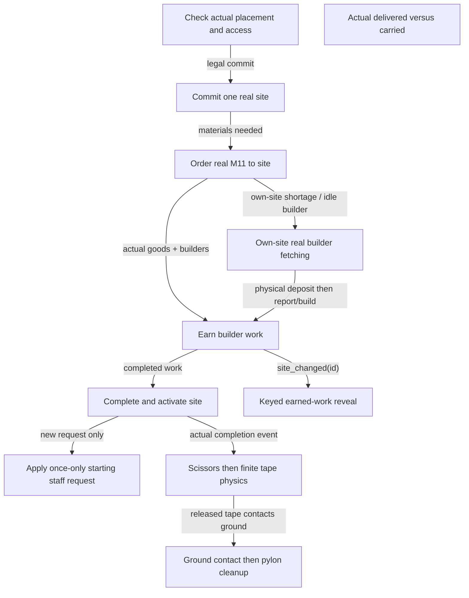

Cancellation and request_dismantle are separate branches with consumed-material/clearance rules. An incomplete/paused/cancelled site does not become a free functional building. Same manager occupation validation is supplied by the 3D view. Empty-field placement validation starts at the shared Table standing-access point, preserving the solid Table and rejecting blocked routes without starting inside its collider. Live cancellation keeps exact site/session/state validation and refreshes actual material loss while builders continue; it is not invalidated by consumption alone. Normal live empty-field startup is1x. Shared licensed prototype exteriors cover buildable kinds; Vehicle Park remains open ground. Presentation listens to keyed owner signals, preserves meshes/colliders across work updates and tears down with site/session lifetime. Follow-up: assigned starved builders may fetch only their own site M11 on foot through existing real claims/carries; one duty/task, no simultaneous construction. Selected menu distinguishes actual haul receipt/carry. Completed exterior retains full-height prepared material, work state does not rebuild unchanged reservations, zero-alpha effect preparation targets measured first-use OpenGL hitch. Smoke1.5s then snip2s, tape release3.5s; actual capability remains immediate.

**Source anchors:**

- [preview](https://github.com/TheInfinityIQ/Trencho_V4/blob/5fdd5561f3337896b85eef4ebb942bfdeb75101e/game/construction/construction_service.gd#L66) — Check actual placement and access
- [place](https://github.com/TheInfinityIQ/Trencho_V4/blob/5fdd5561f3337896b85eef4ebb942bfdeb75101e/game/construction/construction_service.gd#L144) — Commit one real site
- [order_materials](https://github.com/TheInfinityIQ/Trencho_V4/blob/5fdd5561f3337896b85eef4ebb942bfdeb75101e/game/construction/construction_service.gd#L264) — Order real M11 to site
- [advance_work](https://github.com/TheInfinityIQ/Trencho_V4/blob/5fdd5561f3337896b85eef4ebb942bfdeb75101e/game/construction/construction_service.gd#L515) — Earn builder work
- [_activate](https://github.com/TheInfinityIQ/Trencho_V4/blob/5fdd5561f3337896b85eef4ebb942bfdeb75101e/game/construction/construction_service.gd#L626) — Complete and activate site
- [_apply_starter_staffing](https://github.com/TheInfinityIQ/Trencho_V4/blob/5fdd5561f3337896b85eef4ebb942bfdeb75101e/game/construction/construction_service.gd#L676) — Apply once-only starting staff request
- [_site_changed](https://github.com/TheInfinityIQ/Trencho_V4/blob/5fdd5561f3337896b85eef4ebb942bfdeb75101e/game/construction/visuals/construction_site_visual.gd#L84) — Keyed earned-work reveal
- [start](https://github.com/TheInfinityIQ/Trencho_V4/blob/5fdd5561f3337896b85eef4ebb942bfdeb75101e/game/construction/visuals/construction_celebration.gd#L163) — Scissors then finite tape physics
- [_ground_contact](https://github.com/TheInfinityIQ/Trencho_V4/blob/5fdd5561f3337896b85eef4ebb942bfdeb75101e/game/construction/visuals/construction_celebration.gd#L220) — Ground contact then pylon cleanup
- [start_builder_supply](https://github.com/TheInfinityIQ/Trencho_V4/blob/5fdd5561f3337896b85eef4ebb942bfdeb75101e/game/construction/construction_service.gd#L445) — Own-site real builder fetching
- [delivery_status](https://github.com/TheInfinityIQ/Trencho_V4/blob/5fdd5561f3337896b85eef4ebb942bfdeb75101e/game/construction/construction_service.gd#L459) — Actual delivered versus carried

<a id="truck"></a>
## Construction Office utility truck

**Owner:** ConstructionTruckService. A temporary finite Office bundle provides a real T01 hull. The service owns exclusive hauler trips and loading/driving/unloading phases, not a teleporting delivery bonus.

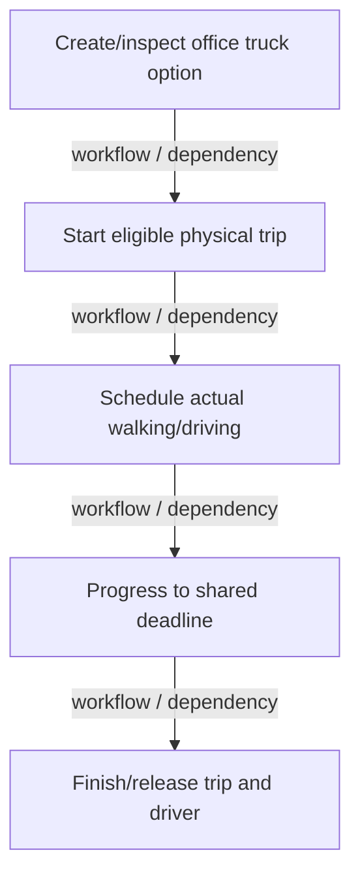

This utility is distinct from Vehicle Works output and ordinary army transport. It retains real cargo and uses the existing clock; rendering is a separate presenter.

**Source anchors:**

- [option](https://github.com/TheInfinityIQ/Trencho_V4/blob/5fdd5561f3337896b85eef4ebb942bfdeb75101e/game/construction/construction_truck_service.gd#L90) — Create/inspect office truck option
- [start](https://github.com/TheInfinityIQ/Trencho_V4/blob/5fdd5561f3337896b85eef4ebb942bfdeb75101e/game/construction/construction_truck_service.gd#L135) — Start eligible physical trip
- [_drive](https://github.com/TheInfinityIQ/Trencho_V4/blob/5fdd5561f3337896b85eef4ebb942bfdeb75101e/game/construction/construction_truck_service.gd#L175) — Schedule actual walking/driving
- [advance_to](https://github.com/TheInfinityIQ/Trencho_V4/blob/5fdd5561f3337896b85eef4ebb942bfdeb75101e/game/construction/construction_truck_service.gd#L195) — Progress to shared deadline
- [_finish](https://github.com/TheInfinityIQ/Trencho_V4/blob/5fdd5561f3337896b85eef4ebb942bfdeb75101e/game/construction/construction_truck_service.gd#L352) — Finish/release trip and driver

<a id="production"></a>
## Shared production and recipe selection

**Owner:** FixedProduction + SelectableProduction. Shared batch lifecycle validates access, operators, physical local inputs and output promise. SelectableProduction adds per-recipe records and confirmed switching of consumed work.

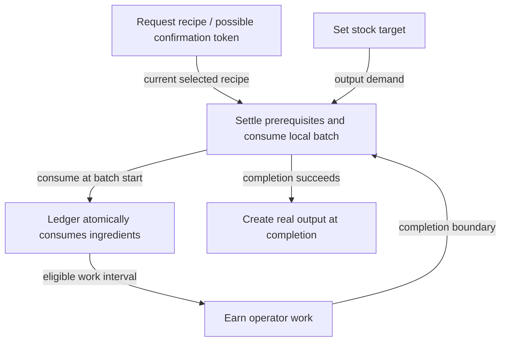

These arrows describe batch lifecycle, not a literal call chain. advance_work is driven by the shared coordinator. Pause retains consumed inputs/work/promise; cancelling a consumed batch loses its unfinished work/inputs.

**Source anchors:**

- [request_recipe](https://github.com/TheInfinityIQ/Trencho_V4/blob/5fdd5561f3337896b85eef4ebb942bfdeb75101e/game/production/selectable_production.gd#L37) — Request recipe / possible confirmation token
- [set_stock_target](https://github.com/TheInfinityIQ/Trencho_V4/blob/5fdd5561f3337896b85eef4ebb942bfdeb75101e/game/production/fixed_production.gd#L150) — Set stock target
- [settle](https://github.com/TheInfinityIQ/Trencho_V4/blob/5fdd5561f3337896b85eef4ebb942bfdeb75101e/game/production/fixed_production.gd#L255) — Settle prerequisites and consume local batch
- [consume_local_batch](https://github.com/TheInfinityIQ/Trencho_V4/blob/5fdd5561f3337896b85eef4ebb942bfdeb75101e/game/identity/identity_ledger.gd#L1471) — Ledger atomically consumes ingredients
- [advance_work](https://github.com/TheInfinityIQ/Trencho_V4/blob/5fdd5561f3337896b85eef4ebb942bfdeb75101e/game/production/fixed_production.gd#L243) — Earn operator work
- [_create_output](https://github.com/TheInfinityIQ/Trencho_V4/blob/5fdd5561f3337896b85eef4ebb942bfdeb75101e/game/production/fixed_production.gd#L339) — Create real output at completion

<a id="workshop"></a>
## Workshop / F04

**Owner:** R01Production or per-site SelectableProduction. Workshop is a configured owner of the shared production lifecycle, not an unrelated crafting engine. Essential R01 manufactures an actual empty E01 rifle; R08 and declared choices share the same facility.

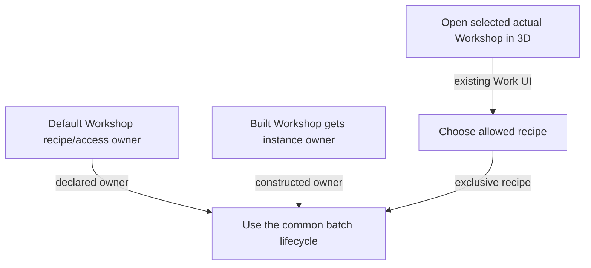

Declared initial-workshop maps explicitly to logical workshop/rear.production. Player-built Workshops use construction.activities[site ID]. The demonstrated 3D interaction used the declared owner; earned full-factory acceptance remains open.

**Source anchors:**

- [_init](https://github.com/TheInfinityIQ/Trencho_V4/blob/5fdd5561f3337896b85eef4ebb942bfdeb75101e/game/production/r01_production.gd#L8) — Default Workshop recipe/access owner
- [_activate](https://github.com/TheInfinityIQ/Trencho_V4/blob/5fdd5561f3337896b85eef4ebb942bfdeb75101e/game/construction/construction_service.gd#L626) — Built Workshop gets instance owner
- [request_recipe](https://github.com/TheInfinityIQ/Trencho_V4/blob/5fdd5561f3337896b85eef4ebb942bfdeb75101e/game/production/selectable_production.gd#L37) — Choose allowed recipe
- [settle](https://github.com/TheInfinityIQ/Trencho_V4/blob/5fdd5561f3337896b85eef4ebb942bfdeb75101e/game/production/fixed_production.gd#L255) — Use the common batch lifecycle
- [_consume_workshop](https://github.com/TheInfinityIQ/Trencho_V4/blob/5fdd5561f3337896b85eef4ebb942bfdeb75101e/game/preview_3d/preview.gd#L414) — Open selected actual Workshop in 3D

<a id="munitions"></a>
## Munitions / F05

**Owner:** R02Production + SelectableProduction. One exclusive munitions facility selects among ammunition, explosives and shell-chain recipes; ingredients and output are physical stock.

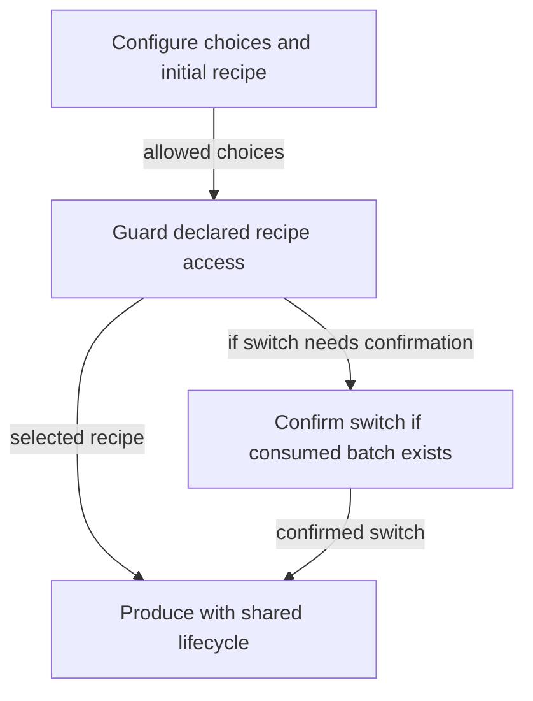

R02, R27, R32 and R33 are choices on the common owner, not four concurrently running batches in one facility. Manufacturing code does not imply that the whole ordinary supply chain has been accepted.

**Source anchors:**

- [_init](https://github.com/TheInfinityIQ/Trencho_V4/blob/5fdd5561f3337896b85eef4ebb942bfdeb75101e/game/production/r02_production.gd#L8) — Configure choices and initial recipe
- [recipe_accessible](https://github.com/TheInfinityIQ/Trencho_V4/blob/5fdd5561f3337896b85eef4ebb942bfdeb75101e/game/production/selectable_production.gd#L19) — Guard declared recipe access
- [confirm_recipe](https://github.com/TheInfinityIQ/Trencho_V4/blob/5fdd5561f3337896b85eef4ebb942bfdeb75101e/game/production/selectable_production.gd#L64) — Confirm switch if consumed batch exists
- [settle](https://github.com/TheInfinityIQ/Trencho_V4/blob/5fdd5561f3337896b85eef4ebb942bfdeb75101e/game/production/fixed_production.gd#L255) — Produce with shared lifecycle

<a id="materials"></a>
## Building Materials / F13

**Owner:** R26Production + FixedProduction. A configured fixed production activity consumes local Metal/Wood and produces physical M11 Building Materials for further construction.

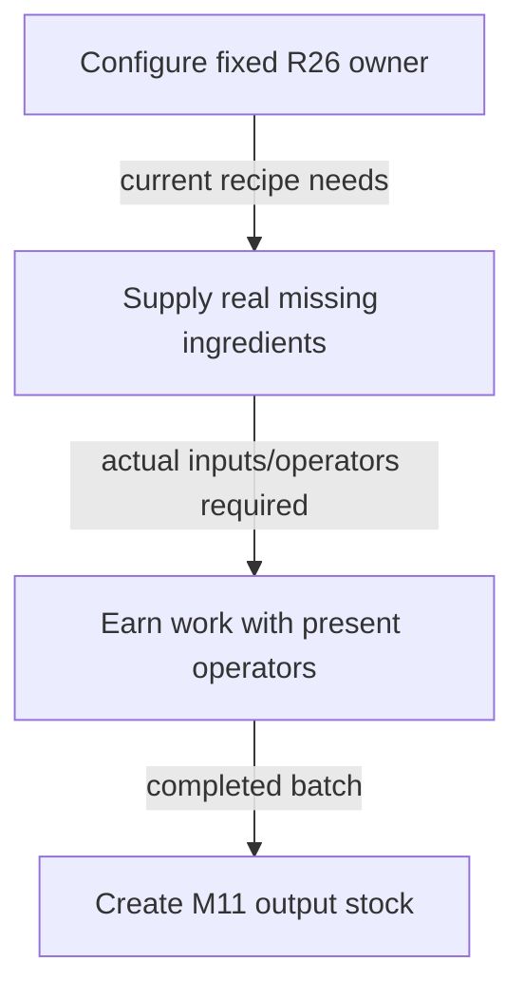

The normal opening 500 M11 is declared starting stock; later R26 output is separately manufactured. Self-sustaining ordinary factory completion remains open.

**Source anchors:**

- [_init](https://github.com/TheInfinityIQ/Trencho_V4/blob/5fdd5561f3337896b85eef4ebb942bfdeb75101e/game/production/r26_production.gd#L9) — Configure fixed R26 owner
- [logistics_demand](https://github.com/TheInfinityIQ/Trencho_V4/blob/5fdd5561f3337896b85eef4ebb942bfdeb75101e/game/production/fixed_production.gd#L117) — Supply real missing ingredients
- [advance_work](https://github.com/TheInfinityIQ/Trencho_V4/blob/5fdd5561f3337896b85eef4ebb942bfdeb75101e/game/production/fixed_production.gd#L243) — Earn work with present operators
- [_create_output](https://github.com/TheInfinityIQ/Trencho_V4/blob/5fdd5561f3337896b85eef4ebb942bfdeb75101e/game/production/fixed_production.gd#L339) — Create M11 output stock

<a id="support"></a>
## Support Workshop / F09

**Owner:** SupportProduction + SelectableProduction. Support recipes reuse the same access, exclusive selection, local-input and physical-output lifecycle.

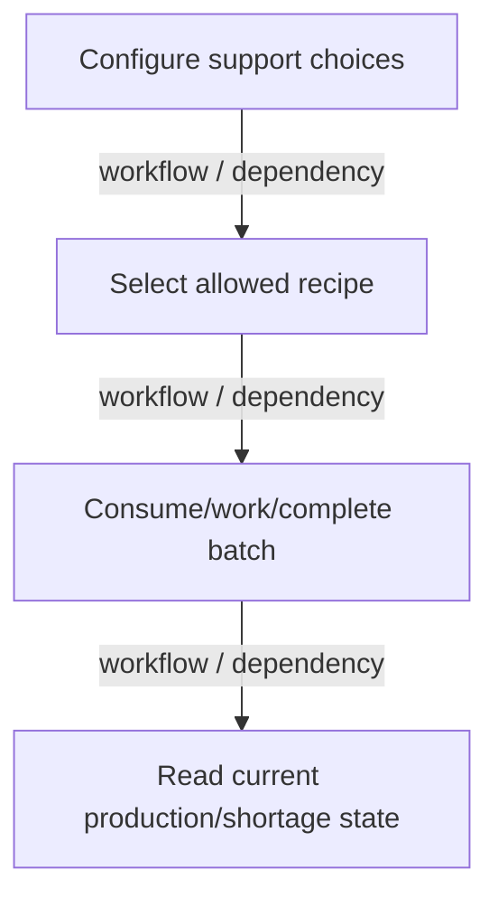

A support recipe or qualification in a catalogue is not proof of an integrated end-to-end support gameplay loop.

**Source anchors:**

- [_init](https://github.com/TheInfinityIQ/Trencho_V4/blob/5fdd5561f3337896b85eef4ebb942bfdeb75101e/game/production/support_production.gd#L5) — Configure support choices
- [request_recipe](https://github.com/TheInfinityIQ/Trencho_V4/blob/5fdd5561f3337896b85eef4ebb942bfdeb75101e/game/production/selectable_production.gd#L37) — Select allowed recipe
- [settle](https://github.com/TheInfinityIQ/Trencho_V4/blob/5fdd5561f3337896b85eef4ebb942bfdeb75101e/game/production/fixed_production.gd#L255) — Consume/work/complete batch
- [snapshot](https://github.com/TheInfinityIQ/Trencho_V4/blob/5fdd5561f3337896b85eef4ebb942bfdeb75101e/game/production/fixed_production.gd#L307) — Read current production/shortage state

<a id="heavy"></a>
## Vehicle Works / heavy manufacture

**Owner:** HeavyProduction + ledger admission + Vehicles. Heavy production extends selectable recipes with actual bay/fleet/parking promises. Completed hulls or heavy objects have canonical IDs; a blocked occupied bay is retained.

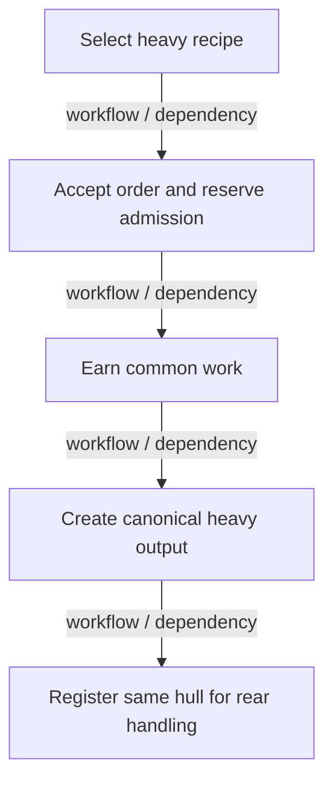

A produced vehicle is not automatically crewed, fuelled, parked, dispatched or combat-ready. Canonical T01–T05 specs are data in vehicle_specs.gd.

**Source anchors:**

- [request_recipe](https://github.com/TheInfinityIQ/Trencho_V4/blob/5fdd5561f3337896b85eef4ebb942bfdeb75101e/game/production/heavy_production.gd#L23) — Select heavy recipe
- [accept_order](https://github.com/TheInfinityIQ/Trencho_V4/blob/5fdd5561f3337896b85eef4ebb942bfdeb75101e/game/production/heavy_production.gd#L96) — Accept order and reserve admission
- [advance_work](https://github.com/TheInfinityIQ/Trencho_V4/blob/5fdd5561f3337896b85eef4ebb942bfdeb75101e/game/production/fixed_production.gd#L243) — Earn common work
- [_create_output](https://github.com/TheInfinityIQ/Trencho_V4/blob/5fdd5561f3337896b85eef4ebb942bfdeb75101e/game/production/heavy_production.gd#L141) — Create canonical heavy output
- [register_output](https://github.com/TheInfinityIQ/Trencho_V4/blob/5fdd5561f3337896b85eef4ebb942bfdeb75101e/game/vehicles/vehicle_activity.gd#L18) — Register same hull for rear handling

<a id="training"></a>
## School, instructors and qualifications

**Owner:** TrainingService. Seats, students and eligible present instructors are real commitments. Elapsed course progress changes qualification on the same Person identity.

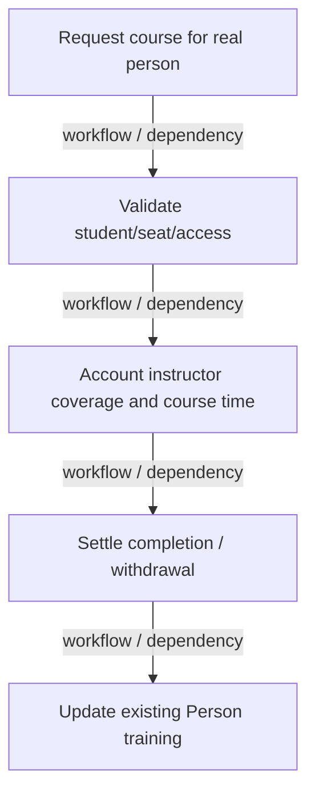

Training is elapsed course time with coverage, unlike operator-work manufacturing. Catalogue courses include basic infantry and specialist qualifications; this does not prove every specialist gameplay loop is complete.

**Source anchors:**

- [request_course](https://github.com/TheInfinityIQ/Trencho_V4/blob/5fdd5561f3337896b85eef4ebb942bfdeb75101e/game/training/training_service.gd#L63) — Request course for real person
- [_eligible](https://github.com/TheInfinityIQ/Trencho_V4/blob/5fdd5561f3337896b85eef4ebb942bfdeb75101e/game/training/training_service.gd#L80) — Validate student/seat/access
- [advance_work](https://github.com/TheInfinityIQ/Trencho_V4/blob/5fdd5561f3337896b85eef4ebb942bfdeb75101e/game/training/training_service.gd#L149) — Account instructor coverage and course time
- [settle](https://github.com/TheInfinityIQ/Trencho_V4/blob/5fdd5561f3337896b85eef4ebb942bfdeb75101e/game/training/training_service.gd#L154) — Settle completion / withdrawal
- [complete_training](https://github.com/TheInfinityIQ/Trencho_V4/blob/5fdd5561f3337896b85eef4ebb942bfdeb75101e/game/identity/identity_ledger.gd#L970) — Update existing Person training

<a id="vehicles"></a>
## Rear vehicles, crew, fuel and parking

**Owner:** VehicleActivity + IdentityLedger. VehicleActivity owns registered hull activity and refuelling jobs. Ledger owns hull facts, crew station custody, fuel and damage; the renderer does not own these facts.

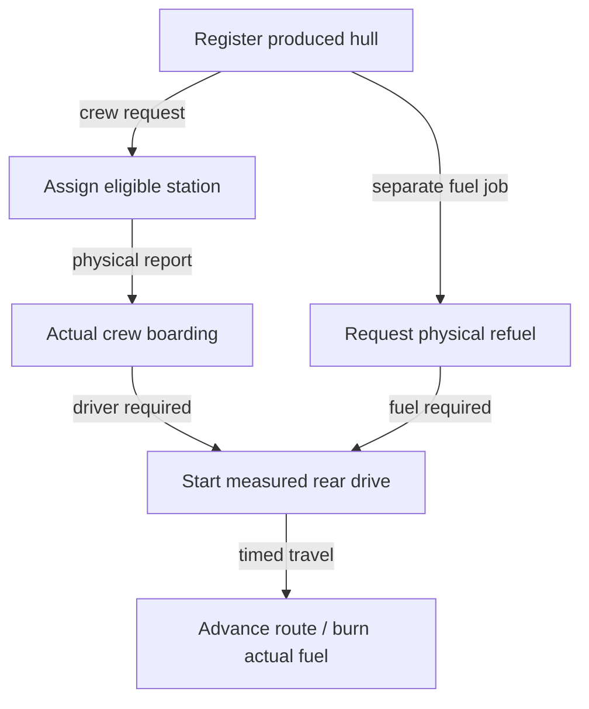

These are separate vehicle operations, not automatic successive commands. Rear and military fleets retain the same hull ID across accepted handoffs. Different services own different movement activities.

**Source anchors:**

- [register_output](https://github.com/TheInfinityIQ/Trencho_V4/blob/5fdd5561f3337896b85eef4ebb942bfdeb75101e/game/vehicles/vehicle_activity.gd#L18) — Register produced hull
- [assign_station](https://github.com/TheInfinityIQ/Trencho_V4/blob/5fdd5561f3337896b85eef4ebb942bfdeb75101e/game/vehicles/vehicle_activity.gd#L65) — Assign eligible station
- [complete_board](https://github.com/TheInfinityIQ/Trencho_V4/blob/5fdd5561f3337896b85eef4ebb942bfdeb75101e/game/vehicles/vehicle_activity.gd#L122) — Actual crew boarding
- [request_refuel](https://github.com/TheInfinityIQ/Trencho_V4/blob/5fdd5561f3337896b85eef4ebb942bfdeb75101e/game/vehicles/vehicle_activity.gd#L144) — Request physical refuel
- [start_drive](https://github.com/TheInfinityIQ/Trencho_V4/blob/5fdd5561f3337896b85eef4ebb942bfdeb75101e/game/vehicles/vehicle_activity.gd#L229) — Start measured rear drive
- [advance_to](https://github.com/TheInfinityIQ/Trencho_V4/blob/5fdd5561f3337896b85eef4ebb942bfdeb75101e/game/vehicles/vehicle_activity.gd#L355) — Advance route / burn actual fuel

<a id="dispatch"></a>
## Rear → HQ manifests and return

**Owner:** DispatchService. Owns accepted manifests, staging/loading, route, HQ unloading, cancellation and return commitments. Ledger keeps actual cargo/person/hull identities and receipts.

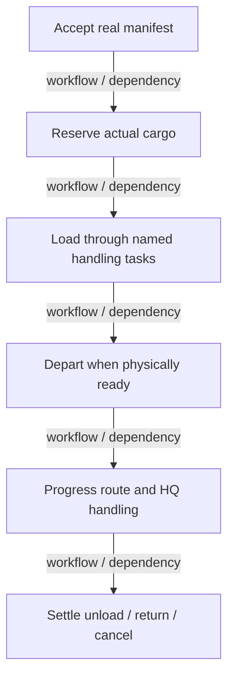

Automatic request fulfilment uses accept_automatic_delivery; retained manual manifests remain distinct. Automatic routine freight does not require a newly added manual Depart action. Ordinary source/staging/loading can use a supplied exclusive common hauler. Real source/staging access precedes pickup; hull port arrival precedes loading. Vehicle/driver/manifest, specialist guns/passengers/HQ and finite task remain existing authorities.

**Source anchors:**

- [accept](https://github.com/TheInfinityIQ/Trencho_V4/blob/5fdd5561f3337896b85eef4ebb942bfdeb75101e/game/dispatch/dispatch_service.gd#L74) — Accept real manifest
- [_reserve_cargo](https://github.com/TheInfinityIQ/Trencho_V4/blob/5fdd5561f3337896b85eef4ebb942bfdeb75101e/game/dispatch/dispatch_service.gd#L169) — Reserve actual cargo
- [_schedule_preparation](https://github.com/TheInfinityIQ/Trencho_V4/blob/5fdd5561f3337896b85eef4ebb942bfdeb75101e/game/dispatch/dispatch_service.gd#L517) — Load through named handling tasks
- [depart](https://github.com/TheInfinityIQ/Trencho_V4/blob/5fdd5561f3337896b85eef4ebb942bfdeb75101e/game/dispatch/dispatch_service.gd#L897) — Depart when physically ready
- [advance_to](https://github.com/TheInfinityIQ/Trencho_V4/blob/5fdd5561f3337896b85eef4ebb942bfdeb75101e/game/dispatch/dispatch_service.gd#L281) — Progress route and HQ handling
- [settle](https://github.com/TheInfinityIQ/Trencho_V4/blob/5fdd5561f3337896b85eef4ebb942bfdeb75101e/game/dispatch/dispatch_service.gd#L417) — Settle unload / return / cancel

<a id="hq"></a>
## HQ receipts, reserve equipment and local issue

**Owner:** HqLogistics. HQ issue is a timed local transfer from physically arrived stock to eligible people/vehicles. Receiving at HQ is separate from frontline delivery or use.

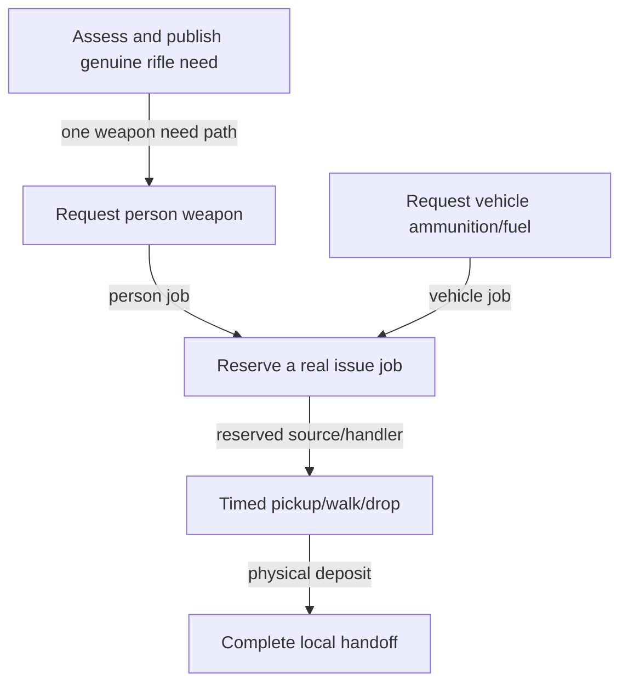

Person weapon, rounds and vehicle issue are parallel job types. rear_supply_needed is connected to RearLogistics; a shortage signal does not manufacture stock.

**Source anchors:**

- [publish_rifle_supply_need](https://github.com/TheInfinityIQ/Trencho_V4/blob/5fdd5561f3337896b85eef4ebb942bfdeb75101e/game/hq/hq_logistics.gd#L309) — Assess and publish genuine rifle need
- [request_person_weapon](https://github.com/TheInfinityIQ/Trencho_V4/blob/5fdd5561f3337896b85eef4ebb942bfdeb75101e/game/hq/hq_logistics.gd#L38) — Request person weapon
- [request_vehicle_ammo](https://github.com/TheInfinityIQ/Trencho_V4/blob/5fdd5561f3337896b85eef4ebb942bfdeb75101e/game/hq/hq_logistics.gd#L53) — Request vehicle ammunition/fuel
- [_reserve_job](https://github.com/TheInfinityIQ/Trencho_V4/blob/5fdd5561f3337896b85eef4ebb942bfdeb75101e/game/hq/hq_logistics.gd#L68) — Reserve a real issue job
- [_finish_step](https://github.com/TheInfinityIQ/Trencho_V4/blob/5fdd5561f3337896b85eef4ebb942bfdeb75101e/game/hq/hq_logistics.gd#L332) — Timed pickup/walk/drop
- [_finish_drop](https://github.com/TheInfinityIQ/Trencho_V4/blob/5fdd5561f3337896b85eef4ebb942bfdeb75101e/game/hq/hq_logistics.gd#L367) — Complete local handoff

<a id="logistics"></a>
## Automatic factory input and army shipping

**Owner:** RearLogistics (event-woken Node). Session commits and genuine HQ/frontline need wake finite passes. It requests missing factory hauls and advances automatic delivery requests through existing owners.

```mermaid
flowchart TD
    n0["Committed session change wakes finite pass"]
    n1["Process one candidate per frame, then idle"]
    n2["Ask activity for actual missing input demand"]
    n3["Create physical rear haul"]
    n4["Progress army delivery request"]
    n0 -->|"enable finite work"| n1
    n1 -->|"factory turn"| n2
    n2 -->|"missing real inputs"| n3
    n1 -->|"delivery turn"| n4
```

_process is enabled only while finite candidates remain; there is no idle logistics polling timer. This does not make the entire game event-only: the shared clock and scheduled army reviews still run.

**Source anchors:**

- [_wake](https://github.com/TheInfinityIQ/Trencho_V4/blob/5fdd5561f3337896b85eef4ebb942bfdeb75101e/game/logistics/rear_logistics.gd#L68) — Committed session change wakes finite pass
- [_process](https://github.com/TheInfinityIQ/Trencho_V4/blob/5fdd5561f3337896b85eef4ebb942bfdeb75101e/game/logistics/rear_logistics.gd#L78) — Process one candidate per frame, then idle
- [_supply_factory](https://github.com/TheInfinityIQ/Trencho_V4/blob/5fdd5561f3337896b85eef4ebb942bfdeb75101e/game/logistics/rear_logistics.gd#L106) — Ask activity for actual missing input demand
- [_ensure_haul](https://github.com/TheInfinityIQ/Trencho_V4/blob/5fdd5561f3337896b85eef4ebb942bfdeb75101e/game/logistics/rear_logistics.gd#L134) — Create physical rear haul
- [_advance_request](https://github.com/TheInfinityIQ/Trencho_V4/blob/5fdd5561f3337896b85eef4ebb942bfdeb75101e/game/logistics/rear_logistics.gd#L269) — Progress army delivery request

<a id="army"></a>
## Military organization, equipment and readiness

**Owner:** MilitaryOrganization. Companies/platoons/squads, demands, crew reports and replacement reports reference real equipped people and attached hulls. Readiness derives from physical facts.

```mermaid
flowchart TD
    n0["Request equipment/personnel need"]
    n1["Form real equipped squad"]
    n2["Report members / settle organization"]
    n3["Assign actual military crew"]
    n4["Assess actual capability"]
    n0 -->|"workflow / dependency"| n1
    n1 -->|"workflow / dependency"| n2
    n2 -->|"workflow / dependency"| n3
    n3 -->|"workflow / dependency"| n4
```

Civilian-to-military duties are ledger assignment/receipt changes, not replacement with a new Infantry object. Autonomous organization is not player RTS soldier-command UI.

**Source anchors:**

- [request_need](https://github.com/TheInfinityIQ/Trencho_V4/blob/5fdd5561f3337896b85eef4ebb942bfdeb75101e/game/military/organization.gd#L88) — Request equipment/personnel need
- [form_squad](https://github.com/TheInfinityIQ/Trencho_V4/blob/5fdd5561f3337896b85eef4ebb942bfdeb75101e/game/military/organization.gd#L126) — Form real equipped squad
- [settle](https://github.com/TheInfinityIQ/Trencho_V4/blob/5fdd5561f3337896b85eef4ebb942bfdeb75101e/game/military/organization.gd#L231) — Report members / settle organization
- [assign_crew](https://github.com/TheInfinityIQ/Trencho_V4/blob/5fdd5561f3337896b85eef4ebb942bfdeb75101e/game/military/organization.gd#L404) — Assign actual military crew
- [capability](https://github.com/TheInfinityIQ/Trencho_V4/blob/5fdd5561f3337896b85eef4ebb942bfdeb75101e/game/military/organization.gd#L1044) — Assess actual capability

<a id="troop"></a>
## Military passenger and supply transport

**Owner:** TroopTransport (owned by MilitaryOrganization). Named trips reserve real people/hull/stations/seats and plan bounded routes. Boarding, travel, interruption and dismount preserve current intent and custody.

```mermaid
flowchart TD
    n0["Queue named transport request"]
    n1["Prepare routes in bounded chunks"]
    n2["Commit current physical trip"]
    n3["Schedule real boarding"]
    n4["Advance physical route"]
    n5["Finish real dismount"]
    n0 -->|"workflow / dependency"| n1
    n1 -->|"workflow / dependency"| n2
    n2 -->|"workflow / dependency"| n3
    n3 -->|"workflow / dependency"| n4
    n4 -->|"workflow / dependency"| n5
```

Reposition and supply-trip methods are additional guarded paths. This owner is different from rear Dispatch and HQ-to-forward freight.

**Source anchors:**

- [request_trip_deferred](https://github.com/TheInfinityIQ/Trencho_V4/blob/5fdd5561f3337896b85eef4ebb942bfdeb75101e/game/military/troop_transport.gd#L29) — Queue named transport request
- [pump_planning](https://github.com/TheInfinityIQ/Trencho_V4/blob/5fdd5561f3337896b85eef4ebb942bfdeb75101e/game/military/troop_transport.gd#L416) — Prepare routes in bounded chunks
- [_commit_planning](https://github.com/TheInfinityIQ/Trencho_V4/blob/5fdd5561f3337896b85eef4ebb942bfdeb75101e/game/military/troop_transport.gd#L675) — Commit current physical trip
- [_schedule_board](https://github.com/TheInfinityIQ/Trencho_V4/blob/5fdd5561f3337896b85eef4ebb942bfdeb75101e/game/military/troop_transport.gd#L1034) — Schedule real boarding
- [_advance_route](https://github.com/TheInfinityIQ/Trencho_V4/blob/5fdd5561f3337896b85eef4ebb942bfdeb75101e/game/military/troop_transport.gd#L1166) — Advance physical route
- [_finish_dismount](https://github.com/TheInfinityIQ/Trencho_V4/blob/5fdd5561f3337896b85eef4ebb942bfdeb75101e/game/military/troop_transport.gd#L1118) — Finish real dismount

<a id="orders"></a>
## Sight reports, command links and intent

**Owner:** OrderService. Observations produce side/echelon-specific contacts and delayed reports/orders. Delivered acknowledged intent is consumed by execution; it is not omniscient hidden-target selection.

```mermaid
flowchart TD
    n0["Watch a real squad"]
    n1["Sample actual local observation"]
    n2["Issue hierarchical intent"]
    n3["Advance delayed command links"]
    n4["Settle acknowledgment / coordination"]
    n0 -->|"sample own members"| n1
    n1 -->|"informed command path"| n2
    n2 -->|"queued link delivery"| n3
    n3 -->|"delivered intent"| n4
```

The ACTIONS catalogue is broader than fully demonstrated autonomous execution. Do not infer every action string has a complete playable path.

**Source anchors:**

- [watch](https://github.com/TheInfinityIQ/Trencho_V4/blob/5fdd5561f3337896b85eef4ebb942bfdeb75101e/game/orders/order_service.gd#L30) — Watch a real squad
- [_sample_squad](https://github.com/TheInfinityIQ/Trencho_V4/blob/5fdd5561f3337896b85eef4ebb942bfdeb75101e/game/orders/order_service.gd#L339) — Sample actual local observation
- [issue_order](https://github.com/TheInfinityIQ/Trencho_V4/blob/5fdd5561f3337896b85eef4ebb942bfdeb75101e/game/orders/order_service.gd#L73) — Issue hierarchical intent
- [advance_to](https://github.com/TheInfinityIQ/Trencho_V4/blob/5fdd5561f3337896b85eef4ebb942bfdeb75101e/game/orders/order_service.gd#L278) — Advance delayed command links
- [settle](https://github.com/TheInfinityIQ/Trencho_V4/blob/5fdd5561f3337896b85eef4ebb942bfdeb75101e/game/orders/order_service.gd#L281) — Settle acknowledgment / coordination

<a id="execution"></a>
## Squad and vehicle action execution

**Owner:** SquadExecution + VehicleExecution. Delivered intent drives foot movement, cover, combat and resupply decisions. Pending route/decision work is separated from authoritative commits.

```mermaid
flowchart TD
    n0["Settle due squad decisions"]
    n1["Pump current decision / route"]
    n2["Execute current acknowledged squad intent"]
    n3["Advance existing motions"]
    n4["Military vehicle decision owner"]
    n0 -->|"queue due decisions"| n1
    n1 -->|"validated current intent"| n2
    n2 -->|"foot motion branch"| n3
    n0 -->|"vehicle branch"| n4
```

Decision scheduling still includes recurring simulation-time reviews. This is not a per-person _process script and is not proof of stable60FPS.

**Source anchors:**

- [settle](https://github.com/TheInfinityIQ/Trencho_V4/blob/5fdd5561f3337896b85eef4ebb942bfdeb75101e/game/battlefield/squad_execution.gd#L157) — Settle due squad decisions
- [pump_planning](https://github.com/TheInfinityIQ/Trencho_V4/blob/5fdd5561f3337896b85eef4ebb942bfdeb75101e/game/battlefield/squad_execution.gd#L46) — Pump current decision / route
- [_execute](https://github.com/TheInfinityIQ/Trencho_V4/blob/5fdd5561f3337896b85eef4ebb942bfdeb75101e/game/battlefield/squad_execution.gd#L199) — Execute current acknowledged squad intent
- [advance_to](https://github.com/TheInfinityIQ/Trencho_V4/blob/5fdd5561f3337896b85eef4ebb942bfdeb75101e/game/battlefield/squad_execution.gd#L118) — Advance existing motions
- [settle](https://github.com/TheInfinityIQ/Trencho_V4/blob/5fdd5561f3337896b85eef4ebb942bfdeb75101e/game/battlefield/vehicle_execution.gd#L16) — Military vehicle decision owner

<a id="policy"></a>
## Authored operations, resupply and resource decisions

**Owner:** OpeningPolicy + OpeningResupply + ResourceOperations + VehicleDeployment. The normal Farmland opening installs scenario-specific policy over reusable organization, orders, execution and transport. Resource proposals and replenishment retain genuine capability/need constraints.

```mermaid
flowchart TD
    n0["Install policy and subordinate owners"]
    n1["Review authored operations"]
    n2["Generate knowledge-based resource proposals"]
    n3["Manage local resupply requests"]
    n4["Track permitted APC deployment"]
    n0 -->|"installed policy"| n1
    n1 -->|"resource proposals"| n2
    n1 -->|"genuine local needs"| n3
    n1 -->|"permitted hull missions"| n4
```

Not a generic campaign AI or procedural-war director. ResourceOperations has a ten-second review interval; some army decision work is scheduled sampling. Availability of these owners does not close ordinary repeated supply acceptance.

**Source anchors:**

- [_init](https://github.com/TheInfinityIQ/Trencho_V4/blob/5fdd5561f3337896b85eef4ebb942bfdeb75101e/game/battlefield/opening_policy.gd#L29) — Install policy and subordinate owners
- [tick](https://github.com/TheInfinityIQ/Trencho_V4/blob/5fdd5561f3337896b85eef4ebb942bfdeb75101e/game/battlefield/opening_policy.gd#L68) — Review authored operations
- [proposal](https://github.com/TheInfinityIQ/Trencho_V4/blob/5fdd5561f3337896b85eef4ebb942bfdeb75101e/game/battlefield/resource_operations.gd#L30) — Generate knowledge-based resource proposals
- [tick](https://github.com/TheInfinityIQ/Trencho_V4/blob/5fdd5561f3337896b85eef4ebb942bfdeb75101e/game/battlefield/opening_resupply.gd#L289) — Manage local resupply requests
- [tick](https://github.com/TheInfinityIQ/Trencho_V4/blob/5fdd5561f3337896b85eef4ebb942bfdeb75101e/game/battlefield/vehicle_deployment.gd#L319) — Track permitted APC deployment

<a id="collect"></a>
## Rifle squad collection and return journeys

**Owner:** RifleSupplyTravel + SquadExecution. Per-request collection travel chooses feasible walking/transport legs. Execution owns actual foot motions; TroopTransport owns actual vehicle jobs and custody.

```mermaid
flowchart TD
    n0["Request named collect/return journey"]
    n1["Bounded candidate planning"]
    n2["Choose feasible current route"]
    n3["Observe real job / gathering progress"]
    n4["Interrupt obsolete journey"]
    n0 -->|"named current journey"| n1
    n1 -->|"candidate routes"| n2
    n2 -->|"actual chosen job"| n3
    n0 -->|"cancellation branch"| n4
```

Each journey has a cycle/intent identity. It must not revive an obsolete order after resupply. A diagrammed selection path is not a measured optimality or full replenishment result.

**Source anchors:**

- [request_journey](https://github.com/TheInfinityIQ/Trencho_V4/blob/5fdd5561f3337896b85eef4ebb942bfdeb75101e/game/battlefield/rifle_supply_travel.gd#L21) — Request named collect/return journey
- [pump_planning](https://github.com/TheInfinityIQ/Trencho_V4/blob/5fdd5561f3337896b85eef4ebb942bfdeb75101e/game/battlefield/rifle_supply_travel.gd#L83) — Bounded candidate planning
- [_choose](https://github.com/TheInfinityIQ/Trencho_V4/blob/5fdd5561f3337896b85eef4ebb942bfdeb75101e/game/battlefield/rifle_supply_travel.gd#L374) — Choose feasible current route
- [_observe_job](https://github.com/TheInfinityIQ/Trencho_V4/blob/5fdd5561f3337896b85eef4ebb942bfdeb75101e/game/battlefield/rifle_supply_travel.gd#L510) — Observe real job / gathering progress
- [interrupt_journey](https://github.com/TheInfinityIQ/Trencho_V4/blob/5fdd5561f3337896b85eef4ebb942bfdeb75101e/game/battlefield/rifle_supply_travel.gd#L218) — Interrupt obsolete journey

<a id="forward"></a>
## Frontline person supply issue

**Owner:** ForwardSupply. After stock physically reaches a declared stop, a named eligible handler picks up, walks and deposits rounds into the actual recipient custody.

```mermaid
flowchart TD
    n0["Register actual forward stop"]
    n1["Request local issue to actual person"]
    n2["Finish physical pickup"]
    n3["Advance timed local handling"]
    n4["Complete recipient handoff"]
    n0 -->|"workflow / dependency"| n1
    n1 -->|"workflow / dependency"| n2
    n2 -->|"workflow / dependency"| n3
    n3 -->|"workflow / dependency"| n4
```

ForwardSupply composes freight and rack-issue subowners. HQ arrival alone does not replenish a person on the battlefield.

**Source anchors:**

- [register_delivery_stop](https://github.com/TheInfinityIQ/Trencho_V4/blob/5fdd5561f3337896b85eef4ebb942bfdeb75101e/game/forward_supply/forward_supply.gd#L28) — Register actual forward stop
- [start_issue](https://github.com/TheInfinityIQ/Trencho_V4/blob/5fdd5561f3337896b85eef4ebb942bfdeb75101e/game/forward_supply/forward_supply.gd#L79) — Request local issue to actual person
- [_finish_pickup](https://github.com/TheInfinityIQ/Trencho_V4/blob/5fdd5561f3337896b85eef4ebb942bfdeb75101e/game/forward_supply/forward_supply.gd#L219) — Finish physical pickup
- [advance_to](https://github.com/TheInfinityIQ/Trencho_V4/blob/5fdd5561f3337896b85eef4ebb942bfdeb75101e/game/forward_supply/forward_supply.gd#L176) — Advance timed local handling
- [_finish_drop](https://github.com/TheInfinityIQ/Trencho_V4/blob/5fdd5561f3337896b85eef4ebb942bfdeb75101e/game/forward_supply/forward_supply.gd#L244) — Complete recipient handoff

<a id="freight"></a>
## HQ → forward stop freight and return

**Owner:** ForwardTransport. Actual military T01, stock portions, handlers, fuel and both route directions are committed to a job. Unloaded forward stock and return are separate phases.

```mermaid
flowchart TD
    n0["Queue delivery preparation"]
    n1["Bounded route preparation"]
    n2["Create guarded physical delivery"]
    n3["Load actual portions"]
    n4["Advance route / fuel"]
    n5["Unload actual stock at stop"]
    n0 -->|"workflow / dependency"| n1
    n1 -->|"workflow / dependency"| n2
    n2 -->|"workflow / dependency"| n3
    n3 -->|"workflow / dependency"| n4
    n4 -->|"workflow / dependency"| n5
```

This is a separate movement owner from rear Dispatch. Supply policy observes its jobs and may request later genuine replenishment; no stock is credited merely because a timer was scheduled.

**Source anchors:**

- [request_deferred](https://github.com/TheInfinityIQ/Trencho_V4/blob/5fdd5561f3337896b85eef4ebb942bfdeb75101e/game/forward_supply/forward_transport.gd#L20) — Queue delivery preparation
- [pump_planning](https://github.com/TheInfinityIQ/Trencho_V4/blob/5fdd5561f3337896b85eef4ebb942bfdeb75101e/game/forward_supply/forward_transport.gd#L119) — Bounded route preparation
- [_request_delivery](https://github.com/TheInfinityIQ/Trencho_V4/blob/5fdd5561f3337896b85eef4ebb942bfdeb75101e/game/forward_supply/forward_transport.gd#L242) — Create guarded physical delivery
- [_finish_load](https://github.com/TheInfinityIQ/Trencho_V4/blob/5fdd5561f3337896b85eef4ebb942bfdeb75101e/game/forward_supply/forward_transport.gd#L464) — Load actual portions
- [_advance_route](https://github.com/TheInfinityIQ/Trencho_V4/blob/5fdd5561f3337896b85eef4ebb942bfdeb75101e/game/forward_supply/forward_transport.gd#L636) — Advance route / fuel
- [_finish_unload](https://github.com/TheInfinityIQ/Trencho_V4/blob/5fdd5561f3337896b85eef4ebb942bfdeb75101e/game/forward_supply/forward_transport.gd#L533) — Unload actual stock at stop

<a id="rack"></a>
## Forward vehicle ammunition rack issue

**Owner:** VehicleRackIssue. A named local handler moves actual arrived E26 rounds into a permitted vehicle rack, with payload, capacity and exclusivity checks.

```mermaid
flowchart TD
    n0["Request exact arrived rounds / hull / handler"]
    n1["Validate hull and current station readiness"]
    n2["Advance physical handling"]
    n3["Complete due issue phases"]
    n0 -->|"workflow / dependency"| n1
    n1 -->|"workflow / dependency"| n2
    n2 -->|"workflow / dependency"| n3
```

The current forward-rack path is specifically guarded E26 handling, not a universal arbitrary-vehicle ammo refill framework.

**Source anchors:**

- [request](https://github.com/TheInfinityIQ/Trencho_V4/blob/5fdd5561f3337896b85eef4ebb942bfdeb75101e/game/forward_supply/vehicle_rack_issue.gd#L16) — Request exact arrived rounds / hull / handler
- [_hull_error](https://github.com/TheInfinityIQ/Trencho_V4/blob/5fdd5561f3337896b85eef4ebb942bfdeb75101e/game/forward_supply/vehicle_rack_issue.gd#L155) — Validate hull and current station readiness
- [advance_to](https://github.com/TheInfinityIQ/Trencho_V4/blob/5fdd5561f3337896b85eef4ebb942bfdeb75101e/game/forward_supply/vehicle_rack_issue.gd#L94) — Advance physical handling
- [settle](https://github.com/TheInfinityIQ/Trencho_V4/blob/5fdd5561f3337896b85eef4ebb942bfdeb75101e/game/forward_supply/vehicle_rack_issue.gd#L106) — Complete due issue phases

<a id="combat"></a>
## Infantry fire, wounds, morale and care

**Owner:** CombatService + ledger physical mutations. Combat owns fire eligibility, cadence, reload commitments, stress, bleeding/care and squad cohesion. Terrain owns sight/cover and ledger owns actual rounds, injuries and deaths.

```mermaid
flowchart TD
    n0["Inspect actual shooter/weapon/target"]
    n1["Fire and consume loaded ammunition"]
    n2["Apply injury to actual person"]
    n3["Start eligible medic care"]
    n4["Resolve timed combat/care/stress"]
    n5["Read actual squad cohesion"]
    n0 -->|"eligible fire"| n1
    n1 -->|"hit / actual casualty"| n2
    n2 -->|"eligible care branch"| n3
    n1 -->|"cooldown / reload / stress"| n4
    n3 -->|"timed care"| n4
    n2 -->|"cohesion consequence"| n5
```

Fire, reload, care and cohesion are different branches, not one mandatory sequential chain. Medical care exists inside this service plus field aid facilities; no standalone complete medical logistics system is implied.

**Source anchors:**

- [inspect_fire](https://github.com/TheInfinityIQ/Trencho_V4/blob/5fdd5561f3337896b85eef4ebb942bfdeb75101e/game/combat/combat_service.gd#L41) — Inspect actual shooter/weapon/target
- [fire](https://github.com/TheInfinityIQ/Trencho_V4/blob/5fdd5561f3337896b85eef4ebb942bfdeb75101e/game/combat/combat_service.gd#L84) — Fire and consume loaded ammunition
- [injure](https://github.com/TheInfinityIQ/Trencho_V4/blob/5fdd5561f3337896b85eef4ebb942bfdeb75101e/game/combat/combat_service.gd#L201) — Apply injury to actual person
- [start_care](https://github.com/TheInfinityIQ/Trencho_V4/blob/5fdd5561f3337896b85eef4ebb942bfdeb75101e/game/combat/combat_service.gd#L217) — Start eligible medic care
- [settle](https://github.com/TheInfinityIQ/Trencho_V4/blob/5fdd5561f3337896b85eef4ebb942bfdeb75101e/game/combat/combat_service.gd#L279) — Resolve timed combat/care/stress
- [squad_cohesion](https://github.com/TheInfinityIQ/Trencho_V4/blob/5fdd5561f3337896b85eef4ebb942bfdeb75101e/game/combat/combat_service.gd#L326) — Read actual squad cohesion

<a id="mounted"></a>
## Mounted weapons, armour and projectiles

**Owner:** VehicleCombatService. T03 MG, T04 autocannon and T05 main/coax have explicit data and actual crew/ammo requirements. Timed aim/reload/projectile work uses existing ledger/world.

```mermaid
flowchart TD
    n0["Inspect mount and crew eligibility"]
    n1["Aim / select current mount target"]
    n2["Fire actual loaded ammunition"]
    n3["Advance projectile / reload timing"]
    n4["Apply actual hull surface and armour damage"]
    n0 -->|"workflow / dependency"| n1
    n1 -->|"workflow / dependency"| n2
    n2 -->|"workflow / dependency"| n3
    n3 -->|"workflow / dependency"| n4
```

Canonical backend mount data is not derived from visible model barrels. Detailed3D T03 art is deferred; T01/T02 visuals are partial/provisional. Do not infer presentation parity from combat implementation. People, heavy guns and structures use their separate existing damage owners.

**Source anchors:**

- [inspect_fire](https://github.com/TheInfinityIQ/Trencho_V4/blob/5fdd5561f3337896b85eef4ebb942bfdeb75101e/game/vehicle_combat/vehicle_combat_service.gd#L126) — Inspect mount and crew eligibility
- [aim](https://github.com/TheInfinityIQ/Trencho_V4/blob/5fdd5561f3337896b85eef4ebb942bfdeb75101e/game/vehicle_combat/vehicle_combat_service.gd#L103) — Aim / select current mount target
- [fire](https://github.com/TheInfinityIQ/Trencho_V4/blob/5fdd5561f3337896b85eef4ebb942bfdeb75101e/game/vehicle_combat/vehicle_combat_service.gd#L171) — Fire actual loaded ammunition
- [advance_to](https://github.com/TheInfinityIQ/Trencho_V4/blob/5fdd5561f3337896b85eef4ebb942bfdeb75101e/game/vehicle_combat/vehicle_combat_service.gd#L239) — Advance projectile / reload timing
- [apply_vehicle_surface_damage](https://github.com/TheInfinityIQ/Trencho_V4/blob/5fdd5561f3337896b85eef4ebb942bfdeb75101e/game/identity/identity_ledger.gd#L1544) — Apply actual hull surface and armour damage

<a id="recovery"></a>
## Vehicle destruction, repair and towing

**Owner:** RecoveryService. A ledger vehicle-damage signal triggers once-only wreck/occupant consequences. Actual qualified workers/materials and timed coupling/towing own recovery jobs.

```mermaid
flowchart TD
    n0["Vehicle damage signal receiver"]
    n1["Resolve wreck once in ledger"]
    n2["Start material-backed repair"]
    n3["Couple real tractor/target"]
    n4["Start measured tow route"]
    n5["Advance recovery work"]
    n0 -->|"once-only destruction"| n1
    n0 -->|"repair branch"| n2
    n0 -->|"tow branch"| n3
    n3 -->|"coupled route"| n4
    n2 -->|"repair interval"| n5
    n4 -->|"tow interval"| n5
```

Repair and tow are separate branches after damage; neither automatically restores a whole destroyed crew or lost cargo. Not a claim of a fully polished demo recovery UI.

**Source anchors:**

- [_on_damage](https://github.com/TheInfinityIQ/Trencho_V4/blob/5fdd5561f3337896b85eef4ebb942bfdeb75101e/game/vehicle_recovery/recovery_service.gd#L22) — Vehicle damage signal receiver
- [resolve_vehicle_wreck](https://github.com/TheInfinityIQ/Trencho_V4/blob/5fdd5561f3337896b85eef4ebb942bfdeb75101e/game/identity/identity_ledger.gd#L1585) — Resolve wreck once in ledger
- [start_repair](https://github.com/TheInfinityIQ/Trencho_V4/blob/5fdd5561f3337896b85eef4ebb942bfdeb75101e/game/vehicle_recovery/recovery_service.gd#L96) — Start material-backed repair
- [start_coupling](https://github.com/TheInfinityIQ/Trencho_V4/blob/5fdd5561f3337896b85eef4ebb942bfdeb75101e/game/vehicle_recovery/recovery_service.gd#L236) — Couple real tractor/target
- [start_tow_route](https://github.com/TheInfinityIQ/Trencho_V4/blob/5fdd5561f3337896b85eef4ebb942bfdeb75101e/game/vehicle_recovery/recovery_service.gd#L244) — Start measured tow route
- [advance_to](https://github.com/TheInfinityIQ/Trencho_V4/blob/5fdd5561f3337896b85eef4ebb942bfdeb75101e/game/vehicle_recovery/recovery_service.gd#L151) — Advance recovery work

<a id="objectives"></a>
## Objective capture, control and income

**Owner:** ObjectiveService + Receiving account. Registered physical places track control, owner, contest, eligible presence and income. Actual uncontested Resource control credits the existing requisition account.

```mermaid
flowchart TD
    n0["Register physical objective"]
    n1["Derive eligible physical contributors"]
    n2["Advance control/income interval"]
    n3["Credit real requisition account"]
    n4["Read current public objective presentation"]
    n0 -->|"workflow / dependency"| n1
    n1 -->|"workflow / dependency"| n2
    n2 -->|"workflow / dependency"| n3
    n3 -->|"workflow / dependency"| n4
```

Capture/ownership/income code exists. The recent3D evidence observed initial neutral markers; actual3D capture/contest/owner-transition runtime acceptance remains open.

**Source anchors:**

- [register](https://github.com/TheInfinityIQ/Trencho_V4/blob/5fdd5561f3337896b85eef4ebb942bfdeb75101e/game/objectives/objective_service.gd#L19) — Register physical objective
- [_refresh](https://github.com/TheInfinityIQ/Trencho_V4/blob/5fdd5561f3337896b85eef4ebb942bfdeb75101e/game/objectives/objective_service.gd#L120) — Derive eligible physical contributors
- [advance_to](https://github.com/TheInfinityIQ/Trencho_V4/blob/5fdd5561f3337896b85eef4ebb942bfdeb75101e/game/objectives/objective_service.gd#L45) — Advance control/income interval
- [credit_objective_income](https://github.com/TheInfinityIQ/Trencho_V4/blob/5fdd5561f3337896b85eef4ebb942bfdeb75101e/game/procurement/receiving_simulation.gd#L389) — Credit real requisition account
- [markers](https://github.com/TheInfinityIQ/Trencho_V4/blob/5fdd5561f3337896b85eef4ebb942bfdeb75101e/game/battlefield/battlefield_presentation.gd#L4) — Read current public objective presentation

<a id="terrain"></a>
## Terrain, footprint, sight and cover queries

**Owner:** TerrainWorld + TerrainCatalog + RouteWork. Metre-cell/base-region world facts, overlays, obstacles and shields answer terrain support, route footprint, visibility and cover. It is custom domain geometry, not Godot navigation for every entity.

```mermaid
flowchart TD
    n0["Author terrain regions / cells"]
    n1["Check footprint/support"]
    n2["Begin bounded terrain route work"]
    n3["Observe actual eye/muzzle sight"]
    n4["Derive target cover"]
    n0 -->|"physical surface"| n1
    n0 -->|"movement query"| n2
    n0 -->|"sight query"| n3
    n0 -->|"cover query"| n4
```

The normal world is authored Farmland4km×6km. Multiple complete procedural map families and campaign/persistence are not established by terrain catalogue or snapshot methods.

**Source anchors:**

- [paint](https://github.com/TheInfinityIQ/Trencho_V4/blob/5fdd5561f3337896b85eef4ebb942bfdeb75101e/game/terrain/terrain_world.gd#L18) — Author terrain regions / cells
- [footprint](https://github.com/TheInfinityIQ/Trencho_V4/blob/5fdd5561f3337896b85eef4ebb942bfdeb75101e/game/terrain/terrain_world.gd#L161) — Check footprint/support
- [begin_route](https://github.com/TheInfinityIQ/Trencho_V4/blob/5fdd5561f3337896b85eef4ebb942bfdeb75101e/game/terrain/terrain_world.gd#L233) — Begin bounded terrain route work
- [observe](https://github.com/TheInfinityIQ/Trencho_V4/blob/5fdd5561f3337896b85eef4ebb942bfdeb75101e/game/terrain/terrain_world.gd#L618) — Observe actual eye/muzzle sight
- [cover](https://github.com/TheInfinityIQ/Trencho_V4/blob/5fdd5561f3337896b85eef4ebb942bfdeb75101e/game/terrain/terrain_world.gd#L626) — Derive target cover

<a id="routes"></a>
## Route, hull load and continuation planning

**Owner:** RoutePlanner + RoutePlanWork + Terrain RouteWork. Measured gross load, canonical hull dimensions/turning and terrain/bridge constraints produce route parts. Continuations permit preparation across frames; movement owners commit actual travel.

```mermaid
flowchart TD
    n0["Read gross actual hull + cargo mass"]
    n1["Begin route continuation"]
    n2["Route planning work state"]
    n3["Terrain segment continuation"]
    n4["Synchronous route convenience path"]
    n0 -->|"canonical load"| n1
    n1 -->|"creates continuation"| n2
    n2 -->|"terrain segments"| n3
    n4 -->|"sync convenience drives work"| n2
```

Pure planning is distinct from boarding, elapsed travel, fuel debit and job admission. The synchronous API and incremental APIs both exist; do not label all routes asynchronous.

**Source anchors:**

- [gross_kg](https://github.com/TheInfinityIQ/Trencho_V4/blob/5fdd5561f3337896b85eef4ebb942bfdeb75101e/game/routes/route_planner.gd#L15) — Read gross actual hull + cargo mass
- [begin_plan](https://github.com/TheInfinityIQ/Trencho_V4/blob/5fdd5561f3337896b85eef4ebb942bfdeb75101e/game/routes/route_planner.gd#L21) — Begin route continuation
- [route_plan_work.gd](https://github.com/TheInfinityIQ/Trencho_V4/blob/5fdd5561f3337896b85eef4ebb942bfdeb75101e/game/routes/route_plan_work.gd#L1) — Route planning work state
- [route_work.gd](https://github.com/TheInfinityIQ/Trencho_V4/blob/5fdd5561f3337896b85eef4ebb942bfdeb75101e/game/terrain/route_work.gd#L1) — Terrain segment continuation
- [plan](https://github.com/TheInfinityIQ/Trencho_V4/blob/5fdd5561f3337896b85eef4ebb942bfdeb75101e/game/routes/route_planner.gd#L24) — Synchronous route convenience path

<a id="field"></a>
## Field structures, roads and support sites

**Owner:** FieldService + FieldCatalog. Projects own local material delivery, eligible engineer work, damage/rebuild, occupancy and completed service use such as lookout, aid, depot, repair and obstacles.

```mermaid
flowchart TD
    n0["Order physical field project"]
    n1["Deliver real material"]
    n2["Assign actual engineer"]
    n3["Progress site work"]
    n4["Use completed field service"]
    n5["Enter actual completed structure"]
    n0 -->|"workflow / dependency"| n1
    n1 -->|"workflow / dependency"| n2
    n2 -->|"workflow / dependency"| n3
    n3 -->|"workflow / dependency"| n4
    n4 -->|"workflow / dependency"| n5
```

Road/structure capabilities are implemented within this owner/catalogue; they are not independent global building entities or proof of all engineering actions being exposed in the normal3D UI.

**Source anchors:**

- [order](https://github.com/TheInfinityIQ/Trencho_V4/blob/5fdd5561f3337896b85eef4ebb942bfdeb75101e/game/field_structures/field_service.gd#L38) — Order physical field project
- [deliver_material](https://github.com/TheInfinityIQ/Trencho_V4/blob/5fdd5561f3337896b85eef4ebb942bfdeb75101e/game/field_structures/field_service.gd#L113) — Deliver real material
- [assign_engineer](https://github.com/TheInfinityIQ/Trencho_V4/blob/5fdd5561f3337896b85eef4ebb942bfdeb75101e/game/field_structures/field_service.gd#L68) — Assign actual engineer
- [advance_to](https://github.com/TheInfinityIQ/Trencho_V4/blob/5fdd5561f3337896b85eef4ebb942bfdeb75101e/game/field_structures/field_service.gd#L363) — Progress site work
- [service_status](https://github.com/TheInfinityIQ/Trencho_V4/blob/5fdd5561f3337896b85eef4ebb942bfdeb75101e/game/field_structures/field_service.gd#L158) — Use completed field service
- [enter](https://github.com/TheInfinityIQ/Trencho_V4/blob/5fdd5561f3337896b85eef4ebb942bfdeb75101e/game/field_structures/field_service.gd#L515) — Enter actual completed structure

<a id="bridge"></a>
## Bridge construction, crossings and repair

**Owner:** BridgeService. Owns authored/constructed crossing geometry, material/engineer work, traffic queues, load admission, damage and repairs; publishes surfaces to TerrainWorld.

```mermaid
flowchart TD
    n0["Register an authored crossing"]
    n1["Order a constructed bridge"]
    n2["Progress construction / repair"]
    n3["Publish actual bridge surface"]
    n4["Request guarded physical crossing"]
    n0 -->|"existing crossing"| n3
    n1 -->|"construction branch"| n2
    n2 -->|"completed surface"| n3
    n3 -->|"actual traffic admission"| n4
```

Authored registration and new construction are alternate origins. Crossing damage can retime traffic and cause physical losses; a route preview does not reserve or complete a crossing.

**Source anchors:**

- [register_existing_bridge](https://github.com/TheInfinityIQ/Trencho_V4/blob/5fdd5561f3337896b85eef4ebb942bfdeb75101e/game/bridges/bridge_service.gd#L23) — Register an authored crossing
- [order](https://github.com/TheInfinityIQ/Trencho_V4/blob/5fdd5561f3337896b85eef4ebb942bfdeb75101e/game/bridges/bridge_service.gd#L27) — Order a constructed bridge
- [advance_to](https://github.com/TheInfinityIQ/Trencho_V4/blob/5fdd5561f3337896b85eef4ebb942bfdeb75101e/game/bridges/bridge_service.gd#L229) — Progress construction / repair
- [_set_surface](https://github.com/TheInfinityIQ/Trencho_V4/blob/5fdd5561f3337896b85eef4ebb942bfdeb75101e/game/bridges/bridge_service.gd#L369) — Publish actual bridge surface
- [request_crossing](https://github.com/TheInfinityIQ/Trencho_V4/blob/5fdd5561f3337896b85eef4ebb942bfdeb75101e/game/bridges/bridge_service.gd#L584) — Request guarded physical crossing

<a id="demolition"></a>
## Attached demolition charges

**Owner:** DemolitionService. D04 is attached to existing field structures/bridges. Local material, qualified engineers, authorization, clearance and fuse/remote-control commitments govern detonation.

```mermaid
flowchart TD
    n0["Order charge on actual target"]
    n1["Deliver/reserve real M06"]
    n2["Authorize current consequences"]
    n3["Start fuse or guarded remote trigger"]
    n4["Resolve detonation through target owner"]
    n0 -->|"required material"| n1
    n1 -->|"ready / consequence review"| n2
    n2 -->|"fuse branch; remote is alternate"| n3
    n3 -->|"due fuse"| n4
```

Despite ID demo, this is demolition gameplay service; review scenes are classified separately. Fuse and remote are alternate modes, not automatic player access to all hostile devices.

**Source anchors:**

- [order](https://github.com/TheInfinityIQ/Trencho_V4/blob/5fdd5561f3337896b85eef4ebb942bfdeb75101e/game/bridges/demolition_service.gd#L39) — Order charge on actual target
- [deliver](https://github.com/TheInfinityIQ/Trencho_V4/blob/5fdd5561f3337896b85eef4ebb942bfdeb75101e/game/bridges/demolition_service.gd#L112) — Deliver/reserve real M06
- [authorize](https://github.com/TheInfinityIQ/Trencho_V4/blob/5fdd5561f3337896b85eef4ebb942bfdeb75101e/game/bridges/demolition_service.gd#L193) — Authorize current consequences
- [start_fuse](https://github.com/TheInfinityIQ/Trencho_V4/blob/5fdd5561f3337896b85eef4ebb942bfdeb75101e/game/bridges/demolition_service.gd#L242) — Start fuse or guarded remote trigger
- [_detonate](https://github.com/TheInfinityIQ/Trencho_V4/blob/5fdd5561f3337896b85eef4ebb942bfdeb75101e/game/bridges/demolition_service.gd#L294) — Resolve detonation through target owner

<a id="mines"></a>
## Mines, hazards, knowledge and clearance

**Owner:** MineService + DeviceCatalog. Actual D01–D03 devices, per-side knowledge and timed scan/disarm tasks are distinct from D04 demolition. Ledger movement signals detect physical contacts.

```mermaid
flowchart TD
    n0["Place guarded real device"]
    n1["Observe/record side-specific knowledge"]
    n2["Start engineer scan / disarm"]
    n3["Actual ledger movement signal"]
    n4["Resolve device detonation"]
    n0 -->|"observed placement only"| n1
    n1 -->|"known hazard clearance"| n2
    n0 -->|"armed physical device"| n3
    n3 -->|"contact trigger"| n4
```

Route hazard knowledge is not omniscient access to every planted device. Placement/knowledge/clearance/contact are branches; main UI and3D visual parity are not established for all.

**Source anchors:**

- [order](https://github.com/TheInfinityIQ/Trencho_V4/blob/5fdd5561f3337896b85eef4ebb942bfdeb75101e/game/mines/mine_service.gd#L63) — Place guarded real device
- [observe_placement](https://github.com/TheInfinityIQ/Trencho_V4/blob/5fdd5561f3337896b85eef4ebb942bfdeb75101e/game/mines/mine_service.gd#L108) — Observe/record side-specific knowledge
- [start_scan](https://github.com/TheInfinityIQ/Trencho_V4/blob/5fdd5561f3337896b85eef4ebb942bfdeb75101e/game/mines/mine_service.gd#L143) — Start engineer scan / disarm
- [_on_moved](https://github.com/TheInfinityIQ/Trencho_V4/blob/5fdd5561f3337896b85eef4ebb942bfdeb75101e/game/mines/mine_service.gd#L245) — Actual ledger movement signal
- [_detonate](https://github.com/TheInfinityIQ/Trencho_V4/blob/5fdd5561f3337896b85eef4ebb942bfdeb75101e/game/mines/mine_service.gd#L265) — Resolve device detonation

<a id="ui"></a>
## Main menus, rear controls and guidance

**Owner:** Main + CommandShell + BaseDemo + panels. The mounted base_demo.gd is the real main management UI despite its filename. Button commands use service owners; retained panels refresh through session commits/time with visibility guards. Combined purchases and staffing use explicit confirmation; model refresh preserves current unconfirmed staffing drafts and model/context replacement invalidates them. Existing-site inspection opens Build controls without acquiring a new blueprint; acquisition retains its separate explicit intent.

```mermaid
flowchart TD
    n0["Button navigation requests"]
    n1["Deferred main navigation"]
    n2["Actual BaseDemo panel/selection"]
    n3["Command result reconciles session"]
    n4["Refresh visible current panel"]
    n5["Confirm actual combined purchase draft"]
    n6["Open panel with explicit preview intent"]
    n7["Acquire a new blueprint only by construction intent"]
    haul_grip["Native six-dot grip drag"]
    haul_draft["Reorder local hauling draft"]
    haul_confirm["Confirm authoritative task order"]
    n0 -->|"queued panel command"| n1
    n1 -->|"current panel/selection"| n2
    n2 -->|"visible read model"| n4
    n3 -->|"committed command refresh"| n4
    n5 -->|"actual Receiving command result"| n3
    n2 -->|"existing-site inspection: preview false"| n6
    n6 -->|"only explicit acquisition intent"| n7
    haul_grip -->|"same-list stable category IDs"| haul_draft
    haul_draft -->|"explicit user confirmation"| haul_confirm
```

Hidden UI intentionally skips expensive refresh. This matters to selection:3D Workshop opens management before resolving current facility metadata. Existing scroll-heavy layout remains; generated diagrams do not establish enjoyable UI acceptance. Hauling has a composed inline disclosure with native grip drag/insertion line and keyboard/button fallback. Draft survives live status refresh; Confirm delegates once to Rear; central menu close discards unconfirmed changes.

**Source anchors:**

- [_ready](https://github.com/TheInfinityIQ/Trencho_V4/blob/5fdd5561f3337896b85eef4ebb942bfdeb75101e/game/ui/command_shell.gd#L34) — Button navigation requests
- [_apply_navigation](https://github.com/TheInfinityIQ/Trencho_V4/blob/5fdd5561f3337896b85eef4ebb942bfdeb75101e/game/main/main.gd#L87) — Deferred main navigation
- [_select](https://github.com/TheInfinityIQ/Trencho_V4/blob/5fdd5561f3337896b85eef4ebb942bfdeb75101e/game/rear_base/base_demo.gd#L1725) — Actual BaseDemo panel/selection
- [_result](https://github.com/TheInfinityIQ/Trencho_V4/blob/5fdd5561f3337896b85eef4ebb942bfdeb75101e/game/rear_base/base_demo.gd#L1715) — Command result reconciles session
- [_refresh_contents](https://github.com/TheInfinityIQ/Trencho_V4/blob/5fdd5561f3337896b85eef4ebb942bfdeb75101e/game/rear_base/base_demo.gd#L1896) — Refresh visible current panel
- [_confirm_purchase](https://github.com/TheInfinityIQ/Trencho_V4/blob/5fdd5561f3337896b85eef4ebb942bfdeb75101e/game/rear_base/base_demo.gd#L583) — Confirm actual combined purchase draft
- [show_panel](https://github.com/TheInfinityIQ/Trencho_V4/blob/5fdd5561f3337896b85eef4ebb942bfdeb75101e/game/rear_base/base_demo.gd#L347) — Open panel with explicit preview intent
- [select_build_kind](https://github.com/TheInfinityIQ/Trencho_V4/blob/5fdd5561f3337896b85eef4ebb942bfdeb75101e/game/rear_base/base_demo.gd#L1163) — Acquire a new blueprint only by construction intent
- [_get_drag_data](https://github.com/TheInfinityIQ/Trencho_V4/blob/5fdd5561f3337896b85eef4ebb942bfdeb75101e/game/rear_base/hauling_priority_row.gd#L39) — Native six-dot grip drag
- [reorder](https://github.com/TheInfinityIQ/Trencho_V4/blob/5fdd5561f3337896b85eef4ebb942bfdeb75101e/game/rear_base/hauling_priority_list.gd#L85) — Reorder local hauling draft
- [_apply](https://github.com/TheInfinityIQ/Trencho_V4/blob/5fdd5561f3337896b85eef4ebb942bfdeb75101e/game/rear_base/hauling_priority_list.gd#L118) — Confirm authoritative task order

<a id="battleview"></a>
## Battlefield read models and 2D inspection

**Owner:** BattlefieldPresentation + BattlefieldView. Read models select permitted own units/observed contacts and objective facts. Inspection and supply-stage feedback use actual identities with existing information restrictions.

```mermaid
flowchart TD
    n0["Build permitted public markers"]
    n1["Read permitted inspection"]
    n2["Refresh visible battlefield UI"]
    n3["Select actual entity for observation"]
    n0 -->|"visible markers"| n2
    n1 -->|"selected permitted facts"| n2
    n3 -->|"focus current identity"| n1
```

Presentation reads do not issue military orders or grant knowledge. Snapshot/marker APIs are query layers, not independent simulation state owners.

**Source anchors:**

- [markers](https://github.com/TheInfinityIQ/Trencho_V4/blob/5fdd5561f3337896b85eef4ebb942bfdeb75101e/game/battlefield/battlefield_presentation.gd#L4) — Build permitted public markers
- [inspect](https://github.com/TheInfinityIQ/Trencho_V4/blob/5fdd5561f3337896b85eef4ebb942bfdeb75101e/game/battlefield/battlefield_presentation.gd#L15) — Read permitted inspection
- [_refresh](https://github.com/TheInfinityIQ/Trencho_V4/blob/5fdd5561f3337896b85eef4ebb942bfdeb75101e/game/battlefield/battlefield_view.gd#L229) — Refresh visible battlefield UI
- [focus_entity](https://github.com/TheInfinityIQ/Trencho_V4/blob/5fdd5561f3337896b85eef4ebb942bfdeb75101e/game/battlefield/battlefield_view.gd#L116) — Select actual entity for observation

<a id="preview"></a>
## Default 3D rear view, placement and Workshop interaction

**Owner:** Preview + WorldPresenter + rear presenters. Main/F5 reuses this 3D scene around the same manager/session, actual site/Table E interactions, first/third-person views and overhead grid construction. Supplier visuals subscribe to Receiving state and keyed ledger movement; they do not own purchases or vehicle motion. Artist-supplied worker/soldier models replace provisional manager duplicates; CharacterVisual binds actual state to imported in-place clips and attachments.

```mermaid
flowchart TD
    n0["Bind/replace current3D world"]
    n1["Handle explicit gameplay input"]
    n2["Consume input/geometry work in physics"]
    n3["Validate and commit actual placement"]
    n4["Consume actual Table or current site E target"]
    n5["Reconcile physical rear visuals"]
    n6["Open actual Supply Table purchase controls"]
    n7["Static one-metre construction grid"]
    n8["Bind current supplier-event presentation"]
    n9["Apply keyed actual supplier pose"]
    n0 -->|"current world"| n1
    n1 -->|"pending input / geometry"| n2
    n2 -->|"placement branch"| n3
    n2 -->|"contextual E branch"| n4
    n2 -->|"committed rear change"| n5
    n4 -->|"exact current table hit"| n6
    n0 -->|"world build creates overhead mode"| n7
    n0 -->|"same Receiving/ledger owners"| n8
    n8 -->|"keyed entity_moved events"| n9
```

Default main.tscn instances this scene; preview.tscn remains a compatible direct entry. E uses the existing actual Table/site/completed Workshop hit guards. Purchase and placement still use explicit draft/commit commands and their existing owners. Source structure and scoped evidence do not establish player acceptance, full 3D migration or FPS.

**Source anchors:**

- [_replace_world](https://github.com/TheInfinityIQ/Trencho_V4/blob/5fdd5561f3337896b85eef4ebb942bfdeb75101e/game/preview_3d/preview.gd#L133) — Bind/replace current3D world
- [_unhandled_input](https://github.com/TheInfinityIQ/Trencho_V4/blob/5fdd5561f3337896b85eef4ebb942bfdeb75101e/game/preview_3d/preview.gd#L282) — Handle explicit gameplay input
- [_physics_process](https://github.com/TheInfinityIQ/Trencho_V4/blob/5fdd5561f3337896b85eef4ebb942bfdeb75101e/game/preview_3d/preview.gd#L349) — Consume input/geometry work in physics
- [_consume_commit](https://github.com/TheInfinityIQ/Trencho_V4/blob/5fdd5561f3337896b85eef4ebb942bfdeb75101e/game/preview_3d/preview.gd#L589) — Validate and commit actual placement
- [_consume_workshop](https://github.com/TheInfinityIQ/Trencho_V4/blob/5fdd5561f3337896b85eef4ebb942bfdeb75101e/game/preview_3d/preview.gd#L414) — Consume actual Table or current site E target
- [refresh_rear](https://github.com/TheInfinityIQ/Trencho_V4/blob/5fdd5561f3337896b85eef4ebb942bfdeb75101e/game/preview_3d/world_presenter.gd#L342) — Reconcile physical rear visuals
- [_open_supply_table](https://github.com/TheInfinityIQ/Trencho_V4/blob/5fdd5561f3337896b85eef4ebb942bfdeb75101e/game/preview_3d/preview.gd#L462) — Open actual Supply Table purchase controls
- [_build_grid](https://github.com/TheInfinityIQ/Trencho_V4/blob/5fdd5561f3337896b85eef4ebb942bfdeb75101e/game/preview_3d/world_presenter.gd#L157) — Static one-metre construction grid
- [bind](https://github.com/TheInfinityIQ/Trencho_V4/blob/5fdd5561f3337896b85eef4ebb942bfdeb75101e/game/preview_3d/supplier_convoys.gd#L10) — Bind current supplier-event presentation
- [_moved](https://github.com/TheInfinityIQ/Trencho_V4/blob/5fdd5561f3337896b85eef4ebb942bfdeb75101e/game/preview_3d/supplier_convoys.gd#L43) — Apply keyed actual supplier pose

<a id="field3d"></a>
## 3D RTS markers, units, vehicles and objectives

**Owner:** FieldPersons / FieldT01Trucks / FieldObjectives + cached cue overlays. Scene-owned presenters reconcile permitted rows; keyed changes update actual poses and cached screen anchors. Cue projection/picking is separate from domain combat.

```mermaid
flowchart TD
    n0["Reconcile current permitted world markers"]
    n1["Admit actual friendly people"]
    n2["Admit exact canonical T01/T02"]
    n3["Reconcile registered objectives"]
    n4["Pick actual current projected marker"]
    n0 -->|"people branch"| n1
    n0 -->|"T01/T02 branch"| n2
    n0 -->|"objective branch"| n3
    n1 -->|"cached cue"| n4
    n2 -->|"cached cue"| n4
    n3 -->|"cached cue"| n4
```

People, hulls and objectives are parallel presenters. Existing field_t01 paths support exactly T01/T02; their name is historical. T02 exterior is provisional commercial art, T03 detailed exterior deferred, objective transition runtime open. People now retain Artist-supplied skeletons and clips, with detailed animation gated by visibility and zoom. The previous static-manager pose adapter is removed; permitted-ID admission remains unchanged.

**Source anchors:**

- [refresh_markers](https://github.com/TheInfinityIQ/Trencho_V4/blob/5fdd5561f3337896b85eef4ebb942bfdeb75101e/game/preview_3d/world_presenter.gd#L431) — Reconcile current permitted world markers
- [reconcile](https://github.com/TheInfinityIQ/Trencho_V4/blob/5fdd5561f3337896b85eef4ebb942bfdeb75101e/game/preview_3d/field_persons.gd#L31) — Admit actual friendly people
- [reconcile](https://github.com/TheInfinityIQ/Trencho_V4/blob/5fdd5561f3337896b85eef4ebb942bfdeb75101e/game/preview_3d/field_t01_trucks.gd#L29) — Admit exact canonical T01/T02
- [reconcile](https://github.com/TheInfinityIQ/Trencho_V4/blob/5fdd5561f3337896b85eef4ebb942bfdeb75101e/game/preview_3d/field_objectives.gd#L14) — Reconcile registered objectives
- [_select_marker](https://github.com/TheInfinityIQ/Trencho_V4/blob/5fdd5561f3337896b85eef4ebb942bfdeb75101e/game/preview_3d/preview.gd#L618) — Pick actual current projected marker

<a id="manager"></a>
## Player manager pose and movement

**Owner:** ManagerPose + WorldPresenter CharacterBody3D. The manager has one persistent foot pose with heading; first/third cameras are views of it. The manager is not a PERSON staff member or camera-position proxy.

```mermaid
flowchart TD
    n0["Build manager body from shared pose"]
    n1["Read actual foot pose"]
    n2["Resolve manager movement"]
    n3["Publish resolved physical pose"]
    n4["Supply current occupation to placement"]
    n0 -->|"workflow / dependency"| n1
    n1 -->|"workflow / dependency"| n2
    n2 -->|"workflow / dependency"| n3
    n3 -->|"workflow / dependency"| n4
```

Switching perspective does not create free workers. Full grounded vehicle contact/displacement/hold integration is deferred; current query-only truck shapes must not be called completed manager collision integration.

**Source anchors:**

- [_build_player](https://github.com/TheInfinityIQ/Trencho_V4/blob/5fdd5561f3337896b85eef4ebb942bfdeb75101e/game/preview_3d/world_presenter.gd#L177) — Build manager body from shared pose
- [scene_position](https://github.com/TheInfinityIQ/Trencho_V4/blob/5fdd5561f3337896b85eef4ebb942bfdeb75101e/game/preview_3d/manager_pose.gd#L17) — Read actual foot pose
- [move_manager](https://github.com/TheInfinityIQ/Trencho_V4/blob/5fdd5561f3337896b85eef4ebb942bfdeb75101e/game/preview_3d/world_presenter.gd#L514) — Resolve manager movement
- [publish_resolved](https://github.com/TheInfinityIQ/Trencho_V4/blob/5fdd5561f3337896b85eef4ebb942bfdeb75101e/game/preview_3d/manager_pose.gd#L23) — Publish resolved physical pose
- [_consume_commit](https://github.com/TheInfinityIQ/Trencho_V4/blob/5fdd5561f3337896b85eef4ebb942bfdeb75101e/game/preview_3d/preview.gd#L589) — Supply current occupation to placement

<a id="scenario"></a>
## Authored world, opening armies and normal rear start

**Owner:** FarmlandSession + FarmlandScenario + BattlefieldStart / RearStart. Scenario creation composes the4km×6km world, declared forces/objectives/stops and authored operation policy. Normal empty-field creation is distinct from legacy prebuilt diagnostic sessions.

```mermaid
flowchart TD
    n0["Normal empty-field session factory"]
    n1["Create shared session and declared world"]
    n2["Install authored map geometry"]
    n3["Declare actual initial armies"]
    n4["Optional declared rear package"]
    n0 -->|"empty-field option"| n1
    n1 -->|"world"| n2
    n1 -->|"initial forces"| n3
    n1 -->|"declared rear alternative"| n4
```

The normal opening is one manager,2500REQ,500M11,Supply Table and no free hired workers/workshops. Main debug/review constructors have distinct arrangements. No persistent campaign/save system or complete multi-family procedural generator is established here.

**Source anchors:**

- [create_empty_field](https://github.com/TheInfinityIQ/Trencho_V4/blob/5fdd5561f3337896b85eef4ebb942bfdeb75101e/game/scenario/farmland_session.gd#L12) — Normal empty-field session factory
- [create](https://github.com/TheInfinityIQ/Trencho_V4/blob/5fdd5561f3337896b85eef4ebb942bfdeb75101e/game/scenario/farmland_session.gd#L9) — Create shared session and declared world
- [farmland_scenario.gd](https://github.com/TheInfinityIQ/Trencho_V4/blob/5fdd5561f3337896b85eef4ebb942bfdeb75101e/game/battlefield/farmland_scenario.gd#L1) — Install authored map geometry
- [battlefield_start.gd](https://github.com/TheInfinityIQ/Trencho_V4/blob/5fdd5561f3337896b85eef4ebb942bfdeb75101e/game/scenario/battlefield_start.gd#L1) — Declare actual initial armies
- [rear_start.gd](https://github.com/TheInfinityIQ/Trencho_V4/blob/5fdd5561f3337896b85eef4ebb942bfdeb75101e/game/scenario/rear_start.gd#L1) — Optional declared rear package

<a id="debug"></a>
## Explicit prototype debug actions

**Owner:** RearDebugMenu + RearDebugActions. The menu dispatches explicit cheats against the current supplied model and marks debug_used. These bypasses are distinct from ordinary production, purchase and delivery.

```mermaid
flowchart TD
    n0["Build debug action menu"]
    n1["Execute supplied current model action"]
    n2["Instantly complete pending construction"]
    n3["Force physical worker delivery exception"]
    n4["Free raw-resource order exception"]
    n0 -->|"explicit click"| n1
    n1 -->|"instant-build branch"| n2
    n1 -->|"force-deliver workers"| n3
    n1 -->|"free resources branch"| n4
```

The last three nodes are alternate debug branches. They must not be used to claim earned ordinary-loop acceptance.

**Source anchors:**

- [_ready](https://github.com/TheInfinityIQ/Trencho_V4/blob/5fdd5561f3337896b85eef4ebb942bfdeb75101e/game/debug/rear_debug_menu.gd#L9) — Build debug action menu
- [execute](https://github.com/TheInfinityIQ/Trencho_V4/blob/5fdd5561f3337896b85eef4ebb942bfdeb75101e/game/debug/rear_debug_actions.gd#L5) — Execute supplied current model action
- [debug_complete_pending](https://github.com/TheInfinityIQ/Trencho_V4/blob/5fdd5561f3337896b85eef4ebb942bfdeb75101e/game/construction/construction_service.gd#L591) — Instantly complete pending construction
- [debug_deliver_people](https://github.com/TheInfinityIQ/Trencho_V4/blob/5fdd5561f3337896b85eef4ebb942bfdeb75101e/game/procurement/receiving_simulation.gd#L228) — Force physical worker delivery exception
- [debug_order_raw_resources](https://github.com/TheInfinityIQ/Trencho_V4/blob/5fdd5561f3337896b85eef4ebb942bfdeb75101e/game/procurement/receiving_simulation.gd#L170) — Free raw-resource order exception

<a id="diagnostics"></a>
## Function-call logging and retained performance tooling

**Owner:** FunctionCallLog + performance/report helpers. Instrumentation counts instrumented entries and optionally unique caller stacks per real second. It is a diagnostic observer, not every possible function automatically instrumented or tested.

```mermaid
flowchart TD
    n0["Instrumented entry records counter"]
    n1["Optional caller-stack grouping"]
    n2["Flush current reports"]
    n3["Retained performance thresholds"]
    n4["Retained menu exercise runner"]
    n0 -->|"per-second reporting"| n2
    n1 -->|"stacks only if enabled"| n2
    n3 -->|"retained harness dependency"| n4
```

Counter reports are not a measured cost ranking. GDUnit/test sources and menu performance harness remain retained; current policy does not run old suites or claim every button/function is tested. No engine or regression was run for this atlas.

**Source anchors:**

- [record](https://github.com/TheInfinityIQ/Trencho_V4/blob/5fdd5561f3337896b85eef4ebb942bfdeb75101e/game/diagnostics/function_call_log.gd#L23) — Instrumented entry records counter
- [record](https://github.com/TheInfinityIQ/Trencho_V4/blob/5fdd5561f3337896b85eef4ebb942bfdeb75101e/game/diagnostics/function_call_log.gd#L23) — Optional caller-stack grouping
- [_collect_reports](https://github.com/TheInfinityIQ/Trencho_V4/blob/5fdd5561f3337896b85eef4ebb942bfdeb75101e/game/diagnostics/function_call_log.gd#L142) — Flush current reports
- [performance_budget.gd](https://github.com/TheInfinityIQ/Trencho_V4/blob/5fdd5561f3337896b85eef4ebb942bfdeb75101e/game/diagnostics/performance_budget.gd#L1) — Retained performance thresholds
- [menu_performance_suite.gd](https://github.com/TheInfinityIQ/Trencho_V4/blob/5fdd5561f3337896b85eef4ebb942bfdeb75101e/game/diagnostics/menu_performance_suite.gd#L1) — Retained menu exercise runner

<a id="reviews"></a>
## Optional review scenes, fixtures and probes

**Owner:** Main.REVIEWS and standalone diagnostic scenes. The repo retains subsystem demos/fixtures, a synthetic full-size probe and overhead evaluation. Many are available from optional Diagnostics; they are not evidence of ordinary gameplay completion.

```mermaid
flowchart TD
    n0["Optional review scene catalogue"]
    n1["Instantiate selected separate review"]
    n2["Standalone identity fixture"]
    n3["Synthetic world-size query probe"]
    n4["Separate overhead evaluation"]
    n0 -->|"optional selection"| n1
    n1 -->|"identity review example"| n2
    n0 -->|"standalone probe, not main loop"| n3
    n0 -->|"standalone evaluation"| n4
```

base_demo is deliberately NOT classified here: it is mounted main UI. Optional scenes may instantiate independent simulations. Test files are listed under their subsystem in the source inventory, with retained-test classification; no test suite was executed.

**Source anchors:**

- [main.gd](https://github.com/TheInfinityIQ/Trencho_V4/blob/5fdd5561f3337896b85eef4ebb942bfdeb75101e/game/main/main.gd#L1) — Optional review scene catalogue
- [_show_review](https://github.com/TheInfinityIQ/Trencho_V4/blob/5fdd5561f3337896b85eef4ebb942bfdeb75101e/game/main/main.gd#L144) — Instantiate selected separate review
- [identity_fixture.gd](https://github.com/TheInfinityIQ/Trencho_V4/blob/5fdd5561f3337896b85eef4ebb942bfdeb75101e/game/identity/identity_fixture.gd#L1) — Standalone identity fixture
- [full_size_probe.gd](https://github.com/TheInfinityIQ/Trencho_V4/blob/5fdd5561f3337896b85eef4ebb942bfdeb75101e/game/world_probe/full_size_probe.gd#L1) — Synthetic world-size query probe
- [overhead_evaluation.gd](https://github.com/TheInfinityIQ/Trencho_V4/blob/5fdd5561f3337896b85eef4ebb942bfdeb75101e/game/overhead_evaluation/overhead_evaluation.gd#L1) — Separate overhead evaluation

<a id="character_animation"></a>
## Worker and soldier model animation

**Owner:** CharacterVisual with RearWorkers and FieldPersons. Actual activity/position facts select imported Artist clips. Game services retain world motion, stock custody, labour and shots. Bone-local cargo and a separate equipped rifle use the exported attachment matrices. Existing personal-weapon reload facts drive the seventh soldier clip at the actual reload duration; imported vertex palettes are explicitly enabled.

```mermaid
flowchart TD
    compose["Compose imported character and cached animator"]
    rear["Map actual worker phase to clip"]
    field["Update only permitted current soldier facts"]
    state["Select authored in-place action"]
    cargo["Bind pickup-contact cargo presentation only"]
    shot["Real person-held loaded-round release"]
    recoil["Play keyed actual-shot recoil"]
    playback["Pause speed and visibility/detail gating"]
    compose -->|"cached clips and skeleton"| state
    rear -->|"rear phase facts"| state
    field -->|"health and motion facts"| state
    state -->|"presentation tracks only"| cargo
    shot -->|"keyed person_fired event"| recoil
    state -->|"presentation lifetime"| playback
```

AnimationPlayer performs fixed cross-fades for this finite exclusive clip set; no extra animation-state polling, root-motion authority or animation-owned game mutation. Hips bone motion is preserved. Engine screen notifications disable hidden/offscreen evaluation; existing RTS projection events gate detailed animation at close zoom. Soldier wounded_idle is mapped explicitly. Source/Artist QA and narrow integration evidence do not establish every action, universal avoidance, native input or FPS.

**Source anchors:**

- [_ready](https://github.com/TheInfinityIQ/Trencho_V4/blob/5fdd5561f3337896b85eef4ebb942bfdeb75101e/game/characters/character_visual.gd#L24) — Compose imported character and cached animator
- [_sync_activity](https://github.com/TheInfinityIQ/Trencho_V4/blob/5fdd5561f3337896b85eef4ebb942bfdeb75101e/game/preview_3d/rear_workers.gd#L88) — Map actual worker phase to clip
- [_refresh](https://github.com/TheInfinityIQ/Trencho_V4/blob/5fdd5561f3337896b85eef4ebb942bfdeb75101e/game/preview_3d/field_persons.gd#L50) — Update only permitted current soldier facts
- [set_activity](https://github.com/TheInfinityIQ/Trencho_V4/blob/5fdd5561f3337896b85eef4ebb942bfdeb75101e/game/characters/character_visual.gd#L79) — Select authored in-place action
- [_bind_cargo_tracks](https://github.com/TheInfinityIQ/Trencho_V4/blob/5fdd5561f3337896b85eef4ebb942bfdeb75101e/game/characters/character_visual.gd#L103) — Bind pickup-contact cargo presentation only
- [fire_loaded_round](https://github.com/TheInfinityIQ/Trencho_V4/blob/5fdd5561f3337896b85eef4ebb942bfdeb75101e/game/identity/identity_ledger.gd#L1346) — Real person-held loaded-round release
- [fire](https://github.com/TheInfinityIQ/Trencho_V4/blob/5fdd5561f3337896b85eef4ebb942bfdeb75101e/game/characters/character_visual.gd#L118) — Play keyed actual-shot recoil
- [sync_playback](https://github.com/TheInfinityIQ/Trencho_V4/blob/5fdd5561f3337896b85eef4ebb942bfdeb75101e/game/characters/character_visual.gd#L135) — Pause speed and visibility/detail gating

## Scope and maintenance

- Source inspection only; no engine, test suite or runtime trace executed for this atlas.
- Folder/diagram groupings are documentation boundaries, not invented classes or autoloads.
- Inherited function purposes retain their original review/derivation status; inventory is not proof of semantic review of every function.
- Default F5 main and opt-in F6 3D preview share services; optional review scenes may create separate sessions.
- Full ordinary factory/supply/repeat loop, complete 3D parity, native input and 60FPS acceptance remain open.

Run the existing **Update System Map.cmd** to refresh the atlas with the maps. If a reviewed game source changes, review the affected catalog descriptions and update its normalized SHA256 in reviewed_sources before regenerating. New non-test scripts require an explicit file_owners assignment; retained tests are indexed separately. Do not clear review hashes without reading the changed code.
