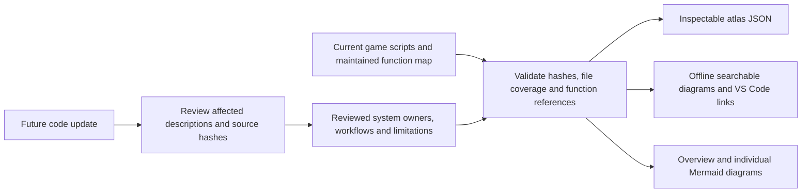

# Current implementation atlas contract

Scope: source-only documentation of the game at `ae6deb6d567d972edf58fc3d60c0b28007206f6c`.
No gameplay, engine launch, regression suite, profiler or performance claim.

Acceptance: distinguish shared identities from activity owners; show real clock,
event, resource and command connections; cover every inventoried game script,
classifying retained tests/review scenes separately; validate every diagram's
function reference against current source; provide individual diagrams plus an
overview and searchable source index. Explain diagram arrows as workflow/data
relationships, not an exhaustive or observed runtime call graph. Preserve known
unfinished integration and 3D limitations. Outputs work offline without a plugin,
web service or network renderer. Source changes invalidate reviewed descriptions
until the affected catalog entries are reviewed. Integrate generation into the
existing explicit map updater without executing old tests or changing fixtures.
