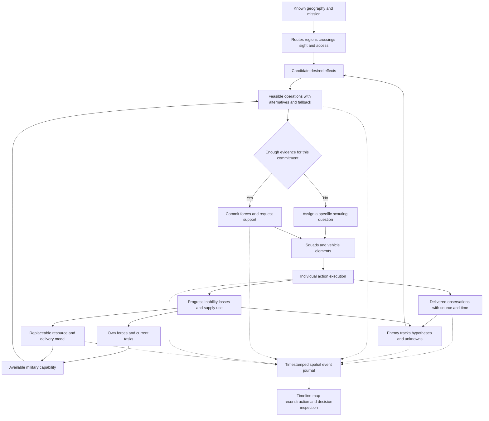

# Autonomous commander prototype design

9 November 2026. Working gameplay design for Dawson's separate AI prototype and eventual integration into Trencho. The purpose is to discover understandable autonomous commanders whose operations depend on geography, evidence, usable forces and supply. This is a starting model to experiment with, not an instruction to replace current Trencho systems or freeze every parameter.

The commander receives a known geographic map, maintains an uncertain picture of the enemy, derives useful military objectives, and runs operations through subordinate units. A replaceable resource model supplies availability and fulfilment. The same reasoning should work with simple prototype reserves and later with Trencho's actual military stock, people, transport and player factory.

The decision diagram below also has an [editable Mermaid source](diagrams/ai_commander_prototype.mmd).

## Confirmed direction and working choices

Dawson explicitly chose **known terrain and roads, uncertain enemy presence**. Both sides know the opposing HQ's starting location. They do not receive enemy unit positions, current strength, orders, production, inventory or garrison merely because the HQ is known. The commander must scout when an important proposed action depends on an unconfirmed enemy assumption.

Objectives are generated from potential effects and needs; they need no map node or property called `objective`. The game still supplies its mission, physical rules and meaningful world properties. Knowing that a facility can provide supplies is factual information; deciding to seize it is military reasoning.

Dawson accepted **Commander → squads / vehicle elements → individuals** as the prototype command structure. There are no company or platoon command layers in this design. This is also the intended structure for taking the proven prototype AI back into Trencho; changing the current game's implementation is a separate integration task.

The resource boundary below interprets the requested separate resource layer as a **replaceable provider**. A small finite reserve/budget model can support the separate game. Trencho later supplies physical availability and delivery through another provider. Reserve amounts, caution, scoring weights, report delays and formation detail are prototype choices. They should change when experience suggests a better game.

## The commander decision cycle

The commander maintains an operation while repeating this reasoning:

1. Receive reports, own-unit status and support updates.
2. Update what is observed, inferred, contradicted or still unknown.
3. Identify dangers to the current operation and opportunities created by the map.
4. Generate desired effects and alternative ways to achieve them.
5. Check forces, routes, supply, uncertainty and fallback requirements together.
6. Seek decisive missing information, or select a sufficiently supported operation.
7. Assign tasks and request support within the commander's actual authority.
8. Follow reports, recognise success or inability, and retain, adapt or abandon the operation.

This is not a sequence that freezes the whole army while one step runs. Scouts, defenders, supply parties and existing missions can continue. Tactical units can react to immediate threats before a commander receives their reports.

## Information the AI receives

Separate the simulation's true world from each side's available information. An experimenter's all-seeing overlay is a debugging view and cannot feed the commander.

| Information | What the commander may use |
| --- | --- |
| Initial geography | Terrain, elevation, roads, waterways, static structures, passability rules and known starting infrastructure |
| Initial mission | Broad war aim, own HQ and the known starting location of the enemy HQ |
| Own forces | Actual allocated units, equipment, mobility, health, ammunition, fuel and commitments, with report freshness where communications are modelled |
| Enemy forces | Delivered sightings, fire reports, tracks or other supported evidence; never hidden live unit queries |
| Changed terrain or infrastructure | Last known condition, updated by observation, friendly work, route failure or another legitimate report |
| Resources | Own authorised stock, commitments, deliveries and shortages; enemy supply is inferred from evidence |

The known map is not a continuously updated global sensor. An unseen bridge demolition or new enemy fortification is not revealed just because its location is on the map. A route executor encountering it can stop and report the change. The enemy HQ coordinate is a durable starting fact; its current garrison, operational condition and accessible approach remain separate questions.

### Observations

An observation carries the observer, original time, receipt time, covered area or viewing direction, reported class/count range, position uncertainty and sensing conditions. Preserve the original time when a report moves upward; relaying it does not make it fresh. A subordinate's local knowledge and the commander's received knowledge may differ.

Useful reports include a sighting, fire from an approximate area, a route obstruction, a successful observation with nothing detected, an observed withdrawal, a lost patrol, a supply arrival and a task's progress. A missing patrol is evidence of loss of contact, not an exact enemy location.

A sighting can be a rough class such as infantry, light vehicle or heavy armour. The AI should not automatically learn weapon load, remaining ammunition or unit identity from a silhouette. Repeated reports of the same group should update one track where justified rather than create another enemy group each time.

## Enemy beliefs and assumptions

Maintain different kinds of knowledge rather than one global confidence number:

| Kind | Example | Appropriate consequence |
| --- | --- | --- |
| Known geography | A bridge is the shortest heavy-vehicle crossing | Consider it when evaluating routes and their vulnerability |
| Recent observation | A scout reported armoured vehicles on the eastern road | Treat their reported area as a real threat, subject to report age |
| Stale track | That group was seen several minutes ago | Spread plausible locations along reachable routes; stop using its old point as an exact target |
| Hypothesis | The enemy may be screening the bridge | Plan reconnaissance, a protected approach or a defensive precaution |
| Unknown | The far bank has not been observed | Retain uncertainty instead of assuming it is empty |

For an enemy track, retain existence confidence, last observed strength/class, possible current area and possible intent separately. Uncertainty about where a known group moved differs from uncertainty that the group exists at all.

### Initial expectations from enemy HQ

Use the known HQ and map to identify plausible reinforcement and supply axes. Routes that offer useful access, cover, crossings and travel time toward contested ground are plausible enemy approaches. A position that observes or protects such an approach is a plausible screen. These are explanations for suspicion, not facts about enemy deployment.

Do not assume every enemy started at HQ unless the scenario explicitly says so. Without that fact, travel time from HQ describes possible reinforcement arrival, not proof that no enemy can already be forward. Do not invent a garrison size from the HQ's existence.

Preserve competing explanations: the enemy may advance on the main road, use a covered flank, defend a crossing or retain forces near HQ. They are alternative uses of a limited unknown force, not a full imaginary army on every route. Numerical likelihoods, if used, begin as adjustable heuristics rather than calibrated probabilities.

### Updating beliefs

A moving contact's possible area grows along routes it could physically use. A tank should not acquire plausible positions across an impassable river merely through a circular uncertainty radius. Roads, movement class and elapsed time constrain the estimate; inferred intent can bias it without making one guessed position certain.

Reliable new evidence can overturn the prior. Keep the provenance of a hypothesis so the AI can explain that a supposed bridge screen came from terrain reasoning and was later contradicted by scouts. Correlated reports from the same original sighting are not independent confirmation.

Absence is useful only where a sensor had a reasonable chance to detect the suspected force. A scout seeing an open crossing can lower the likelihood of a visible tank there. Looking at the near bank does not clear the woods on the far side. Quiet radio traffic or a patrol passing nearby is not universal proof of safety.

Uncertainty should encourage information gathering and sensible protection, not permanent paralysis. A commander may guard a suspected approach or use a limited probe. It must not aim precisely at a guessed hidden unit or describe an unobserved force as confirmed.

## Reading strategic value from the map

The useful strategic representation consists of areas and connections: traversable regions, route corridors, crossings, observation positions, defensible approaches and places with actual functions. It should work on a different map without a list of authored resource-objective IDs.

The commander should be able to reason about:

- Travel and transport time between own forces, supply access and possible destinations.
- Connections whose loss would isolate a force or make a supply route much longer.
- Cover, visibility, fields of fire, concealed approaches and alternative routes.
- Where an opponent approaching from its known support area might interfere.
- Whether its actual unit types, engineering and transport can use a route.
- Whether friendly forces can be supplied and withdrawn after arriving.

A bridge is valuable when it provides access needed by an operation or is a vulnerable link in supply. A hill is valuable when observation or fire from it affects a relevant route or force. Neither is automatically worth capturing on every map. A convenient fallback area can be an open piece of ground, not a named node.

The game supplies **affordances**: what an object or location permits. A road permits movement; a crossing has load and access limits; a supply facility can receive or distribute stock. Economic gain needs an actual economic rule. A farm texture or town mesh does not generate income simply because the commander considers it important.

## Generating objectives as desired effects

An objective is a temporary desired change with a reason and evidence of success. Its target may be an area, corridor, known installation or observed enemy capability. The AI creates its own objective identity for coordination; that is different from requiring an objective-tagged scene node.

| Trigger or opportunity | Derived objective | Evidence of success |
| --- | --- | --- |
| Suspected enemy approach could threaten own HQ | Establish warning and a defensive screen on that approach | Suitable observation coverage and an actually positioned screening force |
| Forward troops depend on one exposed road | Keep that supply corridor usable | Supply can physically pass, threats are managed and alternatives remain understood |
| A crossing enables a useful advance | Secure access to the far bank | The required force can cross, hold an exit and sustain itself |
| Unobserved ridge overlooks the chosen approach | Establish what can observe or fire onto that approach | Reconnaissance answers the relevant visibility/threat question |
| Reports identify a hostile force blocking supply | Remove or contain its ability to interrupt the route | Friendly traffic can resume; a missing old contact alone is insufficient |
| Known economic infrastructure can fund further supply | Obtain and retain its actual economic benefit | Its real control conditions and effect are satisfied |
| Observed enemy movement exposes a flank | Exploit the opening before reinforcements arrive | A useful position or capability is gained within a feasible support window |
| Friendly formation is exhausted or undersupplied | Recover combat capability in a sustainable position | Actual people, supply and readiness recover enough for the next task |
| An operation toward enemy HQ has become feasible | Isolate or neutralise the command base under the game's mission rules | The game's actual HQ/result conditions occur |

Each candidate records:

- The desired effect, its parent purpose and affected area or route.
- The observations and assumptions supporting it, with freshness requirements.
- Expected benefit, urgency and alternatives, including doing less or waiting.
- Required capabilities, supply, timing, route access and fallback.
- What would count as success, failure, expiry or a reason to stop.

Generate objectives from unmet needs as well as opportunities. Protecting an existing advantage, locating a threat and regrouping can matter more than taking new ground. Where no useful attack is feasible, the AI should explain what it is preserving or waiting for rather than invent an attack to stay busy.

Avoid producing separate missions for every nearby cell. Nearby candidates with the same effect should form one operational area or corridor. Preserve a candidate's identity when new evidence refines its area, rather than repeatedly cancelling and recreating equivalent orders.

## Scouting as an operation with a question

Reconnaissance is chosen to improve a decision. Assign a question such as: **Can enemy armour cover this crossing, and is our proposed dismount area observed?** Fog clearing without a purpose is a weak substitute.

A reconnaissance task needs an area or route, the question, relevant suspected enemy types, suitable observers, an exposure limit, a reporting condition, a time budget and a fallback. Terrain can suggest a vantage point, but cannot certify it is safe from unseen enemies.

The commander compares the cost and risk of scouting with the consequence of being wrong. Information is more valuable when it could change the selected operation, force package or route. Repeatedly scouting an irrelevant empty corner has little value even if uncertainty there is high.

Possible outcomes are confirmation, a contradiction, partial coverage, a newly observed threat, inability to reach a vantage point or lost contact. Partial information remains partial. A report can answer the original question and also create another, but every unanswered detail should not extend the patrol forever.

### When confirmation is required

Before a large commitment whose success depends on an assumed enemy location or undefended approach, the commander should obtain relevant reconnaissance or choose a less exposed alternative. A confirmed HQ coordinate alone is insufficient evidence for an undefended HQ assault.

Immediate defence against an observed threat does not wait for a complete map survey. Defending a possible approach, sending a patrol and conducting a bounded reconnaissance in force are legitimate actions under uncertainty. A probe carries an explicit withdrawal condition; it is not a full attack disguised to avoid the reconnaissance decision.

Confirmation is about the information needed for the action, not a universal percentage. A recent sighting may justify avoiding a route but not striking a precise target after the group could have moved. Weapons and target selection still obey the actual game's visibility and firing rules.

## Selecting a feasible operation

First reject plans that the assigned force cannot execute: incompatible routes, missing transport, no way to answer a known required capability, unavailable allocated units or insufficient authorised supply. Reconnaissance may itself be feasible when an assault is not.

Treat danger to own command, an imminent loss or an already engaged force's survival as emergency considerations before ordinary opportunity ranking. For other choices, compare useful effect, urgency and information gained against likely losses, travel time, supply burden, uncertainty and the cost of abandoning the current mission.

A useful conceptual comparison is:

**Operation value = expected useful effect + urgency + decision-relevant information − military risk − time and supply burden − cost of changing the current plan.**

This describes factors, not a fixed formula. Keep the terms inspectable, avoid counting the same benefit or cost twice, and compare a small number of meaningful alternatives. Evaluate plausible enemy responses and what the plan would cost if a major assumption is wrong. Do not require an exhaustive prediction of the war.

Force assessment should compare capabilities, not just head count. Infantry with rifles, an empty gun and a crewed anti-armour weapon are different answers to an observed armoured threat. A high numerical readiness value cannot replace a missing essential capability.

Retain an adequate reserve or fallback option relative to the threat and operation. The reserve can be a task constraint rather than a fixed percentage. The prototype should let us observe the trade-off between committing enough force and having nothing left to protect supply or respond elsewhere.

## Commander squads and individuals

The commander issues intent: desired effect, purpose, assigned resources, constraints, reporting conditions and fallback. It does not select each soldier's next footstep. Subordinates choose local routes, positions and engagement details within that intent and their current knowledge.

| Level | Primary decision |
| --- | --- |
| Commander | Which effects matter now, how to divide forces, what risks and support commitments are acceptable |
| Squad or vehicle element | Turn assigned intent into local movement, positioning, engagement and support tasks, using actual people/equipment and reporting progress or inability directly to command |
| Individual | Perform the physical action with current position, weapon, cargo and condition |

The commander directly assigns intent to squads and vehicle elements. A squad leader or vehicle controller delegates its actual actions to individuals, including drivers and weapon crew. The commander coordinates simultaneous operations and keeps reserves; local leaders decide how to execute their element's task. This preserves strategic intent versus local execution without permanent company or platoon ranks.

Several elements can share a temporary operation group, such as securing a crossing. The group records their common purpose, supporting roles, timing/conditions, resource commitments and fallback. It is coordination context, not another commander, officer or order-relay layer. For example, command assigns one squad to provide supporting fire, another to manoeuvre, and a vehicle element to cover the approach; each element reports against the shared operation. Do not quietly reintroduce the rejected layers under different names.

Direct reporting still distinguishes when a subordinate observed something from when command received it. Removing intermediate ranks does not grant instantaneous enemy knowledge. There is no planned expansion back to companies/platoons merely for realism; revisit the structure only if experimentation exposes a distinct useful decision it cannot support.

An operation progresses through proposal, information gathering, preparation, execution and assessment. It can also wait for support, become interrupted, finish or be abandoned. These are useful meanings to expose, not mandatory engine classes.

Every task needs a current owner, parent operation and revision so that a late report or an old supply return cannot revive an abandoned mission. Replanning keeps real commitments: troops do not teleport home and departed freight does not disappear. A subordinate unable to execute reports why and follows its applicable safety/fallback intent.

## The replaceable resource layer

Keep the commander's reasoning dependent on capabilities, usable availability and delivery promises, rather than directly on Trencho workshop nodes or its stock ledger. The resource provider is authoritative about what can actually be committed and fulfilled. The AI's prediction of a need is not stock.

| Concern | Separate prototype | Later Trencho integration |
| --- | --- | --- |
| Forces and equipment | Finite simplified rosters and equipment packages | Actual people, qualifications, weapons, stations and military allocations |
| Consumables | Local ammunition/fuel or abstract supply units with declared conversion | Actual ammunition types, fuel and held stock |
| Reserves | Limited support pool or replenishment budget | Physically available HQ/forward stock and genuine replacement access |
| Delivery | Simplified but explicit capacity, destination and travel/handling delay | Existing loading, transport, arrival and issue owners |
| Industrial support | A finite prototype supplier with visible limits | Player's chosen production and automatic fulfilment of actual army requests |
| Costs and losses | Recorded by the prototype's execution/resource model | Recorded by actual gameplay services and returned as reports |

Start with a finite simple model. An explicitly labelled unlimited-support mode can isolate decision-making experiments, but its success says nothing about logistical competence. Avoid making the prototype a second factory game merely to experiment with command decisions.

### Resource facts

A resource fact needs type or capability, quantity/extent, location, availability state, commitment owner and time/freshness. Distinguish available, reserved, loading, in transit, arrived at destination and issued to the intended unit. A forecast is an estimate with a source and uncertainty, not a guaranteed delivery.

Keep a separate view of authorised spending or support. In the standalone game, the commander may control a military budget if the prototype grants it that authority. In Trencho, friendly AI requests supply; it does not spend the player's requisition, change recipes, seize rear workers or override industrial priorities. The enemy may use its declared procurement rules. The provider returns what each side is entitled to request.

### Questions and requests across the boundary

The exact programming interface is the developer's choice. The behavioural exchange should support:

1. **Assess:** What can this force do now, where, and for approximately how long?
2. **Estimate:** What additional support would make an operation feasible, at what earliest plausible time and with what capacity limits?
3. **Request:** Ask for a capability or explicit supplies for an operation, destination, urgency and useful deadline; state the shortfall and military consequence.
4. **Commit:** Reserve or allocate only what the provider authorises. Repeated updates to the same need replace its remaining requirement instead of duplicating an order.
5. **Report:** Receive acceptance, rejection, partial fulfilment, transport interruption, receipt, issue and actual loss/consumption.
6. **Revise or release:** Change future unfulfilled commitments when an operation changes. Keep loaded/departed freight and already consumed resources in their real state.

A commander may describe a need as sustaining two rifle squads on a route for a period, while a provider translates it to concrete types and quantities. Preserve the translation assumptions and also support explicit item needs. Do not pretend a generic supply point can answer an anti-armour, medical or bridge requirement unless the adapter actually defines that capability.

At each update, distinguish intended cost, committed cost and actual expenditure. Cancellation can release an unused reservation; it cannot return spent ammunition or resurrect lost people. Goods already travelling require an actual cancellation/diversion/return policy, not a bookkeeping refund.

### Deriving supply needs

Estimate task requirements from approach, expected action and safe return or fallback. Consider current local load, credible enemy resistance, travel, handling capacity and the delay before another delivery can arrive. Use ranges or safety margins where behaviour is uncertain; tune them through the prototype.

Shortfall is the requirement left after usable local resources and credible committed support arriving in time. Do not count HQ stock, a pending factory order and its future truckload as three supplies. A unit cannot count the same rounds both loaded and loose, or reserve the same transport in two concurrent plans.

If support arrives late, reassess whether the mission is still useful. If it is rejected, defend, regroup, choose a cheaper operation or explain what cannot be attempted. A request failure must not lead the commander to assume success or endlessly issue the same unaffordable order.

## A portable reasoning boundary

The following information records describe meanings, not a required class hierarchy or engine API:

| Record | Essential meaning |
| --- | --- |
| Map knowledge | Terrain, connections, known functions, known HQ sites and last known changes |
| Observation | Source, original time, received time, area, reported fact and uncertainty |
| Enemy belief | Evidence provenance, possible position/strength/intent, confidence and alternatives |
| Objective candidate | Desired effect, reason, affected area, evidence needed and success/stop conditions |
| Operation | Assigned forces, dependencies, expected support, route/area, timing, risk, fallback and current revision |
| Support request | Stable need identity, parent operation, destination, capability/items, amount, urgency and remaining unmet need |
| Task intent | Recipient, purpose, desired effect, constraints, completion evidence and fallback |
| Execution report | Actual progress, observations, inability, costs, receipts, losses and task revision |

World/execution integration provides legal map facts, perception, capability and feedback. The commander returns intents and support requests. The resource provider fulfils only authorised support. Execution remains responsible for physical actions; the commander cannot directly edit positions, stock or damage.

The two commanders should use the same reasoning boundary with separate knowledge, commitments and policy settings. Different caution or priorities may create different styles. Hidden enemy truth or a free resource grant is not a personality setting.

The useful portability goal is to keep these meanings and decision logic stable while swapping providers and execution. It is not a promise that code from an unspecified separate engine can be copied unchanged into Godot. Once the prototype project is chosen, Lead can map these boundaries to its actual implementation.

## Replanning without indecision

Reconsider a mission when new information changes its feasibility or value, an important route fails, supply timing changes, a task reports completion/inability, or an urgent threat develops. A modest periodic review can catch things that do not emit reports. Exact scheduling belongs to the prototype implementation, not a design requirement for per-unit frame polling.

Distinguish a small score fluctuation from a reason to reverse an army. Apply a cost for changing plans, preserve preparation where useful and require a meaningful improvement before switching ordinary missions. Immediate survival can override that commitment. Explicitly record whether a report caused a local adjustment or a new strategic intent.

Scouting information has a useful lifetime. If preparation takes much longer than expected, confirm critical approaches again. Do not create a cycle in which each new scout report invalidates preparation merely because time passed; require only the freshness relevant to the particular risk.

## Worked example with no authored objective nodes

The map has two HQ locations, a river, two crossings, roads and a ridge. Each commander knows this geography. No bridge, hill or town has an objective flag.

The friendly commander wants a sustainable route toward the enemy HQ. The nearest bridge offers a fast crossing, but the ridge can observe its road and the alternative ford cannot support its heavy vehicle. The commander derives three related effects: learn whether the ridge threatens the approach, secure the crossing exit, and preserve the near-bank supply route.

The enemy HQ makes the road to the ridge a plausible reinforcement route. This creates a screening hypothesis, not a spawned or confirmed enemy unit. Before committing the main force, a scout is tasked to observe the ridge's relevant firing positions and the crossing exit, with a covered approach and withdrawal point.

The scout reports armour near the crossing but no heavy force in the specific ridge area it could actually see. The commander reduces that local hypothesis and recognises a confirmed capability problem at the bridge. It can request appropriate support, contain the crossing and scout the second approach rather than send unsupported rifle squads into armour.

The simple prototype provider might offer one anti-armour element after a stated delay, consuming a limited reserve. Trencho's provider would instead check actual military capability and issue a genuine unmet support request where necessary. Factory goods and qualified people only help once real transport and issue make that capability available. The commander uses the returned availability, not an imagined successful order.

If support is delayed beyond the useful window, the operation changes. If the enemy withdraws, the last contact becomes a track with growing positional uncertainty; the army does not pursue an exact invisible coordinate. The crossing remains worth considering because of access and supply, even after the original enemy group is gone.

At every step the generated objectives explain a desired effect. None requires the map creator to label the ridge or bridge as an objective, and none guarantees a scripted victory after a delivery.

## Timestamped interactions and map history

Dawson requested that every interaction be logged with timestamps and map locations for later analysis and correction. Treat this as a structured gameplay event history, including the AI's information and reasoning, rather than relying on console text or counts of function calls. Recording should begin with the first playable prototype so the first confusing decision can be investigated afterward.

The useful chain is **what occurred → who observed it → when command learned it → what belief changed → which decision followed → what was ordered → what execution actually did**. Related records retain stable references so an investigator can follow that chain in either direction.

### What to record

| Interaction family | Events to retain |
| --- | --- |
| Perception and communication | Sighting, relevant negative observation and coverage, contact lost, report sent/received, communication interruption and report rejection |
| Beliefs | Hypothesis created/revised/contradicted/expired, track association, uncertainty changes and the evidence or review causing them |
| Objective reasoning | Candidate generated/revised/rejected, alternatives considered, feasibility reasons, selected effect and mission retained or changed |
| Orders and execution | Task issued/delivered/acknowledged/rejected, route chosen/revised, movement started/committed/blocked/stopped/arrived, progress, inability, fallback, cancellation and completion |
| Combat and condition | Actual shot/reload commitments and outcomes, impact or miss where applicable, damage, wounds, suppression, incapacitation, death, recovery and relevant capability changes |
| Resources and transport | Request/quote/accept/reject, allocation/reservation/release, loading/boarding, departure, interruption, arrival/unloading/issue, actual consumption and loss |
| World and experiment controls | Terrain/infrastructure changes, spawning/removal, mission/configuration changes, pause/speed changes and human interventions or bookmarks |

Use the authoritative action's event as the original occurrence; different observers' reports reference it only where the analysis channel can legitimately make that association. Each report still has its own identity and delivery history. An AI-facing report of an unidentified vehicle uses a track identity, not a hidden enemy entity ID supplied by the logger.

Every meaningful evaluation and interaction is retained during a recorded run, including rejected commands and the reason an existing mission was retained. This does not require recording the same idle state or every function entry each rendered frame. Long-running activity needs its start, committed progress or a lossless timed path representation, changes and final outcome. A planned route alone cannot reconstruct where a unit actually went. A hit, sighting or interruption records the actual position at that instant even between movement summaries.

If records are compressed or repeated unchanged fields are stored by reference, the decoded event history must remain complete. A storage limit, disabled channel, logging failure or dropped interval must be conspicuous; a partial recording must not look like a complete account. Exact storage, buffering and file management are engineering choices.

### The event envelope

These fields describe the common meanings needed across the standalone prototype and Trencho:

| Field | Purpose |
| --- | --- |
| Run and event identity | Identify the recording and one immutable event; prevent duplicates during export or import |
| Sequence and simulation step | Give events a stable order when several occur at the same simulation time |
| Occurrence time | Simulation time when the action or observation actually happened, with sufficient subsecond precision |
| Receipt or knowledge time | When the relevant recipient learned about the occurrence; separate from the original sighting time |
| Recorded wall time | UTC time for correlating application failures or human notes; never a substitute for game time |
| Kind, actor and participants | Action type, issuing/acting entity or group, affected parties and relevant roles |
| Map and spatial reference | Map identity/revision and event-time points, areas, corridors or routes, with defined coordinate units |
| Operation and causal references | Parent mission/task/request, current revision, causing events, report and supporting belief/evidence references |
| State change and outcome | Relevant before/after values or references, actual quantities/costs and accepted/blocked/failed/completed result |
| Decision reason | A stable reason category and readable explanation; alternatives and factor values where a decision was made |
| Knowledge perspective | Which side and command level knew this, whether it is observed or inferred, and whether the record belongs only to analyst truth |

An event can have several causal parents: a plan may change because of a sighting, an expired delivery estimate and a casualty report together. Preserve those relationships rather than assigning the change solely to the most recent event.

Times use the simulation's own clock: at 2x, game time advances accordingly; during Pause, a permitted human menu change can share the same game time as another event but still has a different sequence. A reported sighting keeps its original occurrence time even if command receives it later. A unit's local reaction can therefore precede the commander's knowledge without indicating a logging error.

### Locations and uncertainty

Define coordinates once in the recording manifest: map origin, horizontal axes, units in metres and elevation convention. A 2D prototype and Trencho may use different engine axes; the integration translates them into the declared map convention. Never silently mix screen pixels, local transforms and world positions.

Capture locations at event time, not by looking up a moving actor when someone later opens the log. An order may need issuer location, recipient location and target corridor separately. An observation needs the observer's position and the reported enemy area. A resource transfer needs its source and destination, not just the commander's position.

Use an uncertainty area or route envelope for a suspected or stale enemy. Do not manufacture an exact target point to fill the location field. Global decisions without a meaningful location use an explicit global/no-location value and their affected operation references, not a fake coordinate at the map origin.

Keep **actual world history** and **what each commander knew** distinguishable. The analyst can inspect the true enemy path after the run, but the commander never reads that channel. At any time on the viewer, it must be possible to display the blue commander's picture, the red commander's picture or the analyst's truth without accidentally combining them. A subsequently confirmed sighting cannot appear in the commander's earlier knowledge.

### Decision explanations and reconstruction

For a commander decision, retain the actual inputs it used, directly or through immutable snapshot references: relevant contacts and ages, hypotheses, own capabilities, support availability, candidate effects, rejected alternatives and score factors if used. Record configuration/policy versions and any random choice that materially affected selection. Logging only the winning score cannot explain why a better-looking alternative was rejected.

A run manifest retains the map/seed and initial state, simulation and AI build versions, resource-provider mode/configuration, doctrine settings and coordinate/time conventions. Periodic state checkpoints plus ordered changes allow an analysis viewer to seek through the run without replaying it from the beginning. Pausing the viewer must not issue a new order into a live game.

Distinguish three capabilities:

- **Event inspection:** inspect recorded actions and causal explanations.
- **History playback:** reconstruct the captured positions, state and commander knowledge on a timeline.
- **Simulation re-execution:** run the scenario again and reproduce behaviour.

The first two are the design goal for the recorded prototype. The third additionally depends on complete inputs, random state, ordering and engine behaviour; a seed alone does not guarantee it. Do not advertise deterministic replay merely because timestamps and a seed were saved.

### Analysis tools

The useful first viewer is a map and a time slider linked to a filterable event list. Selecting an event moves to its time, highlights the relevant places/participants, and opens its cause, information age and outcome. Filter by commander, unit, operation, task, supply request, area and event kind. A location click can show what happened nearby during an interval; following an operation shows its complete history across locations.

An inspector should support questions such as:

- Why did this unit stop here, and which order or blocked route explains it?
- Did the commander know about the armour when it committed to crossing?
- Was a supposedly clear area actually observed, or only assumed safe?
- Was supply unavailable, unrequested, reserved elsewhere, late, lost or already consumed?
- Did a formation receive a new order, reject it, or continue a stale one?

For example, a scout observes armour at simulation 07:12 near a crossing. Command receives the report at 07:16, revises a bridge-screen hypothesis, changes the assault plan and requests support at 07:17. The log links those events and their map areas. If the force crossed at 07:14, we can inspect its local knowledge and previously received order instead of incorrectly judging it using the commander's later report.

The journal is a passive observer of decisions and committed gameplay facts. It neither supplies hidden intelligence nor changes resource, movement or combat authority. Use a versioned machine-readable export that the standalone prototype and later Trencho can both produce; a line-oriented event file plus manifest/checkpoints is a practical option, not a mandated logging framework. Existing Trencho function counters can help investigate implementation cost, but cannot replace this causal gameplay history. This section specifies the requested logging behaviour; no logger or viewer is implemented by the design document.

## What the prototype should make visible

A practical commander inspector should answer:

- What are we trying to achieve, and why is this more useful than the alternatives?
- What have we actually observed, what are we assuming, and how old is the information?
- What question is each scout answering, and what would change the plan?
- Which forces and supplies are committed, and what is still missing?
- Why are we advancing, holding, changing route, regrouping or withdrawing?
- Which assumption failed, and did the response make sense?

Use separate overlays for known geography, observations, uncertain enemy areas, candidate effects, active tasks and supply. Keep experimenter-only truth visually distinct and outside the commander's inputs. Show missing knowledge as missing; displaying an exact enemy icon on the AI's own belief overlay would conceal the problem the prototype is meant to explore.

Keep those views available for recorded history as well as the current instant, using the timestamped event journal and commander-specific snapshots above.

## Practical development sequence

Build enough of the separate game to expose a decision before expanding the support roster:

1. One commander reads terrain, own forces and known HQ coordinates; it explains useful routes, threatened connections and candidate effects without objective tags. Begin the event journal here, including timestamps, map locations, decision inputs and causal references, so the first experiment leaves an inspectable history.
2. Add genuine perception and belief memory. Let scouting answer a consequential question and visibly change one operation.
3. Run both commanders using their separate information. Give local units enough movement/combat behaviour to produce meaningful reports.
4. Add the replaceable finite resource model and simple delivery timing. Observe whether shortage and replenishment change feasible plans sensibly.
5. Expand coordination between squads/vehicle elements, combined arms and support only where the encounter exposes a useful missing decision; retain the accepted three-level command structure.
6. Map the proven reasoning and exchanges to Trencho's real military, information, transport and factory-demand owners.

These are playable prototype increments, not a regression suite, performance campaign or new requirement to run broad scenarios in Trencho. No engine check is introduced by writing this design. Dawson's separate project and its engine/implementation location have not been selected in this chat; no new game project or AI code is created here.

Useful play feedback concerns behaviour: does a commander explain its intentions, learn from scouting, use supply sensibly, avoid chasing stale exact positions and remain active without foolishly spending its army? A sophisticated diagram is not evidence that those things work.

The early logging target is being able to investigate one confusing decision after play from its timestamp, location, inputs, orders and actual result. Expand playback convenience as useful; do not postpone recording until the AI is nearly finished.

## Relationship to current Trencho

Current [G17 orders](g17_hierarchical_orders.md) already distinguish observations, delivery delays and current versus stale contacts. [Military organization](g15_military_organization.md) describes real formations and capability. The [implementation atlas](system_atlas.md) records current ownership; these are integration references, not instructions to copy every old threshold or class boundary. Their implemented company/platoon organization is not the accepted prototype hierarchy and should not be imported as a requirement. Preserve useful capability, identity and report semantics while adapting command ownership during later integration.

Two differences are deliberate. Current `ResourceOperations` begins with registered Resource objective IDs; the separate prototype should derive operational candidates from map functions, needs and beliefs instead. Current enemy-HQ registration provides a marker without an initial contact; Dawson now explicitly gives each prototype commander the enemy HQ location at the start. That initial geographic knowledge must not reveal its garrison or become universal live sight.

Trencho's original [factory and autonomous war vision](game_design_document.md) remains: the player manages industry and logistics while the commanders run the war. Reintegrating the AI must preserve the player's production choices and replace abstract support fulfilment with actual supply owners. This design does not complete or rewrite current AI, alter the live opening, or declare any game-loop stage accepted.
