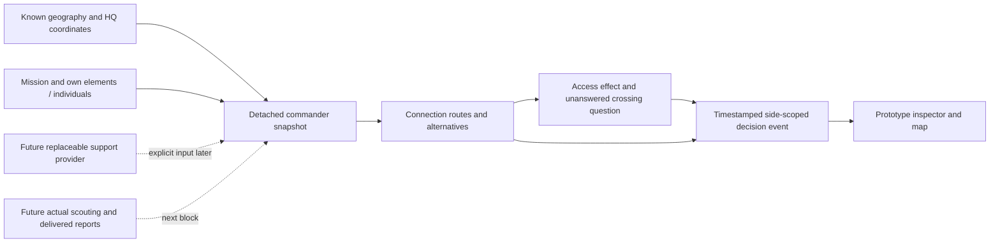

# First commander prototype block

This standalone Godot project is separate from the Trencho game. Accepted design copied from Dawson's working-tree `docs/ai_commander_prototype.md` and `docs/diagrams/ai_commander_prototype.mmd` on 13 November 2026; the copies are references, not a live-game integration.

## Frozen acceptance

- A commander consumes a detached known geography graph, mission, known HQ coordinates and actual own element/individual roster. It has no reference to hidden enemy truth, live Trencho ledger or objective-tagged nodes.
- From physical traversable connections, calculate a feasible route and at least one alternative, explain their different travel cost, select a desired effect associated with maintaining access, and identify a consequential unknown enemy presence at a constrained crossing. No assumption about HQ garrison becomes a fact.
- One inspector shows the input map, chosen route, alternative, own Commander → element → individual identities, desired effect, uncertainty and timestamped side-scoped decision record with references to actual inputs and rejected alternatives. Game-time and map positions are declared explicitly.
- This block presents an intent and a question; it does not claim that an order was issued, a scout moved, a report was delivered, a resource was consumed, or combat occurred. Those belong to the next block. No fake timer or granted resources.
- One brief GitHub-only current-change demonstration checks the actual first decision and journal; no local engine, broad scenario, regression suite, live Trencho integration or gameplay/FPS acceptance.

The Godot [RefCounted](https://docs.godotengine.org/en/stable/classes/class_refcounted.html) and [Control](https://docs.godotengine.org/en/stable/classes/class_control.html) documentation inform standalone state ownership and the inspector. No node-tree, ledger, simulation clock or truth-state reference is passed into the commander. Resource provider is an explicit future interface; no resource model is invented for this block.
