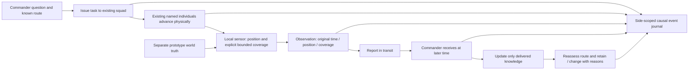

# Proposed second block: scout a consequential unknown

The Designer accepts this bounded next direction. Implementation remains subject to Lead's ownership and staging decision; the first-block check is pending.

Acceptance: same existing squad/individual identities follow a real traversable path without teleportation or respawn. A local sensor creates an observation only from actual proximity and declared coverage; an empty or partial observation applies only to that area/time, and cannot reveal HQ garrison. The report preserves original observation time, physical location and coverage separately from later receipt. Commander knowledge and route assessment do not use it early. Receipt prompts an explained reassessment linked by event IDs to the original question, task and observation; the route may remain unchanged. No support grant, extra command layers, combat/tactics expansion, or live-game state mutation. One short direct check of this new action after Lead review; no broad scenario or regression matrix. UI and simulation values must not infer an enemy from a timer or arrival.

Proposed ownership: feature-owned standalone world/travel, observation/report and commander state, each consuming explicit owned values rather than live Trencho references. A shared prototype clock advances committed physical position and report transit; event history stores detached values. The already-written static decision may be adapted in scope after Lead assigns exact boundaries. Resource provider remains explicitly absent until an actual support decision requires it.

## Owned source boundaries and state transitions

- `game/scout_world.gd` (new): owns actual prototype persons, physical positions, ground route segments and a private physical observation environment. It emits only local observations to the task owner; its truth state is never passed to commander.
- `game/scout_operation.gd` (new): owns one issued task, same element/individual IDs, task progress, local observation and pending report; explicit `advance(delta)` updates the common prototype time and interpolates actual movement. Finite sensor range, terrain/coverage limits and report delay are parameters for this single experiment, not balance commitments. Sensing occurs from actual position; unobserved area remains unknown.
- `game/commander.gd`: add a small delivered-report reassessment entry point taking only own known-map snapshot, current operation and an immutable delivered observation envelope. Before receipt the original decision remains unchanged. Event causes identify question, task, observation and delivery; no hidden truth input.
- `game/inspector.gd`: display actual positions, local report separately from commander state and an explicit advance action, preserving the current side/knowledge labels. No per-frame simulation or second clock.
- `game/example_map.gd`: declare scenario fixture and actual entities separately from the detached known-map/own-force snapshot. No free supplies or report timers presented as sensing.

Validation proposal: one arranged crossing case, use real task and actual finite physical movement to a scout observation, verify commander retains the original question until later report receipt, then records an evidence-linked reconsideration; inspect original observation and receipt times/coverage. The exact fixture and single brief GitHub action require Lead review. This is not an exhaustive sensor, movement or combat campaign and gives no full gameplay/native/FPS acceptance.
